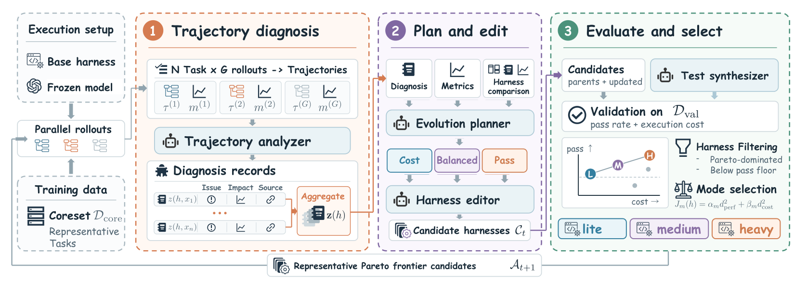
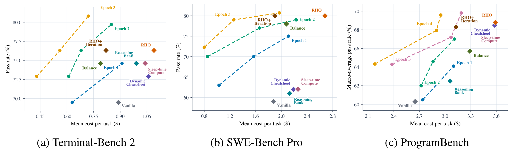

# HarnessPro: Recursive Harness Self-Improvement with Pareto Optimization for Performance-Cost Trade-offs

## 来源信息

| 项 | 内容 |
| --- | --- |
| 标题 | HarnessPro: Recursive Harness Self-Improvement with Pareto Optimization for Performance-Cost Trade-offs |
| 作者 | Zhuoshi Pan¹\*, ZhiYuan Feng¹\*, Yukuo Cen², Honglin Lin³, Junru Lu⁴, Zhongxia Chen⁵, Shuo Yang⁵, H. Vicky Zhao¹†, Jie Tang¹†（\* 共同一作；† 通讯作者） |
| 机构 | Tsinghua University（第一机构）；另有 Z.AI、Shanghai Jiao Tong University、University of Warwick、Kling AI |
| 来源 | [arXiv:2610.26770v2](https://arxiv.org/abs/2610.26770v2)（cs.LG; cs.CL）；v1 2026-10-19 → v2 2026-10-20，本笔记基于 v2 |
| 代码 | <https://github.com/pzs19/HarnessPro>（MIT；阅读时 ★84；只核到结构与 README 自述，未验证与论文实验的可复现性对应） |
| 许可 | [CC BY 4.0](http://creativecommons.org/licenses/by/4.0/) |
| 阅读日期 | 2026-10-25 |
| 仓库编号 | 00218 |

版本比对、PDF 副本 sha256、配图裁剪框与逐项核对记录见同目录 `audit.md`。

---

## 核心结论

一句话：**HarnessPro 把 harness 的递归自改进从「只追 pass rate」改成「pass rate + 每任务执行成本」的双目标搜索**——用固定的 LLM 生成测试替代 LLM 直接打分（label-free），让同一 planner 按省成本 / 平衡 / 保性能三种偏好各出一份计划，再由 harness editor 实现成候选，用 Pareto 过滤加归一化加权平方距离选出 lite / medium / heavy 三个部署档位，再让选中的 harness 进入下一轮。

- **解决什么问题**：已有 harness RSI（RHO、AHE 等）主要优化 pass rate，性能提升常伴随更多探索与验证，推高 token 成本与延迟；实际部署同时关心成本与延迟（§1）。
- **核心想法**：目标从单点变成 Pareto 前沿；评测器从「LLM 读轨迹」变成「固定生成测试」；一次演化不是产出一个 harness，而是产出三个部署档位。
- **怎么做到**：trajectory analyzer 诊断 → planner 按三条 instruction 出三份计划 → editor 实现成三个候选 → 验证集评估 + pass floor + Pareto 过滤 + 加权选择 → 选中的 harness 进入下一轮（§4）。
- **关键结果**：GPT-5.5 × Codex 下，heavy 档相对 RHO 在三个 benchmark 上平均 +2.0 个百分点 pass rate、平均相对成本 −26.1%（三个 benchmark 逐项变化的算术平均，不是池化值）；GLM-5.2 × Claude Code 下 heavy 在三个 benchmark 上也都超过 RHO 且成本更低（§5.2）。
- **定位**：增量主要在「选择与递归」而不在 proposer；适合既要做 agent harness / RSI、又必须把执行成本一起纳入目标的团队，以及需要 label-free 评估落地的人。

---

## 问题

论文把 harness 定义为管理基础模型与环境交互的软件运行时层：prompts、tools/skills、context/memory 机制、hooks、verification policies（§3）。给定任务 `x`，harness $h$ 执行后留下轨迹 $\tau_h(x)$，记录工具调用、环境反馈与最终产物。递归自改进（RSI）就是用过去任务的轨迹诊断问题、改 harness，让未来任务做得更好。

这条线上已有工作，但各占一角（§2、Table 1）：

- **AFlow** 搜索模型调用算子的图：目标是 pass，反馈用 ground truth，输出单个 workflow；
- **SkillMOO** 同时优化 pass 与 cost，但范围只到 skills，反馈仍是 ground truth；
- **RHO** 做 label-free 的 harness 演化，但只优化 pass、只跑单轮、只输出一个 harness；
- **AHE** 做可追踪的 harness 编辑，范围是完整 harness、也做递归，但依赖 ground truth、输出单个 harness。

**空白很清楚**（按 Table 1 的列看）：没有工作同时做到「完整 harness + label-free + 递归多轮 + pass/cost 双目标 + Pareto 集合输出」。HarnessPro 的定位就是补这一格。

作者把难点拆成两条（§3 末）：

1. **搜索空间大且离散**：harness 由 instructions、tools、skills、hooks、rules 等组件构成，组合空间巨大，不能用梯度优化。
2. **性能与成本的权衡**：更多推理、探索、验证可能提升 pass rate，但会消耗更多 token；反过来，盲目削减这些活动又可能伤性能。要推进 Pareto 前沿，必须从轨迹里区分「必要计算」与「可避免开销」。

**为什么非要 label-free**。RHO 让 LLM 直接比较轨迹、按自偏好选候选；作者发现 LLM judge 对执行轨迹过于乐观，常把有缺陷的实现判成成功（§4.3）。Figure 2（p6）的初步实验在 Terminal-Bench 2 与 SWE-Bench Pro 的训练任务上汇总：官方判 Fail 的 12 个样本里，LLM judge 只判出 5 个 Fail（failure recall 41.7%），LLM 生成测试判出 10 个（83.3%）。代价是官方 Pass 的 8 个样本里有 1 个被生成测试误判（12.5% 假阳性），而正文只强调 recall。

**成本为什么是问题**。以 GPT-5.5 × Codex 为例，RHO 相对 Vanilla 在三个 benchmark 上都提升了 pass rate，但成本也全面上升：SWE-Bench Pro 上每任务平均成本从 1.88 美元升到 2.68 美元（+42.6%），pass rate 从 59.0% 升到 80.0%（§5.2）。HarnessPro 要回答的就是：能不能在提升 pass rate 的同时把这条成本曲线压下去。

**本文的设定与前提**：演化阶段不使用 ground-truth 解、官方测试或 grader；生成测试在整个演化中固定；验证集与测试集对 planner 不可见；最终 harness 冻结后只在 held-out test 上跑官方评测（§4.2、§4.3）。

---

## 核心想法

### 一句话

成本不是模型的常数，而是 harness 的属性——同一模型、同一任务，harness 决定把多少 token 花在探索、验证和重复劳动上；于是「更便宜」可以和「更准」一样成为搜索目标。

### 直觉：先分清「必要计算」与「可避免开销」

harness 里有大量可避免的开销：重复读同一个文件、反复跑已经通过的检查、把长日志整段塞回上下文、用最高 reasoning effort 去改一个错别字。这些开销不产生新信息，只把账单推高。真正必要的计算是另一部分——理解任务契约、定位失败、做一次有效验证。

如果能把两者分开，就可以在不牺牲 pass rate 的前提下砍掉前者。论文的做法是从轨迹诊断「哪一段计算没有换来信息」，再让 planner 针对性地改：加预算钩子（budget hooks）、加输出压缩、按任务难度路由 reasoning effort。§5.3 检查演化产物后确认，提升来自这几类机制的组合，而不是单纯「压缩上下文」或「无脑加 reasoning effort」。

### 为什么固定生成测试能当尺子

LLM judge 读的是「轨迹写得像不像成功」，而轨迹由候选自己产生——候选越会写总结，越容易被判成功。生成测试换了信号源：把任务描述变成可执行测试，跑一遍，过没过由代码决定。要让它当尺子还需要两个条件，论文都显式做了：

- **可执行**：测试是 `test_generated.py` 这样的真实用例（每个任务约 10 个），在 fresh container 里运行，工具只返回执行诊断，不返回官方测试、grader 或标签（§C.3）。
- **固定**：测试在演化前一次性生成，整个演化过程不变（Eq. 6）。所有候选、所有轮次都在同一套测试上比较，分数才可比。

代价也很直接：测试本身可能弱、可能错（Figure 2 有 12.5% 假阳性）；固定测试又给了候选逐渐适配它的空间。

### 为什么一次演化能出三个档位

Pareto 前沿本来就是一个集合，不是一个点。作者让 planner 按三条不同 instruction 各出一份计划——`I1` 优先降平均成本、`I2` 平衡、`I3` 优先提成功率——每个父候选因此长出三个新候选。评估后先过滤，再在同一个前沿上用三组权重选三个代表点，就得到 lite / medium / heavy。部署方按预算选档，不必重跑演化；三档共享同一轮诊断与同一批测试，成本被摊薄。

### 为什么递归能继续推进前沿

被选中的 harness 成为下一轮的父候选，下一轮诊断基于它自己的轨迹——问题不再是 seed harness 的问题，而是「这个已经优化过的 harness 还剩下什么浪费」。Terminal-Bench 2 的 heavy 是最干净的例子：epoch 1 是 74.6% / 0.91 美元，epoch 3 是 80.8% / 0.72 美元（§5.4），性能与成本同时改善。

### 一个走通的例子：SWE-Bench Pro 的 medium

- epoch 1：70.0% / 1.57 美元；
- epoch 2：77.0% / 1.66 美元——pass 升了，成本也升了；
- epoch 3：79.0% / 1.26 美元——两项同时改善（§5.4）。

只跑一轮的话，看到的会是「提性能必然涨价」，正好是论文想反驳的印象。第二轮把第一轮新增的探索固化下来，同时暴露新的浪费；第三轮再压掉，成本才回到 1.26。这条曲线也说明过滤与选择必须每轮重做：同一个 harness 在不同候选池里的相对位置会变。

### 与已有做法的区别

| 维度 | RHO（直接前代） | HarnessPro |
| --- | --- | --- |
| 目标 | 只优化 pass rate | pass rate + 每任务成本 |
| 范围 | skills + tools | 完整 harness |
| 反馈 | LLM 自偏好直接判轨迹 | 固定的 LLM 生成测试 |
| 输出 | 单个 harness | lite / medium / heavy 的 Pareto 代表集 |
| 迭代 | 单轮 | 多轮，选中的 harness 进入下一轮 |

### 代价

- **演化成本没有计入报告**：表里的成本只是任务执行成本；跑完整个循环还要多轮 rollout、analyzer / planner / editor 的调用、每个任务约 10 个测试的合成，以及每轮在所有验证任务上评估每个候选（Algorithm 1 第 17 行）。
- **固定测试会过拟合**：候选在多轮里反复面对同一套测试，held-out test 能缓解但不能排除。
- **阈值是 benchmark 产物**：14 / 26 / 44 这类钩子阈值是在某个 benchmark 上演化出来的，换模型或任务分布要重新演化或调参。

---

## 方法

### 符号表

| 符号 | 含义 | 维度 / 取值 |
| --- | --- | --- |
| $h$ | 一个 harness：prompts、tools/skills、memory、hooks、verification policies 的运行时组合 | 候选的最小单位 |
| $\mathcal{H}$ | 所有合法 harness 的集合 | 原文未单独定义；按上下文理解为搜索空间 |
| $h_0$ | 初始 harness（seed） | 第 1 轮唯一候选，也是 pass rate floor 的基准 |
| $\mathrm{PR}(h)$ | harness $h$ 的 pass rate | 百分比；验证集上记 $\mathrm{PR}_{\mathrm{val}}$，最终在 held-out test 上评测 |
| $C(h)$ | 每任务平均执行成本 | 美元 / 任务；验证集上记 $C_{\mathrm{val}}$，按 token 用量与公开价格换算 |
| $L(h)$ | 平均执行时间 | 秒；辅助指标 |
| $\tau_h(x)$ | harness $h$ 在任务 `x` 上的轨迹 | 工具调用、环境反馈、最终产物 |
| $z(h,x)$ | 单个（harness，任务）对的轨迹诊断 | problem、影响、来源与证据（文件路径 + 事件区间） |
| $z(h)$ | 跨任务聚合后的诊断 | 超过 64K token 时摘要 |
| $\mathrm{Diff}(h_i,h_k)$ | 两个候选之间的代码 diff | planner 的输入之一 |
| $A_t$ | 第 $t$ 轮开始时的候选集 | 初始只有 $h_0$ |
| $\tilde{\mathcal{C}}_t$ | 第 $t$ 轮参与评估与过滤的候选池 | 原文未定义；按上下文理解为父候选加本轮新生成的候选 |
| $\tilde{\mathcal{A}}_{t+1}$ | 过滤后的 Pareto 候选集 | 每轮最多保留 3 个 |
| $\prec$ | Pareto 支配关系 | $h'\prec h$：两项都不差且至少一项更好 |
| $P_{\max},P_{\min}$ | 过滤后候选池里验证 pass rate 的最大 / 最小值 | 归一化用的极值 |
| $C_{\max},C_{\min}$ | 同上，每任务成本 | 归一化用的极值 |
| $d_{\mathrm{perf}},d_{\mathrm{cost}}$ | 性能、成本的归一化偏差 | $[0,1]$ |
| $\alpha_m,\beta_m$ | 模式 $m$ 的性能 / 成本权重 | lite $(1,2)$、medium $(1,1)$、heavy $(2,1)$ |
| $J_m(h)$ | 模式 $m$ 的加权平方距离 | 越小越好 |
| $h_m^{t+1}$ | 第 $t+1$ 轮模式 $m$ 选中的 harness | $m\in\{\text{lite},\text{medium},\text{heavy}\}$ |
| $G$ | 每个候选在每个训练任务上的独立 rollout 次数 | $G=3$ |
| $S(x)$ | 任务 `x` 的生成测试集 | 演化全程固定，约 10 个可执行用例 |
| $k$ | DPP coreset 的任务数 | $k=10$，$\varepsilon=0.1$、$\theta=0.7$ |

### 一轮演化的数据流

本笔记按 §4.1 与 Algorithm 1（p5）整理；Algorithm 1 第 17 行是「每轮在所有验证任务上评估每个候选」，也是演化开销的主要来源。

1. **选训练 coreset**：用 DPP 核从训练任务里选 10 个，兼顾难度与多样性；选一次，之后固定（§4.1、§A.1）。
2. **维护候选集**：第 $t$ 轮候选集为 $A_t$，初始只有 $h_0$。
3. **并行 rollout**：每个候选在每个训练任务上独立跑 $G=3$ 次，得到轨迹与指标向量（pass、cost、latency）（§4.2）。
4. **轨迹诊断**：trajectory analyzer 联合看这 3 条轨迹，输出问题、影响、来源与证据；跨任务聚合为 $z(h)$（§4.2、Eq. 2）。
5. **计划与编辑**：planner 按三条 instruction 各出一份计划，editor 在独立 workspace 里实现并 commit 到 Git；每个父候选产生 3 个新候选（§4.2、Eq. 3–5）。
6. **评估与选择**：在验证集上用固定的生成测试评估「父候选 + 新候选」，先设 pass floor，再做 Pareto 过滤，最后按加权平方距离选出 lite / medium / heavy（§4.3、Eq. 7–9）。
7. **最终评测**：多轮结束后冻结 harness，只在 held-out test 上跑官方评测（§4.2、§4.3）。

### 四个角色

- **Trajectory analyzer**：对每个候选 $h$ 与任务 `x` 联合分析 $G$ 条 rollout，而不是只看一条；输出 $z(h,x)$ 含 problem、对 performance / cost 的影响、来源与证据（轨迹摘要或片段、文件路径、相关事件范围）。跨任务聚合时超过 64K token 会摘要。
- **Evolution planner**：对每个候选出三份计划，分别由 `I1`（优先降平均执行成本，但明确不许靠跳过必要工作、放弃困难任务或弱化验证来省账单）、`I2`（改进 trade-off，而不是把另外两个方向平均一下）、`I3`（优先提成功率，把额外计算投到能解决真实失败的地方）引导。planner 能看到诊断、指标与候选之间的 diff，但默认不给完整轨迹；验证集与测试集对它隐藏，避免 benchmark leakage。
- **Harness editor**：按计划在独立 workspace 修改候选，产出可执行的新 harness，并 commit 到 Git 以便追踪 / 回滚；每个父候选的 3 份计划对应 3 个新候选。
- **Test synthesizer**：对每个训练 / 验证任务 `x`，从任务描述与初始轨迹 $\tau_{h_0}(x)$ 生成 $S(x)$ 并固定。实现上是一次 Codex 调用：写 10 个可执行测试用例，用冻结的 Empty 产物做执行诊断，再自审；产物包括 `test_generated.py`、`case_manifest.json`、`coverage.json`、`repair-log.json`、`self-review.json`（§C.3、Listings 4–6）。

### 优化目标：原文 Eq (1)

```math
\min_{h\in\mathcal{H}}\ \bigl(-\mathrm{PR}(h),\ C(h)\bigr)
\quad \text{s.t.}\quad \mathrm{PR}(h)\ge \mathrm{PR}(h_0).
```

**逐项读法**：两个目标放在一个向量里，$\mathrm{PR}$ 取负号，是为了让「同时最小化」在字面上成立——pass rate 越高、成本越低越好。约束 $\mathrm{PR}(h)\ge \mathrm{PR}(h_0)$ 挡住「用降质换便宜」的候选，保证任何被部署的 harness 不弱于起点。注意这是对**被部署 harness** 的约束，不约束演化过程本身花多少钱；作者也不返回单个最优解，而是返回 Pareto 前沿上的三个代表点（§3）。

### Pareto 过滤：原文 Eq (7)

```math
\tilde{\mathcal{A}}_{t+1}
=\left\{h\in\tilde{\mathcal{C}}_t\ \middle|\
\mathrm{PR}_{\mathrm{val}}(h)\ge \mathrm{PR}_{\mathrm{val}}(h_0)
\ \wedge\ \nexists h'\in\tilde{\mathcal{C}}_t:\ h'\prec h\right\}.
```

**逐项读法**：先从候选池 $\tilde{\mathcal{C}}_t$ 里删掉验证 pass rate 低于 $h_0$ 的（floor），再删掉被支配的。$h'\prec h$ 表示 $h'$ 在 pass rate 与成本两项上都不比 $h$ 差、且至少一项更好，所以保留下来的每个候选都「有人要」——想更便宜就选它，想更准也选它，找不到一个全面更好的替代。$P$、$C$ 都用验证集与生成测试测，不是官方评测。过滤后若不足 3 个不同 harness，实际保留更少（Figure 3 脚注 2）。

### 归一化偏差：原文 Eq (8)

```math
d_{\mathrm{perf}}(h)=\frac{P_{\max}-\mathrm{PR}_{\mathrm{val}}(h)}{P_{\max}-P_{\min}},
\qquad
d_{\mathrm{cost}}(h)=\frac{C_{\mathrm{val}}(h)-C_{\min}}{C_{\max}-C_{\min}}.
```

**逐项读法**：$P_{\max}$ / $P_{\min}$ / $C_{\max}$ / $C_{\min}$ 都是**当前过滤后候选池**里的极值，不是全局常数。$d_{\mathrm{perf}}$ 衡量「离池内最好 pass 差多远」，池内最好的候选为 0；$d_{\mathrm{cost}}$ 衡量「比池内最便宜贵多少」，最便宜的为 0。两者都压到 $[0,1]$，才能用一个标量相加而不会被「美元」和「百分点」的量纲差吃掉。副作用是分数只在本轮池内有意义：换一批候选，同一个 harness 的 $d$ 会变。若池内 pass 或成本全部相同（分母为 0），原文没有讨论这种 tie-breaking。

### 加权选择：原文 Eq (9)

```math
J_m(h)=\alpha_m\,d_{\mathrm{perf}}(h)^2+\beta_m\,d_{\mathrm{cost}}(h)^2,
\qquad
h^{t+1}_m=\arg\min_{h\in\tilde{\mathcal{A}}_{t+1}} J_m(h).
```

**逐项读法**：平方让偏离大的那一维更受惩罚，$J_m$ 因此像一个以「池内最好、池内最便宜」为原点的加权欧氏距离。$(\alpha_m,\beta_m)$ 编码部署偏好：lite 用 $(1,2)$，成本权重更大；medium 用 $(1,1)$；heavy 用 $(2,1)$，性能权重更大（§A.2）。三个模式各自做一次 $\arg\min$，所以同一个前沿上一次选出三个点，分别对应「愿为性能多付」「两头都要」「愿为省钱降一点」三种部署姿态。

### 未逐符号转写的公式与算法

原文另用 Eq (2) 定义诊断输出 $z(h,x)$、Eq (3)–(5) 描述「计划 → 新候选」的映射、Eq (6) 固定生成测试 $S(x)$；这三组式子本笔记没有逐符号转写，只按 §4.2–4.3 的文字使用其含义。Algorithm 1（p5）与上面七步一致，其第 17 行明确要求每轮在**所有验证任务**上评估每个候选——这项开销不进入 Table 2 的成本口径。

### 与已有方法的结构差异

- **目标**：从单目标 pass rate 变为 pass rate + cost；输出从单个 harness 变为 lite / medium / heavy 的 Pareto 代表集。
- **范围**：从 skills / tools 或 workflow 扩到完整 harness（instructions、skills、tools、hooks、verification rules）。
- **反馈**：从 ground truth 或 LLM 自偏好改为 label-free 的固定生成测试。
- **迭代**：从 RHO 的单轮变为多轮递归，每轮把选中的 harness 作为下一轮候选。



*Figure 1（原文 p4）：左列是 execution setup（base harness、frozen model、parallel rollouts、training coreset）；中间三步是 trajectory diagnosis、plan and edit、evaluate and select；底部的 representative Pareto frontier candidates 进入下一轮。*

---

## 主要结果

**设置**（§5.1）：Terminal-Bench 2（留出 59 个任务）、SWE-Bench Pro（100）、ProgramBench（100）；其余任务里用 DPP 选 10 个作训练 coreset，剩下的是验证集。Backbone 为 GPT-5.5 × Codex 0.147.0 与 GLM-5.2 × Claude Code 2.1.231。每个候选在每个训练任务上跑 $G=3$ 次；TB2 与 SWE-Pro 跑 3 个 epoch、ProgramBench 4 个，每轮最多保留 3 个 harness。Baseline 为 Vanilla、Dynamic Cheatsheet、ReasoningBank、Sleep-time Compute、RHO，外加两个 RHO 变体：`Balance`（只把 RHO 的优化指令改成成本感知）与 `RHO+Iteration`（Balance 跑同样多轮，每轮用 RHO 的 best-of-N 选一个继续）。指标为 pass rate、每任务平均成本（美元）、平均执行时间（秒）；TB2 / SWE-Pro 报 3 次运行的 mean±std，ProgramBench 报 2 次。

| Benchmark | Backbone | RHO：P / C / T | Heavy：P / C / T | ΔP | ΔC |
| --- | --- | --- | --- | --- | --- |
| Terminal-Bench 2 | GPT-5.5 × Codex | 76.3 / 1.09 / 354 | 80.8±1.0 / 0.72±0.05 / 310±31 | +4.5 pp | −33.9% |
| SWE-Bench Pro | GPT-5.5 × Codex | 80.0 / 2.68 / 437 | 80.7±0.6 / 1.97±0.02 / 333±10 | +0.7 pp | −26.5% |
| ProgramBench | GPT-5.5 × Codex | 68.8 / 3.59 / 928 | 69.6±1.03 / 2.95±0.13 / 888±32 | +0.8 pp | −17.8% |
| Terminal-Bench 2 | GLM-5.2 × Claude Code | 78.0 / 1.00 / 1318 | 81.4±1.7 / 0.62±0.02 / 1080±15 | +3.4 pp | −38.0% |
| SWE-Bench Pro | GLM-5.2 × Claude Code | 75.0 / 2.17 / 520 | 77.3±0.6 / 1.01±0.03 / 412±11 | +2.3 pp | −53.5% |
| ProgramBench | GLM-5.2 × Claude Code | 63.3 / 17.00 / 6434 | 64.4±0.8 / 14.95±0.08 / 5925±110 | +1.1 pp | −12.1% |

*Table 2（原文 p8）六行全录；P 为 pass rate（%），C 为每任务平均成本（美元），T 为平均执行时间（秒）。RHO 行无 std，Heavy 行照抄 mean±std；ΔP、ΔC 为本笔记复算。*

1. **heavy 在两种 backbone、三个 benchmark 上都同时取得更高 pass rate 与更低成本**，相对 RHO 的增益从 +0.7 pp（GPT-5.5 的 SWE-Pro）到 +4.5 pp（GPT-5.5 的 TB2），成本降幅从 −12.1%（GLM 的 ProgramBench）到 −53.5%（GLM 的 SWE-Pro）。这说明「性能与成本一起移动」在这一设定下确实做到了，而不是拿性能换便宜。
2. **摘要的 +2.0 pp / −26.1% 只是 GPT-5.5 三行的算术平均**：$(4.5+0.7+0.8)/3=2.0$，$(33.9+26.5+17.8)/3=26.1$。逐项差异很大，不能读成「每个 benchmark 都降 26%」。GLM 的对应均值约 +2.3 pp 与 34.5%，摘要没给。
3. **「比 RHO 便宜」不等于「比 Vanilla 便宜」**：GPT-5.5 下 heavy 在 SWE-Pro 是 1.97 对 Vanilla 1.88（贵 4.8%）、ProgramBench 2.95 对 2.65（贵 11.3%），只有 TB2 是 0.72 对 0.89（便宜 19.1%）。GLM 下 TB2（0.62 对 0.92）与 SWE-Pro（1.01 对 1.17）比 Vanilla 便宜，ProgramBench 更贵（14.95 对 11.34）。
4. **medium / lite 用更少的钱买到接近的性能**：GPT-5.5 的 medium 在 TB2 与 RHO 打平（76.3%），成本 0.56 对 1.09；SWE-Pro 79.0% 对 80.0%、成本 1.26 对 2.68；ProgramBench 67.9% 对 68.8%、成本 2.90 对 3.59。lite 在三个 benchmark 上都高于 Vanilla 的 pass rate，成本分别低 51.7%、57.4%、17.7%。
5. **两个组件都有贡献，去掉 test synthesizer 更疼**：去 planner 后多数实验 pass 降、成本升（SWE-Pro medium 79.0% / 1.26 → 73.0% / 1.42），例外是 TB2 lite（72.9% 不变，成本 0.43 → 0.41）；去 test synthesizer 后两个 benchmark、三个模式的 pass rate 下降 3.4–10.0 pp（SWE-Pro medium 79.0 → 69.0、heavy 80.7 → 72.0）。按「每个成功任务」摊的成本（CoP），heavy 在 TB2 是 0.89 美元、SWE-Pro 2.44 美元，低于 RHO 的 1.43 与 3.35（Table 3）。
6. **成本优势不是无条件的「每项都赢」**：与 `RHO+Iteration` 比，GPT-5.5 下 heavy 在 SWE-Pro 是 1.97 对 1.90（贵 3.7%），在 TB2（80.8% / 0.72 对 76.3% / 0.82）与 ProgramBench（69.6% / 2.95 对 68.3% / 3.13）两项双赢；medium 在 TB2 以 0.56 对 0.82 的成本打平 pass rate。延迟也只在「多数情况」更低：GPT-5.5 的 lite 在 ProgramBench 是 985 秒对 928 秒，比 RHO 慢（§5.2）。



*Figure 4（原文 p9）：GPT-5.5 × Codex 下按 epoch 连线的成本–性能轨迹，菱形为 baseline；中间 epoch 的 test 指标只用于可视化，不参与过滤与选择，最终点才是重复 test 运行的均值。*

---

## 边界与局限

论文没有单独的 Limitations 节（§6 只做总结，p10 是 AI Use Statement 与 Reproducibility Statement），因此以下除标注外都是读者判断。

- **演化成本与成本口径（读者）**：Table 2 只算任务执行成本；整个 RSI 循环的多轮 rollout（10 个训练任务 × 3 次 × 多个候选）、analyzer / planner / editor 的 LLM 调用、每任务测试合成、每轮全验证集评估都没有报告，真实 TCO 可能明显高于表里的数字。成本本身按 token 用量与公开价格换算，不含缓存命中率变化、重试、并行与基础设施费用；延迟是 wall-clock，受负载与网络影响，只能按「多数情况」读。
- **生成测试只有 recall 被强调（读者）**：Figure 2 的 41.7%→83.3% 是 12 个官方 Fail 样本上的 recall；官方 Pass 的 8 个里有 1 个被误判。正文没给 precision、覆盖率或跨任务稳定性，也没讨论候选对固定测试的适配程度；held-out test 能缓解，不能排除。
- **「3 次运行」的语义不明（读者）**：§5.1 说 TB2 / SWE-Pro 的 mean±std 来自 3 次运行，ProgramBench 2 次；Figure 4 题注写的是 "means across repeated test runs"，更像「同一批冻结 harness 重复测试」而非「独立重新演化」。若如此，std 反映的是测试噪声，不是演化方差。
- **覆盖面与超参（读者）**：2 个 backbone × 3 个 benchmark，都是 terminal / repository-level SWE / program reconstruction，没有跨模型规模的 scaling 分析，也没有与 AFlow、SkillMOO、AHE 在同三个 benchmark 上的实证对比——「优于同类」的证据主要是相对 RHO。$k=10$、$G=3$、epoch 数、每轮保留 3 个、权重 $(1,2)/(1,1)/(2,1)$、DPP 的 $\varepsilon$ / $\theta$ 都固定且未消融；归一化依赖当轮候选池极值，换池会改变代表点。

---

## 与其他工作的关系

- **HarnessX**（00199，arXiv 2606.14249）：本文在 §2 引用，代表「用 typed primitives 组合 harness、用轨迹证据」的路线。两者都把 harness 当可演化对象；HarnessX 侧重可组合 primitives，HarnessPro 侧重「完整 harness + 成本目标 + Pareto 三档 + 固定生成测试」的递归搜索。
- **RHO**（arXiv 2606.05922）：主 baseline 也是直接前代——DPP coreset、label-free 设定与 harness 编辑流程都沿用它；HarnessPro 换掉选择器、扩了目标、输出与迭代轮数。RHO 目前不在本仓库清单里。
- **同族但本文未引用**：RRSI（00212）、HarnessDev（00189）、Dream-RSI（00214）、Prime Agent（00205）。全文检索这些名字均为 0 次，对照时不要把「同族」写成「本文引用 / 对比」。

<!-- 复核档案见同目录 audit.md（不随站点发布） -->
