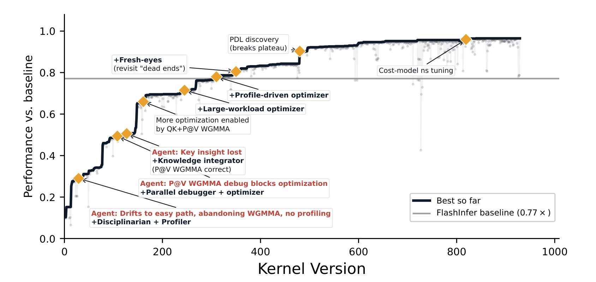
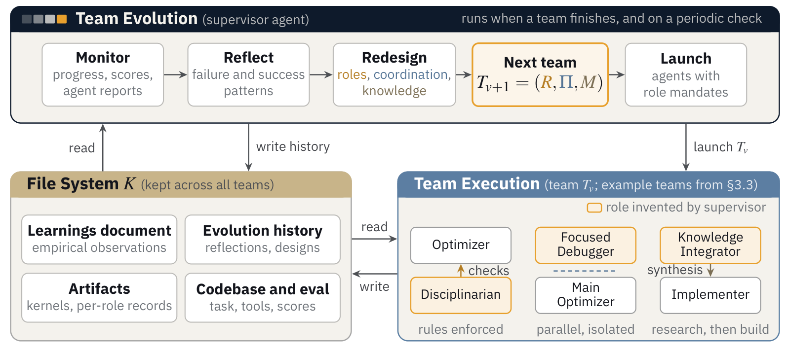
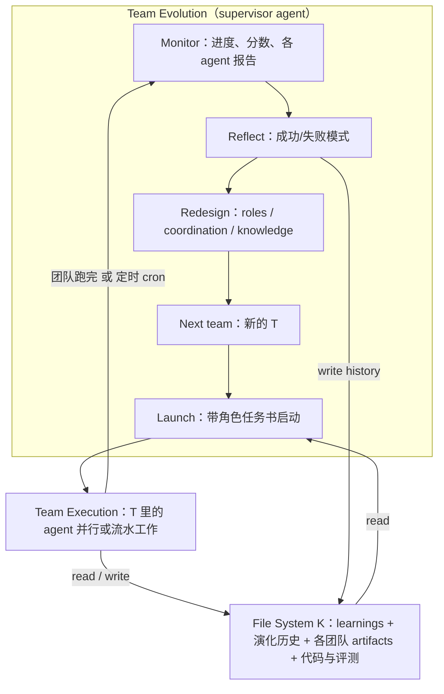

# Evolving Agent Teams

## 来源信息

| 项 | 内容 |
| --- | --- |
| 标题 | Evolving Agent Teams |
| 作者 | Shiyi Cao、Ziming Mao、Dacheng Li、Joseph E. Gonzalez、Ion Stoica（5 位） |
| 机构 | University of California, Berkeley（致谢说明工作完成于 Sky Computing Lab） |
| 来源 | [arXiv:2610.36848v1](https://arxiv.org/abs/2610.36848v1)（cs.AI；2026-10-27 提交；17 页；arXiv nonexclusive-distrib 1.0） |
| 版本 | v1（截至 2026-11-02 只有 v1） |
| 代码 | <https://github.com/caoshiyi/EAT>（Apache-2.0；代码与论文实验的对应关系未验证） |
| 阅读日期 | 2026-11-02 |

---

## 核心结论

一句话：**这篇把「要优化的东西」从解本身扩展到「搜索解的组织」**——在长时间 GPU kernel 优化里，单 agent 和固定多 agent 团队都会滑向「容易实现但架构上限低」的方向并卡在局部最优；作者让一个 supervisor agent 在平台期诊断「卡在哪」，再重新设计下一支团队的角色、协作方式与知识管理，把经验写进跨团队持久的文件系统，从而在相同预算下四个任务全部超过 Claude Code，并在 MLA 上超过固定四人团队、Codex 与两个专用 kernel 优化系统。

- **问题**：coding agent 先吃掉低层原语调优这一层，避开决定性能天花板的高层架构选择；固定团队则为某个阶段而设计，阶段一换就整体失配。
- **核心想法**：把优化对象从解 $s$ 扩到团队配置 $T=(R,\Pi,M)$：角色、协作、知识管理都可被 supervisor 现场重写，而不是由人预先固定。
- **怎么做**：外层循环 Monitor → Reflect → Redesign → Next team → Launch；内层由当前团队执行；一个跨版本持久的文件系统 $K$ 保存代码、评测、learnings、各团队 artifacts 与演化历史。
- **关键结果**：匹配预算下 FA4 0.56× vs 0.33×、GDN 1.90× vs 1.08×、MLA 0.74× vs 0.51×、G+AR 1.18× vs 1.08×（相对各自生产基线，best of 2）；加预算后 MLA 生成 kernel 达 1.21× over 生产 FlashInfer，47 个 workload 中 36 个更快。
- **定位**：适合做 agent 系统与长时程自主优化的人；核心工程贡献不是 prompt，而是「诊断 → 重组 → 持久化经验」这个循环加上文件系统契约。

---

## 问题

### 两层设计空间，agent 会先吃掉容易的那一层

GPU kernel 的性能空间有两层（§1）：

- **低层原语使用**：用不用 WGMMA tensor core、shared memory 是否 swizzle、cp.async / TMA 怎么排。
- **高层架构设计**：dispatch 策略、warp specialization、dataflow、把哪一段放到哪个单元上。

低层原语在既定架构内能榨出可观性能，但**高层架构选择决定了哪些硬件瓶颈还在**，从而决定性能天花板。而 coding agent 的失败模式恰恰是：先挑容易实现的架构方向（例如用 WMMA 而不是 WGMMA），在既定方向里把预算花在调参上，不再回头碰需要大量调试的更难方向。

这条观察在 MLA decode（DeepSeek-V3 推理用的 paged decode kernel）上被具体化：单 agent 反复在 WGMMA 实现上撞正确性错误后放弃，退回到更简单但效率更低的 WMMA 路径。作者给出的数字是：Codex 5.5 xhigh 花 1K 美元、跑了好几天只到专家性能的 28%（§1）；同段还说固定四人团队只到 55%，但这个 55% 与 §4.5 的 0.31× 对不上（见 `audit.md`）。

### 为什么「更强的模型」和「固定的团队」都不够

论文的论证不是「模型不行」，而是**阶段错配**：kernel 优化会依次经过「建立正确性 → 调试硬件原语 → profiling 找瓶颈 → 重新设计架构」这些阶段，每个阶段需要的专家、工具和协作方式不同。固定团队在任何时刻都是为某个阶段设计的，一旦阶段切换就整体失配（§1）。

附录 B 给了一个结构性失败案例：固定四人团队在 MLA 上比单 agent 晚很多才拿到第一个正确 commit。原因是一类 SMEM layout bug——SM90 的 WGMMA 要求 $8\times64$ atom 分块的 shared memory，而 Implementer 写成了 row-major tile，静默破坏了 QK 输出。定位这个 bug 所需的信息在团队里是齐的，但被切分在不同 agent 手里：Hardware Researcher 知道 layout 要求、Implementer 手里有实际的 SMEM 声明，两者对 descriptor 的数值又一致，于是都把 bug 定位到别处；所有角色都有 Read 权限，却没有任何一个角色去读 Implementer 的源码看 layout。作者称之为「结构问题而非能力问题」：角色章程把输出范围隐式限死，`SendMessage` 传的是散文，鼓励「LBO=16，确认？」这种抽象共识而不是字节级核对。

这与 §3.3 里 V7→V8 的现象互补：V4 的报告已写了「用 WGMMA RS、P 放寄存器」这条策略建议，但 V5–V7 全都忽略，因为建议躺在某个团队的报告里，没进共享的 learnings。两类失败——知识被切分在角色之间、知识在团队之间丢失——正好对应后来引入的 Knowledge Integrator 与 `SYNTHESIS.md`。

### 与已有工作的差别（§2，作者自述）

- 相对 CHATDEV / MetaGPT / MAGIS：角色由人类预先设计；这里由 supervisor 按诊断出的需要现场发明。
- 相对 DYLAN / AgentVerse：DYLAN 从手写角色池里选，AgentVerse 每轮从零重组、不保留全局上下文；这里跨重组保留一个持久文件系统。
- 相对 Reflexion / Voyager：那些改进单个 agent 在固定角色内的行为；这里改的是围绕 agent 的整个优化过程。
- 相对 FunSearch / OpenEvolve / AlphaEvolve：没有种群、没有交叉，是串行的、诊断驱动的团队结构适配。

---

## 核心想法

### 一句话

把「派谁去搜」当成可优化的变量：解空间里的搜索照旧，但搜索所用的角色、协作与知识管道由外层循环按诊断结果重写。

### 直觉

单 agent 的瓶颈不只是「不够聪明」，而是它在长时程里缺少三样东西：一个在平台期强制换方向的机制、一个能同时容纳「实现」与「审计」的结构、以及一个不会随团队解散而丢掉的经验库。固定多 agent 团队补上了并行，却把这三样都写死在设计时——团队为阶段 A 而生，进入阶段 B 后，角色分工反而让每个人只看见自己那一块。

supervisor 的思路是把这三样都变成显式对象：诊断（哪类失败正在发生）、重组（角色/协作/知识怎么改）、持久化（经验写到哪）。于是「换方向」不再是某个 agent 的自觉，而是外层循环的职责。

### 为什么成立

1. **诊断写在行为层面**：论文点名的四类失败模式是「滑向容易路径、上一团队的关键洞见丢失、困在调试里、过度微优化」，都可以从进度、分数与各 agent 的报告里读出来，而不是只看分数没涨。
2. **角色可发明**：没有预定义角色池，supervisor 自己写角色任务书；所以它可以造出 `PROFILING SCIENTIST`、`CHALLENGER`、`PRIMITIVE STUDY AGENT`、`KNOWLEDGE INTEGRATOR` 这类为当前症状定制的角色。
3. **知识可持久**：$K$ 跨所有团队版本保存代码库、评测工具、learnings（经验观察）、每个团队的 artifacts 与 evolution history（supervisor 每版的反思与设计决定），新团队直接继承。
4. **触发不靠人**：当前团队跑完，或固定间隔的 cron 检查；后者能抓到「团队自己陷在局部最优里出不来」的情况。

### 一个走通的例子

MLA decode 的 V1→V10 是全文最完整的链条（§3.3，Figure 1）：

- **V1→V2**：单 agent 在压力下从 WGMMA 滑到标量代码、不做 profiling、一次改多个变量。supervisor 加 `Disciplinarian`（禁止非 WGMMA 提交、一次一改）并引入 `LEARNINGS.md`；拿到第一个验证正确的 WGMMA kernel，但分数从 0.15 掉到 0.065——**纪律的第一笔账是性能倒退**。
- **V5→V6**：V3–V5 各自独立尝试 P@V WGMMA 集成，都死在同一个根因。supervisor 改成 `Focused Debugger`（只碰 P@V）+ `Main Optimizer`（只做微优化）完全并行、分支隔离；优化者 12 个 commit，0.34 → 0.49。
- **V7→V8**：V4 的策略建议被 V5–V7 集体忽略。加 `Knowledge Integrator` 与 `SYNTHESIS.md` 后 RS 单测通过，0.50 → 0.51；涨分很小，价值在于让 V9 的集成成为可能。
- **V9→V10**：P@V WGMMA 集成后瓶颈结构全变，旧的 profiling 作废；换成 `Profile-Driven Optimizer` 重新测量，9 个 commit，0.50 → 0.66。



*图 1（原文 Figure 1，p.1）：MLA decode 的优化轨迹（Claude Opus 4.6）；横轴 kernel 版本号，纵轴相对 FlashInfer `run()` 的速度，菱形是 supervisor 的干预点，灰线为生产基线 0.77×。*

### 代价

- **supervisor 会误判**：V2 强制 WGMMA 后分数从 0.15 掉到 0.065；若只看短期分数就会回滚正确的一步，论文靠人写进角色章程的硬约束兜底。
- **并行放大消耗**：并行隔离分支让一个 agent 的失败不阻塞另一个，代价是同时烧多份预算；论文没有「同花费下并行 vs 串行」的受控对比。
- **元工作要占一个角色**：`Knowledge Integrator` 不产出 kernel，只产出文档；在小任务上大概率不划算。
- **归因被模型差异污染**：固定团队用 Opus 4.7、演化团队用 Opus 4.6，跨域实验又换 Opus/Sonnet 5.5；不同实验的分数不能横向拼接。

### 与已有做法的区别

| 做法 | 角色从哪来 | 跨轮保留什么 | 改的是什么 |
| --- | --- | --- | --- |
| 固定角色系统（MetaGPT 等） | 人类预先设计 | 任务上下文 | 解 |
| 动态组队（DYLAN / AgentVerse） | 手写池里选 / 每轮重组 | 少或不保留 | 路由 |
| 单 agent 反思（Reflexion / Voyager） | 单一固定角色 | 经验文本 | 固定角色内的行为 |
| 进化搜索（FunSearch / AlphaEvolve） | 无角色概念 | 程序种群 | 解 |
| **Evolving Agent Teams** | supervisor 现场发明 | 持久文件系统 $K$ | 搜索的组织 $T$ |

---

## 方法

### 符号表

| 符号 | 含义 | 取值 / 说明 |
| --- | --- | --- |
| $s$ | 一个解（可执行程序） | 原文未定义；按上下文理解为一份可编译、可评测的 kernel 实现 |
| $s^{\star}$ | 最优解 | 目标式的 argmax 结果 |
| $\mathcal{P}$ | 可执行程序的集合 | 搜索空间 |
| $\mathcal{F}(s)$ | 解的评分函数 | 原文未定义；按上下文理解为任务定义的性能分数 |
| $\mathcal{C}(s)$ | 正确性约束 | 原文未定义；按上下文理解为「通过正确性测试」 |
| $T$ | 团队配置 | $T=(R,\Pi,M)$ |
| $R$ | 角色集合 | 谁负责什么；可现场发明 |
| $\Pi$ | 协作方式 | 怎么交互；流水、并行或混合 |
| $M$ | 知识管理 | 经验如何积累与共享 |
| $K$ | 持久文件系统 | 跨所有团队版本保留 |
| $T_v$ | 第 $v$ 版团队配置 | Figure 2 图注用 $T_v$ 表示当前团队 |
| $v$ | 团队版本号 | 原文未单独定义；按上下文为每次 supervisor 重组产生的一版 |
| $t_{\mathrm{base}}, t_{\mathrm{kernel}}$ | 基线 / 被评 kernel 的运行时间 | 指标为跨 workload 的几何平均 $t_{\mathrm{base}}/t_{\mathrm{kernel}}$，大于 1 表示更快 |

### 目标：只优化解（§3.1，原文未编号）

任务给定目标描述、代码库与正确性约束，要在可执行程序集合里找分数最高的解：

```math
s^{\star} = \arg\max_{s \in \mathcal{P}} \mathcal{F}(s)
\quad \text{s.t.} \quad \mathcal{C}(s) \ \text{holds}
```

**逐项读法**：$\mathcal{P}$ 是可执行程序的集合，$\mathcal{F}(s)$ 给每个解打分，$\mathcal{C}(s)$ 是必须满足的正确性约束；预算按 token 计。这一项只优化 $s$，团队配置 $T$ 是外生给定的常量——这正是已有系统的共同形态。

作者接着把已有系统统一描述成一个**团队配置** $T=(R,\Pi,M)$：角色 $R$（谁负责什么）、协作 $\Pi$（怎么交互）、知识管理 $M$（经验如何积累与共享）。这篇的立足点是：**已有系统里这三项都是人预先设计并固定的，只优化 $s$ 不优化 $T$**；而长时程优化里正是 $T$ 与当前阶段失配导致停滞。脚注 1 特意澄清：有些进化系统会在运行中调搜索超参（如 AdaEvolve），但「固定」在这里专指 $T$ 本身。

### 两级循环与数据流（§3.2，Figure 2）



*图 2（原文 Figure 2，p.4）：上层 Team Evolution 由 supervisor 执行，下层 Team Execution 由当前团队 $T_v$ 执行；左下为跨版本持久的文件系统 $K$，橙色边框表示 supervisor 发明的角色。*



**逐项读法**：外层五步构成一个诊断驱动的控制回路——Monitor 收集进度、分数与各 agent 的报告；Reflect 归纳成功/失败模式；Redesign 沿 $R,\Pi,M$ 三轴改写下一版 $T$；Next team 生成新的团队配置；Launch 带角色任务书启动。内层 Team Execution 里的 agent 只做执行，读写 $K$；执行结束（或 cron 到点）把控制权交回 Monitor。$K$ 是唯一跨版本存活的对象：supervisor 把每版反思与决定写进 evolution history，执行层把代码、kernel 与逐角色记录写进 artifacts。

### 三个可改的轴

| 轴 | supervisor 能改什么 | 论文里的具体例子 |
| --- | --- | --- |
| Roles $R$ | **发明**角色，而不是从预定义池里选 | `PROFILING SCIENTIST`（设计微基准隔离瓶颈）、`CHALLENGER`（压测「性能天花板」的说法）、`PRIMITIVE STUDY AGENT`（研究可用原语并跑小测试）、`KNOWLEDGE INTEGRATOR`（把散落各团队的报告合成可执行计划） |
| Coordination $\Pi$ | 流水（research → implement → profile）、并行分支、或两者混合 | 一个 agent 只调试阻塞问题（禁止碰主代码库），另一个继续在主分支上优化，避免一个 agent 的失败阻塞另一个 |
| Knowledge $M$ | 规定每个 agent 该把东西写到哪里 | 早期洞见跨团队丢失后，引入跨 agent 的 synthesis 文档，并要求后续所有团队读它 |

附录 A 的 Table 3 把 supervisor 在全部实验里发明过的角色按五类列出（实施与优化 5 个、分析与 profiling 6 个、知识与研究 5 个、质量保证 3 个、架构与设计 3 个），并强调**没有一个预定义**。

### 执行层与文件系统

每个 agent 就是带 shell 访问的 LLM coding agent（论文实现是 Claude Code），能读写文件、跑命令、调用编译器与 profiler。agent 拿到角色任务书 + 代码库 + 评测工具 + $K$ 的访问权；一个 agent 的产出（commit 的代码、profiling 报告、写的分析）按协作计划成为别人的输入。

$K$ 保存五类东西：代码库、评测工具、learnings（经验观察）、每个团队的 artifacts（kernel 与逐角色记录）、evolution history（supervisor 每版的反思与设计决定）。作者的说法是：连续性让每个新团队都能继承此前的经验、失败尝试与成功策略——这也是它与「每轮从零重组」的 AgentVerse 的关键区别。

一个容易被忽略的初始化细节：没有预定义的初始角色或团队配置，supervisor 自己根据任务描述从零设计所有角色、协作计划与知识管理策略（§4.1 Implementation）。

### 与已有方法的结构差异

| 维度 | 固定角色多 agent | 动态组队 | 进化搜索 | 本文 |
| --- | --- | --- | --- | --- |
| 角色来源 | 人预先设计 | 手写池 / 每轮重组 | 无角色 | supervisor 按诊断发明 |
| 优化对象 | 解 | 路由 | 解（种群） | 团队配置 $T$ |
| 经验载体 | 任务上下文 | 少或不保留 | 程序种群 | 持久文件系统 $K$ |
| 反馈信号 | 任务分数 | 任务分数 | 适应度 | 行为层面的失败诊断 + 分数 |

---

## 主要结果

**设置**（§4.1）：四个任务——FA4（B200，CuTe DSL，24 个 workload）、GDN prefill（B200，CUDA，100 个）、MLA decode（H100，CUDA，47 个）、GEMM+AllReduce（H100，CUDA，5 个）；指标是跨 workload 的几何平均 $t_{\mathrm{base}}/t_{\mathrm{kernel}}$，主对比每个设置跑两次报最好的一次。基线为 Claude Code（Opus 4.6）、固定四人团队（Opus 4.7，仅 MLA）、Codex（GPT-5.5 xhigh，仅 MLA）、K-Search 与 CUDAForge（仅 MLA）。

1. **匹配预算下四个任务全部优于单 agent**（§4.2，Figure 3a，best of 2）。这里的「预算」是美元加权成本，不是 token 数；FA4 上两者都远低于专家基线，所以「全胜」指相对 coding-agent 基线。

| 任务 | Evolving Agent Teams | Claude Code (Opus 4.6 1M) |
| --- | --- | --- |
| FA4 (B200) | 0.56× | 0.33× |
| GDN Prefill (B200) | 1.90× | 1.08× |
| MLA Decode (H100) | 0.74× | 0.51× |
| GEMM+AllReduce (H100) | 1.18× | 1.08× |

2. **加预算后能反超专家实现**：MLA 达 1.21× over 生产 FlashInfer（47 个 workload 中 36 个更快，其余 11 个在 0.86–0.99×）；GDN 经 21 个团队版本从 2.2× 提到 4.06× 均值；G+AR 到 1.56× over cuBLAS+NCCL，与 ThunderKittens 的 1.549× 相当。MLA 的 1.21× 是相对图注里的生产基线 0.77×；相对只计 `run()` 的 1.0× 基线，生成的 kernel 是 0.96×（仍略慢）。
3. **消融把涨分归因于「演化」而非「更强模型」**（§4.5）：同一 MLA 任务上 EAT 0.74×、固定四人团队 0.31×、Codex 0.28×。固定团队与演化团队共享多 agent 结构，差别只在能否按诊断重组；但原文在「同一模型」这一点上自相矛盾（固定团队写 Opus 4.7、EAT 用 Opus 4.6），归因因此多了一个未讨论的混杂因素。
4. **与专用 kernel 系统比，赢在收敛到的实现家族**（§4.6，Table 2）：800 美元预算、同一块 H100、47 个 workload、全部通过正确性测试，EAT 两跑 0.721× / 0.685×，K-Search 0.602× / 0.598×，CUDAForge 0.448× / 0.283×。作者的解释不是「agent 更聪明」，而是两个专用系统都停在更容易写对的 WMMA / scalar 实现（0/2 WGMMA），EAT 两跑都拿到 WGMMA（2/2）——「路径」列比分数更有信息量。
5. **能迁移到 kernel 之外，但证据强度较弱**（§4.7、附录 C）：KDA prefill 在 AMD MI350X 上 3.01× over vLLM 手写 HIP kernel、在 B200 上 3.44× over FlashKDA；MoE expert-offload 在 48 GB M4 Pro 上主指标 3.32×（回放真实 coding-agent 会话）；RoboDojo 42 个双臂任务得 62.1（留出 seed）对榜单最佳 55.3。这些是单次运行 + 更强模型（Opus/Sonnet 5.5）的案例，不是受控对比。
6. **反例同样重要**：FA4 是唯一在匹配预算与加预算两种设置下都没超过专家基线的任务；GDN 的 1.90× 几何平均与「100 个 workload 里 43 个比基线慢」同时成立；匹配预算下 MLA 的 0.74× 仍低于 1.0×。附录 D 的等时长 MoE 消融更不利：200 美元时单 agent 1.047×、团队 1.056×，几乎持平，团队的优势主要来自继续花钱。

---

## 边界与局限

**作者明确承认的**：

- 主实验每个设置只跑两次、§4.7 的每个设置只跑一次，统计意义有限；cost-vs-performance 的 Pareto 分析与「更嘈杂域」的受控研究留作未来工作（§5）。

**读者根据证据提出的**：

- **「匹配 token 预算」与「更好的团队」的归因不够干净**：受控对比按美元加权成本，MoE 实验里 200 美元时两者几乎持平，团队的优势发生在继续花钱之后；「演化」至少在部分场景更像「更愿意继续花钱」，需要固定 wall-clock 与花费的对比才能分开。
- **FA4 的失败没有分析**：0.56× vs 0.33× 只在「相对基线」的意义上成立，它同时说明在 Blackwell 上做 attention 前向、需要算法与流水线协同设计时，这套方法仍拿不到 FlashAttention-4 的水平。
- **「36 of 47」缺少分布信息**：论文没给逐 workload 数字与方差，11 个 0.86–0.99× 的样本如何分布无法判断；「最好 kernel 的 MMA 路径」只有 3 个系统 × 2 跑，是相关而非证明。
- **正确性口径未在正文展开**：Table 2 说 47 个 workload 全部通过测试，但容差、是否与 FlashInfer 的数值对齐方式一致都没写；对 kernel 结果来说，正确性口径与性能数字同等重要。
- **跨域结论不能与主实验横比**：MI350X 用算术平均（还是 5 次复测的均值）、B200 用几何平均、MoE 是各 workload 项的均值、RoboDojo 是「五个维度均值的均值」；RoboDojo 还允许策略在运行时调用 LLM（每 episode 最多 20 次），与榜单其他条目是否可比，原文未讨论。

---

## 与其他工作的关系

- **harness 系列（本仓库 00189 / 00199 / 00212 / 00218 / 00220）**：那一系列优化模型外围的 harness 代码与结构；EAT 不改 harness，改的是「这一轮派谁、怎么协作、经验写哪儿」。共同前提一致：把历史经验与执行反馈变成下一轮的结构改动，而不只是改 prompt。EAT 引用的 Meta-Harness（[19]，arXiv:2603.28052）正是这一系列里被反复对照的工作——Meta-Harness 优化 harness，EAT 优化搜索过程本身。
- **K-Search（arXiv:2602.19128）**：本文前两位作者与同两位导师的先前工作，也是 Table 2 里最强的对照（0.602×）；两篇放在一起，能看到同一组人从「固定两角色 + 共演化世界模型」走到「角色本身可演化」的轨迹。
- **同名不同文提醒**：本文引用的 CAKE（[47]，arXiv:2608.12629）、FlashInfer-Bench、ThunderKittens 都是外部系统/基准，不是本仓库已有条目。

<!-- 复核档案见同目录 audit.md（不随站点发布） -->
