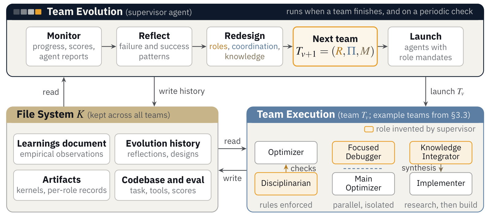
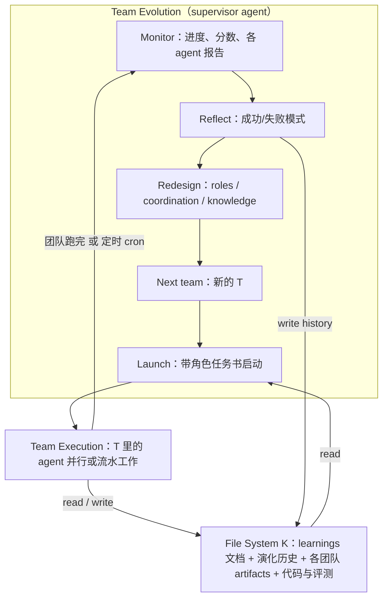
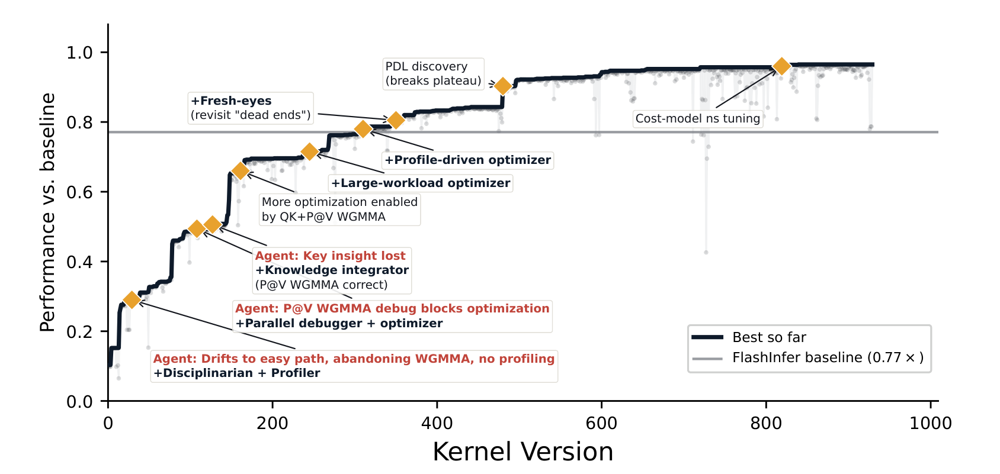

# Evolving Agent Teams

## 来源信息

| 项 | 内容 |
| --- | --- |
| 标题 | Evolving Agent Teams |
| 作者 | Shiyi Cao、Ziming Mao、Dacheng Li、Joseph E. Gonzalez、Ion Stoica（5 位） |
| 机构 | University of California, Berkeley（首页统一署名；致谢说明工作完成于 Sky Computing Lab） |
| 来源 | [arXiv:2610.36848v1](https://arxiv.org/abs/2610.36848v1)（cs.AI；2026-10-27 提交，截至 2026-11-02 只有 v1）；全文 17 页 |
| 阅读日期 | 2026-11-02 |
| 许可 | [arXiv nonexclusive-distrib 1.0](http://arxiv.org/licenses/nonexclusive-distrib/1.0/)（abs 页 "view license" 指向，2026-11-02 核验；**不是** CC 协议） |
| 版本锚点 | 本次抓取 PDF：609,291 B，17 页，sha256 `a2a15b5f0a0aa36797452a2413c59077b74cd3d5966fea6ea39711adbcad0a4d`。abs 页提交记录里的 "(199 KB)" 与 PDF 实际大小不同（该数字更像 e-print 源码包口径，原文未说明），以 sha256 为准 |
| 代码 | <https://github.com/caoshiyi/EAT>（2026-11-02 经 GitHub API 核验：public、Apache-2.0、创建 2026-10-08、最后 push 2026-11-02、46 stars；顶层目录 `.claude-plugin/ agent_team/ assets/ cleanroom/ ops/ SKILL.md NOTICE README.md LICENSE`）。仓库 description 自称 "NeurIPS'26"，而 v1 首页标注 "Preprint."——**材料自述状态不作为核验结果**，本笔记只把它记为"两者表述不同"。**未验证**仓库代码与论文实验的对应关系与可复现性 |
| 阅读范围 | v1 全文 17 页逐页读过（正文 §1–§5 pp.2–10、参考文献 pp.11–13、附录 A pp.14、B pp.14–15、C pp.15–16、D pp.16–17）。**已渲染并逐项核对**：Table 1（p.6）、Table 2（p.9）、Table 3（p.14）、Table 4（p.17）逐格；Figure 1（p.1）、Figure 2（p.4）、Figure 3（p.7）、Figure 4（p.8）、Figure 5（p.9）、Figure 6（p.9）、Figure 7（p.10）、Figure 8（p.16）看渲染页并与正文对照。**图中的定量读数**只用于核对正文已给的数字（见"核对凭据"）。**未做**：未运行仓库代码、未复现任何 kernel、未获取逐 workload 数据（论文未发布 47 个 workload 的逐项数字） |
| 核对凭据 | 渲染 DPI 170/200/300（pymupdf）。Figure 1 读图定标：0.0 刻度线 y≈677 px、1.0 刻度线 y≈88 px（589 px/单位；300 dpi，裁剪框 `(104,458,509,650)`，成品 1688×801），末段平台 y≈108 px → (677−108)/589 ≈ 0.966，用来核对图注"0.96×"；图中读数仅作定性，正文数字以文本为准。配图裁剪框像素坐标：Figure 1 `(104,458,509,650)`、Figure 2 `(114,71,497,242)`（pymupdf 坐标，原点左上，单位 pt），300 dpi；两张成品与同坐标重裁**像素差 bbox 为 None**、边缘 4 px 环全白（255,255,255）。Figure 4b 终点用矢量路径复核（running-best 末点 y=310.67 pt；轴 0.0=369.95、0.5=350.95 → 1.564）；Figure 5b 用 `get_text('words')` 的 x 坐标把数值配到 16K/32K/64K/128K 各格（16K 对 0.40/0.28，32K 对 0.48/0.35）。否定性断言检索词（全文文本层）：`variance`、`confidence interval`、`standard deviation`、`Table 5`、`Appendix E` 均无命中（用于确认正文未给方差/置信区间、表格止于 Table 4）；`36 of 47` 与 `0.86` 只出现在摘要与 §1 的同一处声明（p.1、p.2），后文没有逐 workload 数字；`1.49`/`1.56`/`0.75`/`0.74`/`55%`/`0.31` 用于定位「表述张力」里那几处并存的说法 |
| 归档说明 | arXiv 来源，按仓库策略不归档 PDF（本次阅读用的临时 PDF 已删除） |
| 复核记录 | 2026-11-03 首轮复核（check-paper-note）：重下 v1，sha256 与阅读时一致（`a2a15b5f…`，609,291 B，17 页）；手段=全文文本检索 + 300/400 dpi 渲染 + `get_text('words')` 坐标配对（Figure 5b 逐格、Figure 4b 矢量路径、Figure 1 刻度定标）+ 配图同坐标重裁像素差 + 独立子 agent 审计（只报告）。主要修正：Figure 5b 两处读图错配（16K 被误配成 32K 的 0.48→0.35，高 K 区间 1.37–1.71 改为 1.37–1.59，最高格是 `b=32,k=1000,N=32K`；删除"1.71× 那格即默认 workload"的推断，并补 memory-bound 低 N 并不持平）；Figure 1 定标 0.0 刻度 634→677 px（0.96 结论不变）；Figure 2「K 在中间/图例在右下」→「K 在左下/图例在 Team Execution 面板标题下方」；「FA4 是唯一没超过专家基线的任务」→「唯一在两种预算下都没超过」（匹配预算下 MLA 也未超过）；43/100 的"近半数"→"四成多"；§4.1 引文 all→each；补 MLA 的 0.96×（相对只计 `run()`）与 1.21× 的口径关系、跨域聚合口径（算术 vs 几何）、MoE 主指标 3.32×、MI350X 的 10 workload 算术平均 × 5 次复测、B200 侧 KDA2 2.91/2.74、RoboDojo 分数定义与 50 episodes、MoE 37 GiB 门禁；成本表把 §4.2 与 §4.6 拆成两行；abs 页 199 KB 改为「口径未说明」。未修：仓库代码与实验的可复现性（未验证）；跨域实验单跑（原文自述，无法复核） |

---

## 核心结论

一句话：**这篇把"要优化的东西"从解本身扩展到"搜索解的组织"**——在长时间 GPU kernel 优化里，单 agent 和固定多 agent 团队都会滑向"容易实现但架构上限低"的方向并卡在局部最优；作者让一个 supervisor agent 在每次平台期诊断"卡在哪"，然后**重新设计下一支团队的组成、协作方式和知识管理**，把经验写进跨团队持久的文件系统，从而在相同预算下于四个任务上全部超过 Claude Code，并在 MLA 上超过固定四人团队、Codex 以及两个专门的 kernel 优化系统（K-Search、CUDAForge）。

更具体地说，可以被引用的三条：

1. **在匹配预算下，四个 kernel 任务全部优于单 agent；在 MLA 上还优于固定团队与两个专用系统**（Figure 3a，best of 2）：FA4 0.56× vs 0.33×、GDN 1.90× vs 1.08×、MLA 0.74× vs 0.51×、G+AR 1.18× vs 1.08×（相对各自生产基线）。在 MLA 上与固定四人团队（0.31×）和 Codex GPT-5.5 xhigh（0.28×）的差距，是作者用来论证"涨分来自团队演化而非模型更强"的主要证据（§4.5）。
2. **加预算后能反超专家实现**：MLA decode 上生成 1.21× 超过生产 FlashInfer 的 CUDA kernel，47 个生产 workload 里 36 个更快，其余 11 个在 0.86–0.99×（摘要、§1、Table 2）。这个数字有一个重要的口径前提，见下文"原文自身的表述张力"与"实验与证据"。
3. **可迁移到 kernel 之外**：KDA prefill 在 AMD MI350X 上 3.01× over vLLM、在 B200 上 3.44× over FlashKDA；MoE expert-offload 在 48 GB M4 Pro 上把 Qwen3.8-Flash-Next（MLX 4-bit）跑到 30.3 tokens/s；RoboDojo 42 个双臂操作任务得 62.1（留出 seed）对 55.3（榜单最佳）。这些属于**单次运行 + 更强模型（Opus/Sonnet 5.5）的案例**，不是受控对比（§4.7、附录 C）。

**适合谁看**：做 agent 系统/agent harness 的人（尤其是"多 agent 到底比单 agent 强在哪"这类问题）；做 LLM 生成 kernel / 程序优化的人（这篇是目前少见的、在真实生产 kernel 上拿出端到端数字的工作）；做长时程自主优化（multi-day horizon）的人——它的核心工程贡献其实不是 prompt，而是**诊断 → 重组 → 持久化经验这个循环，加上文件系统契约**。

---

## 问题与动机

### 两层设计空间，以及 agent 会先吃掉容易的那一层

GPU kernel 的性能空间有两层（§1）：

- **低层原语使用**：用不用 WGMMA tensor core、shared memory 是否 swizzle、cp.async / TMA 怎么排。
- **高层架构设计**：dispatch 策略、warp specialization、dataflow、把哪一段放到哪个单元上。

作者的关键观察是：低层原语在一个既定架构内能榨出可观性能，但**高层架构选择决定了哪些硬件瓶颈还在**，从而决定性能天花板。而 coding agent 的失败模式恰恰是：先挑"容易实现"的架构方向（例如用 WMMA 而不是 WGMMA），在既定方向里把预算花在调参上，**不再回头碰需要大量调试的更难方向**。

这条观察在 MLA decode（DeepSeek-V3 推理用的 paged decode kernel）上被具体化：单 agent 反复在 WGMMA 实现上撞正确性错误后放弃，退回到更简单但效率更低的 WMMA 路径。作者给出的数字：Codex 5.5 xhigh 花了 1K 美元、跑了好几天只到专家性能的 28%；固定四人团队到 55%（§1）。——**55% 与后文 §4.5 的 0.31× 对不上（见"原文自身的表述张力"第 1 条），28% 则与 0.28× 一致。**

### 为什么"更强的模型"和"固定的团队"都不够

论文的论证不是"模型不行"，而是**阶段错配**：kernel 优化会依次经过"建立正确性 → 调试硬件原语 → profiling 找瓶颈 → 重新设计架构"这些阶段，每个阶段需要的专家、工具和协作方式不同。固定团队在任何时刻都是为某个阶段设计的，一旦阶段切换就整体失配（§1）。

附录 B 给了一个很具体的结构性失败案例，比正文的抽象论证更有说服力：固定四人团队在 MLA 上比单 agent 晚很多才拿到第一个正确 commit，原因是一类 SMEM layout bug——SM90 的 WGMMA 要求 `8×64` atom 分块的 shared memory，而 Implementer 写成了 row-major tile，静默破坏了 QK 输出。**定位这个 bug 所需的信息在团队里是齐的，但被切分在不同 agent 手里**：Hardware Researcher 知道 layout 要求、Implementer 手里有实际的 SMEM 声明，两者对 descriptor 的数值又一致，于是都把 bug 定位到别处；所有角色都有 Read 权限，但没有任何一个角色去读 Implementer 的源码看 layout。作者的结论是"这是结构问题而非能力问题"：角色章程把输出范围隐式限死（Hardware Researcher 自我定位成"配方专家"而不是 auditor）、spawn prompt 规定的是应答式行为、`SendMessage` 传的是散文，鼓励"LBO=16，确认？"这种抽象共识而不是字节级核对。

这与 §3.3 里 V7→V8 的另一个现象互补：V4 的报告里已经写了"用 WGMMA RS、P 放寄存器"这条策略建议，但 V5–V7 全都忽略了，因为**建议躺在某个团队的报告里，没进共享的 learnings**。两类失败——"知识被切分在角色之间"和"知识在团队之间丢失"——正好对应 supervisor 后来引入的 Knowledge Integrator 与 `SYNTHESIS.md`。

### 与已有工作的差别（§2，作者自述）

- 相对 CHATDEV / MetaGPT / MAGIS 这类固定角色系统：那些角色是人类预先设计的；这里角色由 supervisor 按诊断出的需要**现场发明**。
- 相对 DYLAN / AGENTVERSE 这类动态组队：DYLAN 从手写角色池里选，AgentVerse 每轮从零重组、不保留全局上下文；这里的 supervisor **跨重组保留一个持久文件系统**，且面向的是多天、阶段性变化的优化过程，需要改的是"角色与授权"而不只是路由。
- 相对 Reflexion / Voyager：那些改进**单个 agent 在固定角色内**的行为；这里改的是围绕 agent 的整个优化过程。
- 相对 FunSearch / OpenEvolve / AlphaEvolve：**没有种群、没有交叉**，是串行的、诊断驱动的团队结构适配。
- 相对 Meta-Harness：同样利用"对历史经验的更丰富访问"，但 Meta-Harness 优化的是**模型外围的 harness 代码**，这里优化的是**搜索过程本身**。

---

## 方法

### 问题的形式化（§3.1）

任务给定目标描述、代码库与正确性约束，要在可执行程序集合里找分数最高的解：

```math
s^{\star} = \arg\max_{s \in \mathcal{P}} \mathcal{F}(s) \quad \text{s.t.} \quad \mathcal{C}(s) \ \text{holds}
```

读法：在"可执行程序"这个集合里挑一个解，让评分函数最大，同时满足正确性约束；预算按 token 计。作者接着把已有系统统一描述成一个**团队配置** `T = (R, Π, M)`：角色 `R`（谁负责什么）、协作 `Π`（怎么交互）、知识管理 `M`（经验如何积累与共享）。这篇的立足点是：**已有系统里这三项都是人预先设计并固定的，只优化 `s` 不优化 `T`**；而长时程优化里正是 `T` 与当前阶段失配导致停滞。脚注 1 特意澄清：有些进化系统会在运行中调搜索超参（如 AdaEvolve），但"固定"在这里专指 `T` 本身。

### 两级循环（§3.2，Figure 2）



*图 2（原文 Figure 2，p.4）：框架总览。上层 Team Evolution 由 supervisor agent 执行 Monitor → Reflect → Redesign → Next team → Launch；下层 Team Execution 由当前团队 `T_v` 执行；左下是跨所有团队版本保留的文件系统 `K`，用 read / write 箭头与上下两层相连。橙色边框表示"由 supervisor 发明的角色"（图例在右侧 Team Execution 面板标题下方）。裁剪自 v1 PDF，300 dpi。*



**触发条件**只有两个（§3.2）：当前团队跑完，或固定间隔的 cron 检查。触发后 supervisor 先看进度，再反思成功/失败模式（论文点名的四类：滑向容易路径、上一团队的关键洞见丢失、困在调试里、过度微优化），然后沿三个轴设计下一支团队：

| 轴 | supervisor 能改什么 | 论文里的具体例子 |
| --- | --- | --- |
| Roles `R` | **发明**角色，而不是从预定义池里选 | `PROFILING SCIENTIST`（设计微基准隔离瓶颈）、`CHALLENGER`（压测"性能天花板"的说法）、`PRIMITIVE STUDY AGENT`（研究可用原语并跑小测试）、`KNOWLEDGE INTEGRATOR`（把散落在各团队的报告合成可执行计划） |
| Coordination `Π` | 流水（research → implement → profile）、并行分支、或两者混合 | 一个 agent 只调试阻塞问题（禁止碰主代码库），另一个继续在主分支上优化，避免一个 agent 的失败阻塞另一个 |
| Knowledge `M` | 规定每个 agent 该把东西写到哪里 | 早期洞见跨团队丢失后，引入跨 agent 的 synthesis 文档，并要求后续所有团队读它 |

附录 A 的 Table 3 把 supervisor 在全部实验里发明过的角色按五类列出（实施与优化 5 个、分析与 profiling 6 个、知识与研究 5 个、质量保证 3 个、架构与设计 3 个），并强调**没有一个预定义**。

**文件系统 `K`** 是这篇最"工程"的部分：它跨所有团队版本持久保存代码库、评测工具、learnings 文档（经验观察）、每个团队的 artifacts（kernel 与逐角色记录）和 evolution history（supervisor 每版的反思与设计决定）。作者的说法是：连续性让每个新团队都能继承此前的经验、失败尝试与成功策略——这也是它与"每轮从零重组"的 AgentVerse 的关键区别。

**执行层**：每个 agent 就是带 shell 访问的 LLM coding agent（论文实现是 Claude Code），能读写文件、跑命令、调用编译器与 profiler。agent 拿到角色任务书 + 代码库 + 评测工具 + `K` 的访问权；一个 agent 的产出（commit 的代码、profiling 报告、写的分析）按协作计划成为别人的输入。

**一个容易被忽略的初始化细节**：没有预定义的初始角色或团队配置，supervisor 自己根据任务描述从零设计所有角色、协作计划与知识管理策略（§4.1 Implementation）。

---

## 案例：MLA decode 的演化轨迹（§3.3，Figure 1）



*图 1（原文 Figure 1，p.1）：MLA decode 的长程优化轨迹（Claude Opus 4.6）。横轴是 kernel 版本号，纵轴是相对 FlashInfer `run()` 阶段的速度（1.0× 即持平，且**不含** `plan()` 开销）；灰线是生产 FlashInfer 基线 0.77×（相对只计 `run()` 的 1.0×，差额来自 `plan()` 等额外开销）。菱形是 supervisor 的干预点。裁剪自 v1 PDF，300 dpi；末段平台按像素读约 0.96，与图注一致。*

四个干预片段（§3.3 的方框，数字是相对 `run()` 的分数）：

| 版本 | 观察到的行为 | supervisor 的诊断 | 设计变更 | 结果 |
| --- | --- | --- | --- | --- |
| V1 → V2 | 单 agent 在压力下从 WGMMA 滑到标量代码、不做 profiling、一次改多个变量导致无法归因 | "agent 需要外部纪律；没有强制时会在不方便时放弃硬约束" | 加 `Disciplinarian`（禁止非 WGMMA 提交、一次一改）；每次提交后检查；引入 `LEARNINGS.md` | 第一个验证正确的 WGMMA kernel；分数 0.15 → 0.065（**变慢了**） |
| V5 → V6 | V3–V5 各自独立尝试 P@V WGMMA 集成，都死在同一个根因上 | "结构改动需要先隔离调试再集成，一个 agent session 太短"；且 V5 拿到"配对 spawn"的能力却从没用过 | `Focused Debugger`（只碰 P@V、禁止动主 kernel）+ `Main Optimizer`（只做微优化、禁止碰 P@V），完全并行、分支隔离 | 调试者给出 P@V 是死路的结论；优化者 12 个 commit，0.34 → 0.49（+44%） |
| V7 → V8 | V4 报告里"用 WGMMA RS、P 放寄存器"的建议被 V5–V7 集体忽略 | "跨团队丢知识是最大结构弱点：逐实验事实被记录，跨实验的策略建议没有" | 加 `Knowledge Integrator`，引入 `SYNTHESIS.md` 连接所有发现并要求后续团队必读 | RS 单测通过（P@V WGMMA 首次成功），直接支撑 V9 的集成里程碑；0.50 → 0.51 |
| V9 → V10 | V9 把 P@V WGMMA RS 集成进来，瓶颈结构完全变了 | "两个 GEMM 都上了 WGMMA，所有旧的瓶颈分析都过期了，需要重新 profiling" | 换成标准 `Profile-Driven Optimizer`，单人、profiling 优先 | 9 个 commit，0.50 → 0.66（+32%）；其中仅 Split-K 重调参一项就 +4.1（原文未标单位） |

这条轨迹的几个细节值得单独记住：

- **纪律的第一次代价是性能倒退**：V2 从 0.15 掉到 0.065，因为它强制换到了当时还慢但架构上正确的 WGMMA 实现。这是"用短期分数换长期上限"的具体账单，也是这类系统与"贪心爬山"的分水岭。
- **能给 agent 能力 ≠ agent 会用**：V5 有配对 spawn 的能力却从未使用，supervisor 于是改为**自己编排并行**（V6）。这条对做 agent 工具的人很直接：把并发原语交给模型，和把并发**编排**交给上层，是两件事。
- **"知识突破"只有 +2%**：V7→V8 被标为 knowledge breakthrough，但分数只从 0.50 到 0.51；它的价值在于让 V9 的集成成为可能，而不是立刻涨分。作者没有为这条夸大数字。
- **架构一变，历史 profiling 全部作废**：V10 的 +32% 不是因为发现了新东西，而是因为"该重新测量了"。这类"元层面的时机判断"是最难写进固定 pipeline 的。
- 论文说 MLA 上总共探索了 **100 多种团队配置**（§1），而 Figure 1 的横轴是 **kernel 版本号**（横轴到 1000，轨迹结束在约 930），两者不是一回事，别混读。

---

## 实验与证据

### 设置（§4.1，Table 1）

| 任务 | GPU | 语言 | workload 数 | 基线 | 起点 |
| --- | --- | --- | --- | --- | --- |
| FA4（attention 前向） | B200 | CuTe DSL | 24 | FlashAttention-4 | 0.17× 的 CuTe DSL kernel |
| GDN（Gated DeltaNet prefill） | B200 | CUDA | 100 | FlashInfer | PyTorch 参考实现 |
| MLA（paged decode） | H100 | CUDA | 47 | FlashInfer | PyTorch 参考实现 |
| G+AR（GEMM + AllReduce 融合） | H100 | CUDA | 5 | CUTLASS + NCCL | PyTorch 参考实现 |

指标是**几何平均** `t_base / t_kernel`（跨 workload），>1 表示比基线快；主对比里每个设置跑两次报最好的一次（固定团队与 Codex 消融是单跑；作者自己承认这限制了统计结论）。workload 来源：GDN 与 MLA 取自 FlashInfer-Bench，FA4 用 FlashAttention-4 论文里的形状，G+AR 取自 ThunderKittens 基准套件。

基线分四类：Claude Code（Opus 4.6、1M 上下文，四个任务全跑）、固定四人团队（Profiler / Hardware Researcher / Planner / Implementer，**Opus 4.7** 1M，只在 MLA 上做消融）、Codex（GPT-5.5 xhigh、258K，只在 MLA 上）、以及 kernel 专用系统 K-Search 与 CUDAForge（只在 MLA）。

### 匹配预算下的对比（§4.2，Figure 3a）

四个任务全部优于 Claude Code（best of 2）：

| 任务 | Evolving Agent Teams | Claude Code (Opus 4.6 1M) |
| --- | --- | --- |
| FA4 (B200) | 0.56× | 0.33× |
| GDN Prefill (B200) | 1.90× | 1.08× |
| MLA Decode (H100) | 0.74× | 0.51× |
| GEMM+AllReduce (H100) | 1.18× | 1.08× |

**读这张表要小心两件事**：

1. **FA4 上两者都远低于基线**（0.56× 意味着吞吐只有 FlashAttention-4 的 56%，等价于延迟约 1.79 倍）。所以"consistently outperforms"指的是**相对 coding-agent 基线**，不是相对专家 kernel。四个任务里真正超过专家实现的是 GDN、G+AR，以及加预算后的 MLA；FA4 没有被超过。
2. **"预算"实际按美元加权成本控制**（Figure 3a 横轴是 weighted cost USD），不是 token 数。论文给了折算用的单价：Opus 4.6 1M 为 cache-read / cache-create / input / output = 0.50 / 6.25 / 5.00 / 25.00 美元每百万 token；GPT-5.5 xhigh 为 0.50 / 5.00 / 30.00 美元每百万 token。摘要写"matched token budget"是宽松说法（本笔记判断：同一模型下标价折算的美元与 token 数近似成正比，但两者不是同一个量）。

两个作者自己点明的口径效应：

- **GDN 的 1.90× 有相当一部分不是 kernel 质量**：100 个 workload 里很多是小输入，FlashInfer 的 planning/preprocessing 开销（即使 `plan()` 已缓存）在小规模上主导端到端延迟，而生成的 kernel 没有 planning 阶段，于是小 workload 上出现不成比例的大倍数（§4.2）。
- **GDN 的分布很宽**：最好那次运行最差 workload 0.19×、100 个里有 43 个低于基线（Claude Code 是 0.13× / 49 个）；加预算后最差 0.40×、低于基线的降到 37 个（§4.2、§4.3）。也就是说几何平均 1.90× 与"四成多 workload 比基线慢"同时成立——读懂这一点比记住 1.90 更重要。

### 加预算后的 scaling（§4.3，Figure 4）

- **GDN**：21 个团队版本，从 2.2× 提到 **4.06×** 均值；最差 workload 从 0.19× 改善到 0.40×，低于基线的从 43 降到 37（of 100）。作者的解读是加预算更有利于"初始架构不合适"的困难 workload。
- **G+AR**：到 **1.56×** over cuBLAS+NCCL，与 ThunderKittens 的 1.54× 相当（Figure 4b 中 ThunderKittens 标 1.549×）。轨迹分三段：v1–5 建正确性，产出能跑但慢的两阶段 kernel（0.54×）、v6–10 用 TMA 异步加载 + warp specialization 首次超过基线（1.08×）、v15–22 换成自写 WGMMA + NVLink multicast 做 all-reduce、最后到 cluster 级 TMA multicast（1.56×）。
- **MLA**：加预算后 **1.21×** over 生产 FlashInfer（47 个 workload 中 36 个更快，其余 11 个 0.86–0.99×）；此前的公开最好结果是 K-Search 的 0.61×（§1）。注意这是相对图注里的生产基线 0.77×；相对只计 `run()` 的 1.0× 基线，生成的 kernel 是 **0.96×**（仍略慢），两数的差额就是 `plan()` 等开销的计入方式（Figure 1 图注）。

### 已经被人优化过的代码还能不能改（§4.4，Figure 5）

Flash-KMeans 是一个近期的手工优化版精确 K-Means（FlashAssign 把距离计算与在线 argmin 融合以避开 `N×K` 距离矩阵落 HBM，sort-inverse update 把高竞争 atomic scatter 换成段级局部归约，作者称相对此前 GPU 基线最高 17.9×）。这次不是从 PyTorch 参考起步，而是**从已发布的 Triton 实现起步**，任务是重写成 CUDA：

- 默认 workload 上 **1.71×** over Triton（原文给的数字；它与图 5b 网格里任何一格的配对都对不上——网格内最高约 1.59×，应是另测的默认 workload）。
- 按图 5b 的数值逐格相除：compute-bound 的高 `K` 八格在 **1.37–1.59×**，最高是 `b=32,k=1000,N=32K`（1.49 → 0.94 ms）；`b=32,k=1000,N=64K` 是 2.55 → 1.63 ms（约 1.56×）。原文写 "up to 1.5×"，偏保守。
- memory-bound 的另一半并不都是持平：`k=128` 的四格里，`b=8` 的前三格均约 1.43×、128K 降到 1.07×；`b=32` 是 1.38× / 1.09× / 1.10× / 1.09×。原文的 "matching Triton on memory-bound regimes" 只在 N 较大时接近成立（Figure 5b）。
- 这条实验的意义：说明系统不是只能"从零爬"，也能在人类已经调过的实现上继续拿分。但注意它换的是**实现语言/路径**（Triton → CUDA WGMMA），不是在同一条实现上做微优化。

### 消融：涨分到底来自"演化"还是"模型"（§4.5，Figure 6）

| 配置 | MLA 分数 |
| --- | --- |
| Evolving Agent Teams（Opus 4.6 1M） | 0.74× |
| 固定四人团队（Profiler / Hardware Researcher / Planner / Implementer，Opus 4.7 1M） | 0.31× |
| Codex（GPT-5.5 xhigh，258K） | 0.28× |

作者的推理是：固定团队与演化团队在模型与多 agent 结构上相同，唯一差别是能不能根据诊断出的失败模式重组角色与协作，所以 0.31 → 0.74 这段差距归因于"演化"。**但原文在"同一个模型"这一点上自相矛盾**：§4.5 写 "both use the same model"，而 §4.1 与附录 B 都写明固定团队用 **Opus 4.7**、EAT 用 Opus 4.6（见"原文自身的表述张力"）。如果两者确实不同，这个归因就多了一个原文未讨论的混杂因素；好在方向是对演化团队不利的。Codex 的 0.28× 用来排除"只是模型更强"的解释。

论文还给了固定团队为什么"起步慢"的机制解释（附录 B，见上文"问题与动机"）：不是能力不足，而是**布局规范与实际代码被分在两个角色的上下文里**，没有任何角色去做字节级交叉检查。

### 与 kernel 专用系统比（§4.6，Table 2）

800 美元模型预算、同一块 H100、47 个生产 workload、全部通过 47 个正确性测试：

| 系统 | Run 1 | Run 2 | 最好 kernel 的 MMA 路径 |
| --- | --- | --- | --- |
| CUDAForge | 0.448× | 0.283× | scalar/SIMT（0/2 WGMMA） |
| K-Search | 0.602× | 0.598× | WMMA（0/2 WGMMA） |
| Evolving Agent Teams | **0.721×** | **0.685×** | WGMMA（2/2） |

作者的解释不是"我们的 agent 更聪明"，而是**收敛到的实现家族不同**：两个专用系统在两次运行里都停在更容易写对的实现（WMMA / scalar），而 EAT 两跑都拿到 WGMMA（2/2）。这与 §1 的失败模式一致，也说明 Table 2 的"路径"列比分数更有信息量。

### 跨硬件、跨域（§4.7，Figure 7；附录 C/D）

| 场景 | 结果 | 代价/条件 |
| --- | --- | --- |
| KDA prefill，AMD MI350X | 3.01× over vLLM 手写 HIP kernel（10 个 workload 的**算术平均**、5 次复测的均值；逐 workload 2.09–4.63×；比 Flash Linear Attention 的 Triton kernel 快 7.3×） | Opus 5.5 medium；73 次迭代、186 小时、3.0K 美元；起点是 vLLM kernel 的移植（score 0.99），**不是从零** |
| KDA prefill，B200 | 3.44× over FlashKDA（CUTLASS 融合实现；同 harness 下 KDA2 为 2.91× TIRx / 2.74× CuTe-DSL，其 PTX 版只跑 B300） | 无网络；起点第一轮就移植了 FlashInfer 的 SM100 KDA kernel（1.96×）；iter 1–5 用 Opus 5.5、之后 Sonnet 5.5 |
| KDA，B300（复编译） | 3.54× over FlashKDA，对 KDA2 公布的 3.02×（TIRx）/ 2.98×（PTX）/ 2.85×（CuTe-DSL） | 同一 harness 重测；KDA2 论文自报 B300 上 2.96× |
| MoE expert-offload，M4 Pro 48 GB | 主指标：回放真实 coding-agent 会话 3.32×（Figure 7c）；batch-1 decode 子基准 27.3 tokens/s（naive 13.4），第二次运行 30.3（起点 26.7，solo agent 最终 28.2） | 1.0K 美元；Qwen3.8-Flash-Next、MLX 4-bit、约 79 GB 权重 + 32 GB per-layer embedding、512 routed experts、top-10 + shared expert；过峰值显存 ≤37 GiB 等门禁才算通过 |
| RoboDojo，42 个双臂任务 | 留出 seed 62.1（dev 62.6），榜单最佳 55.3（2026-10-26），π0.5 VLA 单独 11.4；分数=五个维度均值的均值，每任务每 held-out seed 50 episodes | Sonnet 5.5；至 iter 50 花 472 美元（不含运行时 LLM 调用）；iter 1–36 只在 10 个任务子集上优化，37–51 才用全 42 个 |

**跨域设置的聚合口径与主实验不同**，不能与 Figure 3a 的几何平均直接横比：MI350X 是算术平均（还是 5 次复测的均值），B200 是几何平均，MoE 是各 workload 项的均值，RoboDojo 是"五个维度均值的均值"（附录 C）。

匹配预算的单 agent 消融（附录 D）比正文的"3.01×"更能说明问题：

- **MI350X**：同一份起点与任务书，300 美元时单 agent 到 1.65×，团队到 2.13×（团队最终 3.01×，花 3.0K 美元）。
- **MoE offload（从团队 3.2× 的引擎起步，同样 20 小时截止）**：200 美元时两者接近（solo 1.047× vs 团队 1.056×）；20 小时后单 agent 只花了 200 美元就停了，团队花到 509 美元拿到 1.083×，且最终引擎在三个 workload 上都最快（Table 4）。**这条是全文里对"演化更好"最不利的一条**：在等时长、从强起点出发的条件下，两者的早期差距很小，团队的优势主要来自"在同样 20 小时里花了更多钱、走了更远"。

---

## 原文自身的表述张力

以下差异都按 v1 原文核对；记录它们不是为了否定结论，而是因为它们会直接影响引用时的口径。

| 位置 | 一处说法 | 另一处说法 | 备注 |
| --- | --- | --- | --- |
| §1 引言 vs §4.5 / Figure 6 | 固定四人团队"reaches only **55%**"（p.2） | 固定四人团队 **0.31×**（p.9，Figure 6 标 0.31×） | 差了近一倍，是本篇最显眼的不一致。§1 的 28%（Codex）与 §4.5 的 0.28× 是对得上的，只有 55% 对不上 |
| §4.5 vs §4.1 / 附录 B | "both use the same model and multi-agent structure"（p.9） | §4.1 写固定团队"each powered by Claude Code with the same Opus 4.7 1M model"（p.6），附录 B 也是 "all Claude Opus 4.7"（p.14）；EAT 全篇用 Opus 4.6 | 若两者模型确实不同，"0.31 → 0.74 的差距只能归因于团队演化"这一结论就不严格；原文没有讨论这一点 |
| §4.2 vs Figure 3a / §4.5 | 受控预算下 MLA"reaches **0.75×**"（p.7） | Figure 3a 标 **0.74×**，§4.5 也写 0.74×（p.9） | 0.01 的差，可能是四舍五入或不同次运行，但同一段落里两个数并存 |
| §4.2 vs §4.3 / Figure 4b | 加预算后 G+AR"reaching **1.49×** overall and 2.57× on the smallest workload"（p.8） | §4.3 说 G+AR"reaches **1.56×**"，Figure 4b 轨迹终点约 1.56（p.8） | 可以自洽地解释为同一扩展 run 的两个阶段（WGMMA+NVLS 阶段 1.49×，cluster TMA multicast 后 1.56×），但原文没点明，读者容易读成同一个终值 |
| Figure 1 图注 vs 摘要/§1/§5 | 图注："kernel ultimately reaches **0.96×** the plan-excluding baseline, corresponding to **1.2×** the production baseline"（p.1） | 摘要 1.2×、§1 与 §5 1.21×；图注同时给出 0.77× 的基线 | 按图注自己的换算，0.96 / 0.77 = **1.25×**，不是 1.2×。两数可能来自不同聚合集合（轨迹内评估 vs 47 workload 复测），但图注用了"corresponding to"，读者会当作直接换算 |

其余较小的口径问题（不影响结论，引用时注意）：

- §4.1 写"We compare against **three** baseline systems"，随后列了 (1)(2)(3)(4) 四项。
- §1 说此前最好结果是 K-SEARCH 的 **0.61×**，Table 2 里 K-SEARCH 最好一次是 **0.602×**（0.602 按常规应约 0.60）。
- §3.3 的"Split-K retune alone gave **+4.1**"没有单位（百分点？×0.01？）。
- §4.2 说 GDN 面板"shows particularly high speedups (**> 2×**)"，而 Figure 3a 的 GDN 终值标 1.90×；如果指的是逐 workload 分布（Figure 3b 里确有超过 2× 的点）则成立，但正文没限定。
- 摘要写"matched **token** budget"，实验实际按美元加权成本匹配（Figure 3a 横轴）。

---

## 工程视角

### 这套系统的成本结构

论文把成本按公开 per-token 价格折算成美元，supervisor 的花费也计入。几个可比的时间/花费锚点：

| 场景 | 模型 | 规模 | 花费 |
| --- | --- | --- | --- |
| MLA（§4.2 受控对比） | Opus 4.6（1M） | 47 workload，每设置 2 跑 | 未设硬上限（Figure 3a 横轴画到 800 美元以上） |
| MLA（§4.6 与专用系统比） | Opus 4.6（medium effort） | 47 workload，每系统 2 跑 | 800 美元预算 |
| MLA（长跑） | Opus 4.6 | 约 930 个 kernel 版本、100+ 团队配置 | 未给总额（Figure 1 横轴是版本，不是钱） |
| KDA prefill，MI350X | Opus 5.5 medium | 73 次迭代 / 186 小时 | 3.0K 美元 |
| KDA prefill，B200 | Opus 5.5 → Sonnet 5.5 | 6 个 workload | 正文未给总额（Figure 7b 横轴到约 800 美元） |
| MoE offload，M4 Pro | Opus 5.5 | 六次重切角色、团队 1→3→2 | 1.0K 美元 |
| RoboDojo | Sonnet 5.5 | 51 次迭代 | 472 美元（至 iter 50，不含运行时 LLM） |

两点现实提醒：一是这些价格是**论文写作时的 API 标价**，换算成 token 后才知道实际消耗；二是主对比都是 **best of 2**（固定团队与 Codex 消融为单跑），报的是两次里更好的那次，读者不能把它当作期望值——两次之间的差距在 Table 2 里可见（0.721 vs 0.685，约 5%；CUDAForge 是 0.448 vs 0.283，差 58%）。

### 复现材料

仓库 `caoshiyi/EAT`（Apache-2.0）在结构上包含 `.claude-plugin/`（Claude Code 插件形态）、`agent_team/`（团队与 supervisor 逻辑）、`cleanroom/`（干净环境，对应附录 C 里"无网络"的设置）、`ops/`、`SKILL.md`。这解释了它为什么能"没有预定义角色"：supervisor 本身就是一个 Claude Code agent，靠 spawn 与监控 worker 来演化团队。**本笔记只核到仓库结构与许可，没有验证代码与论文数字的对应关系。**

### 把它当成一个循环来读，而不是一堆 prompt

如果要抄它的骨架，最小可用的契约是：

1. **一个可判分的执行器**（这里是"编译 + 跑该任务的整个 workload 集 + 正确性测试"）。没有稳定评分，supervisor 的诊断就是猜。
2. **一个跨版本持久的 `K`**：learnings（事实）+ evolution history（反思与决定）+ artifacts（每版代码与逐角色记录）+ 代码与评测。关键是**区分"逐实验事实"与"跨实验策略建议"**——V7→V8 的失败正是后者的缺失。
3. **三个可改的旋钮** `(R, Π, M)`，而不是只改 prompt。
4. **触发时机**：团队跑完 + 定时 cron 两条；只有前者会漏掉"团队自己陷在局部最优里出不来"的情况。
5. **supervisor 的输入是"症状"而不是"分数"**：论文里有效的诊断都写在行为层面（滑向容易路径、关键洞见丢失、困在调试、过度微优化），而不是"分数没涨"。

### 失败模式

- **supervisor 自己的判断可能错**：V2 强制 WGMMA 后分数从 0.15 掉到 0.065，如果诊断机制只看短期分数就会回滚这一步。论文的纪律靠"human 写进角色章程的硬约束"（如"禁止非 WGMMA 提交"）兜底。
- **并行会放大 token 消耗**：并行隔离分支的收益是"一个 agent 的失败不阻塞另一个"，代价是同时燃烧多份预算；论文没有给"并行 vs 串行"在同等花费下的受控对比。
- **跨团队的知识合成本身要花一个角色**：`Knowledge Integrator` 不产出 kernel，只产出文档。这类"元工作"在小任务上大概率不划算。
- **Runtimes 差异会污染归因**：固定团队用 Opus 4.7、演化团队用 Opus 4.6；附录 C 的跨域实验又换了 Opus/Sonnet 5.5。不同实验之间的分数不能横向拼接。

---

## 局限与待确认问题

**作者明确承认的（§5 Limitations）**：

- 主实验每个设置只跑两次、§4.7 的每个设置只跑一次，统计意义有限；作者自己说 cost-vs-performance 的 Pareto 分析和"更嘈杂域"的受控研究留作未来工作。

**本笔记根据证据提出的**（不是作者说的）：

1. **"匹配 token 预算"与"更好的团队"之间的归因还不够干净**。受控对比里 EAT 的成本曲线确实在同样花费下更高（Figure 3a），但在从强起点出发的 MoE 实验里，200 美元时两者几乎持平（1.056 vs 1.047），团队的优势发生在继续花钱之后。也就是说，"演化"至少在部分场景里更像是"更愿意继续花钱"，而不是"单位花费更高效"。要分开这两者，需要**固定在相同 wall-clock 与相同花费**下的对比，论文只在一个附录设置里做了 20 小时截止。
2. **跨域结论的证据强度不齐**。RoboDojo 的结果里，策略可以在运行时调用一个 LLM（Claude，每 episode 最多 20 次）并使用冻结的 π0.5 checkpoint，不允许训练；论文没有讨论这一"运行时算力/调用预算"与榜单其他条目是否可比（附录 C 只说其他条目的策略代码被从机器上移除）。这是"62.1 vs 55.3"最需要谨慎引用的地方。
3. **FA4 是唯一在受控预算与加预算两种设置下都没有超过专家基线的任务，而论文没有分析原因**。0.56× 对 0.33× 的对比在"相对基线"的意义上成立，但它同时说明：在 Blackwell 上做 attention 前向、需要算法与流水线协同设计（论文自己这么描述任务难点）时，这套方法仍拿不到 FlashAttention-4 的水平。把它写成"全面超过"会过度概括。
4. **"wins on 36 of 47"缺少分布信息**。论文没有给逐 workload 数字，也没给方差；11 个 0.86–0.99× 的样本与 36 个胜场如何分布（是否集中在某些 shape）无法从论文判断。表的"最好 kernel 的 MMA 路径"暗示胜负与是否用上 WGMMA 有关，但只有 3 个系统 × 2 跑，这是相关而非证明。
5. **正确性口径没有在正文展开**。Table 2 说 47 个 workload 全部通过 47 个正确性测试，但测试的容差、是否与 FlashInfer 的数值对齐方式一致，正文没写（附录 C 里只对 KDA 给了"相对 L2 误差 ≤ 2e-2"这种口径）。对 kernel 结果来说，正确性口径与性能数字同等重要。
6. **没有成本-性能 Pareto**：作者自己把这条列为 future work。以现在的证据，读者无法回答"给一半预算还能不能赢"。

---

## 与本仓库其他条目的关系

（本节为本笔记补充，只作定位，不扩展为综述。）

- **与 harness 系列（00189 HarnessDev、00199 HarnessX、00212 RRSI、00218 HarnessPro、00220 Harness²）的关系**：这一系列优化的是**模型外围的 harness 代码/结构**（工具、上下文、验证接口），而 EAT 优化的是**围绕解的多 agent 组织形式**——它不改 harness 的实现，改的是"这一轮派谁、怎么协作、经验写哪儿"。两边的共同前提是一样的：把"历史经验 + 执行反馈"变成下一轮的结构改动，而不是只改 prompt。EAT 引用的 Meta-Harness（[19]，arXiv:2603.28052）正是这一系列里被反复对照的工作，论文用一句话划清了界限：Meta-Harness 优化 harness，EAT 优化搜索过程本身。
- **与 K-Search 的关系**：K-Search（arXiv:2602.19128）是本文前两位作者与同两位导师的先前工作，也是 Table 2 里最强的对照（0.602×），被本文用"收敛到 WMMA 而非 WGMMA"来解释差距。两篇放在一起读，能看到同一组人从"固定两角色 + 共演化世界模型"走到"角色本身可演化"的轨迹。
- **同名不同文提醒**：本文引用的 CAKE（[47]，arXiv:2608.12629）与 FlashInfer-Bench、ThunderKittens 都是**外部系统/基准**，不是本仓库已有条目；不要因为名字相近把它们与仓库里的 harness 类笔记混为一谈。
