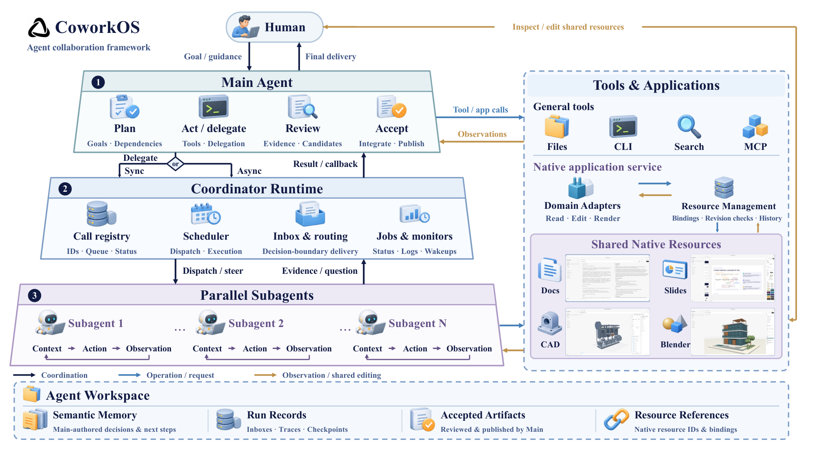
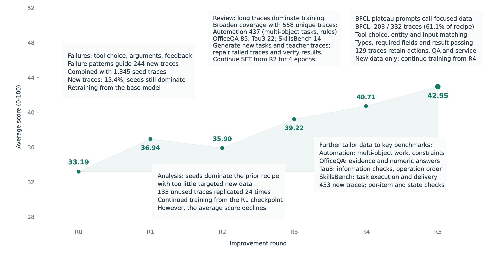

# CoworkOS：把「同事型 Agent」做成一层长期运行的运行时

## 来源信息

| 项 | 内容 |
| --- | --- |
| 标题 | CoworkOS: Scaling Agent Coworkers for Real-world Automation |
| 作者/机构 | CoworkOS Team，40 位作者；共同一作 Jiajie Jin、Guanting Dong、Chengjun Pan，通讯作者 Tao Gui、Yutao Zhu、Zhicheng Dou（p.22）。第一机构 Renmin University of China，另有 Fudan、Peking University、Shanghai Jiao Tong、NUS、ECNU |
| 来源 | arXiv:2611.03178v1（[abs](https://arxiv.org/abs/2611.03178v1) / [HTML](https://arxiv.org/html/2611.03178v1)） |
| 版本 | v1，2026-11-02 提交，34 页（含附录）；CC BY-NC-SA 4.0 |
| 项目页 / 代码 | [coworkos-ai.github.io](https://coworkos-ai.github.io/)；[github.com/RUC-NLPIR/CoworkOS](https://github.com/RUC-NLPIR/CoworkOS)（MIT） |
| 阅读日期 | 2026-11-04 |
| 阅读范围 | arXiv v1 全文 34 页（§1–§6 + 附录 A.1–A.3）；Table 1/2 逐格核对，Figure 2/7/8 读渲染页与矢量源；未复现实验、未运行仓库代码。版本、核对手段与复核记录见同目录 `audit.md` |

---

## 核心结论

一句话：**CoworkOS 不是模型，而是跑在模型和真实工作之间的一层 harness（运行时）——模型只负责决策（做什么、派给谁、接不接受结果），运行时负责保存状态、传递反馈、维持长周期执行。**

- **问题**：多数现有 harness 主要优化「单次任务的完成质量」；而真实协作还要跨应用、跨会话延续——任务会中断、上下文会被压缩、人会中途改文件，CoworkOS 想补的正是「任务之间的延续性」这一半。
- **核心想法**：把「权威」与「执行」分开——Main Agent 对用户负责、做全局规划与验收；Coordinator Runtime 维护持久队列与状态，负责派发、监控、把结果送回来；可选 Subagent 拿独立上下文做局部作业。
- **怎么做到**：三者之间交换的不是完整轨迹，而是「有界背景 + 证据引用 + 状态」；人机共用同一份应用对象，所有写操作走带版本号与冲突检测的资源协议；跨会话状态由分层工作区、语义记忆和有进程与日志的后台 Job 承载，阶段切换时用语义记忆重建上下文。
- **关键结果**：12 个基准固定同一个 GLM-5.3，CoworkOS 在 Productivity（57.54）与 ML Coding（56.26）两个域第一，Tool Use 与 Search 第二；四域均值再平均 62.79，高于 DSH 61.06、OpenHands 58.37、Codex 52.62（本笔记复算）。另有一个五轮 RSI 案例，八基准均值 33.19→42.95，但只有一条轨迹、没有对照。
- **一句话定位**：这是一篇「harness 系统工程 + 一个应用示范」的技术报告；实验用来证明「这套东西能用」，而不是定位「哪个组件带来多少增益」。

---

## 问题

论文把 agent 系统的演进分成三段（§1）：**Agent Workflow**（CoT / ReAct / Reflexion 这类轨迹编排）→ **Agent Assistant**（LangGraph、AutoGen 这类带记忆与工具接口的常驻助手）→ **Agent Cowork**（人机共同推进一份不断变化的交付物，如 Claude Code、Codex、OpenHands、DeepSeek Harness）。它要解决的是第三段的问题，而前两段留下的工程假设不再够用。

把 §1–§3 的问题设定摊开，可以看到三个不再成立的假设（本笔记归纳）：

1. **一次任务、一个上下文窗口**。单次任务的 harness 可以把整条轨迹放进一个上下文，靠 ReAct 循环推进。长周期协作不行：任务跨天、跨应用、跨会话，中间要等计算、等人、等外部状态变化，上下文迟早被压缩或重置；压缩之后「我是谁、做到哪、为什么停」必须能重建。
2. **状态可以由模型自己记住**。对话式记忆能影响下一次怎么想，但不能保证消息送达、执行没丢、重启后还能接上。长任务需要的是可观察、可恢复的执行状态，不是一段摘要文本。
3. **一份产物只有一个作者**。真实协作里同一份文档、演示、CAD 模型会同时被对话讨论、被人手改、被一个 agent 检查、被另一个 agent 精修。若没有版本与冲突规则，最后一次写入就静默覆盖了别人的工作，贡献也无法归属。

论文用两个正交维度刻画 cowork 场景的要求（Figure 2a，p.3）：

- **Task complexity（任务复杂度）**：决策数量与相互依赖、要探索的分支、要组合的工具与证据。写软件、做研究、做设计属于这一类，哪怕不需要等待外部事件。
- **Temporal extent（时间跨度）**：目标要保持多久，包括等计算、等人、等环境变化。监控类任务可能几天只做几个决定，但必须一直「在线」。

两个维度都高的交集，论文举的例子就是 **RSI（recursive self-improvement）**：分析弱点 → 改数据管线 → 等训练与评测 → 用结果决定下一步。

**本文的设定与前提**：模型只做决策，所以前提是模型能力够用（实验固定 GLM-5.3，High thinking，256K 上下文）；人只对 Main 说话，这要求系统能给出一个可问责的解释（原文的工程实现方式是禁止 Subagent 直接接收用户输入）；共享产物要能被人和 agent 同时编辑，所以前提是每个应用有领域适配器，或通过声明资源操作的 MCP 服务接入；长任务要能跑下去，所以前提是外部环境提供一个可采样的状态源，否则运行时会拒绝「没有观察源也没有复盘时间」的等待。

**这不是「又一个 coding agent」**：多数现有 harness 主要优化第一个维度（一次任务的完成质量），CoworkOS 想同时覆盖第二个维度（任务之间的延续性）。原文只提出这两个维度，没有对现有 harness 做统计——这个判断是本笔记的读法。

---

## 核心想法

### 一句话

把「一个无所不知的 agent」拆成「一个负责任的经理 + 一个不会忘事的调度台 + 若干只带局部上下文的工人」。

三层是三种职责，不是三套流程：Main 拥有任务级决策，Subagent 拥有被圈定的作业，Coordinator 让两者之间的交换变得持久且可观察——真正被隔离的是上下文、权限与生命周期。

### 直觉：三处交换，三种「不共享」

1. **Main 与 Subagent 之间不共享上下文，只交换合同与证据。** 委派时必须写清目标、约束、授予的能力、以及边界上期望拿到什么形式的证据；Subagent 拿到的初始上下文是「作业 + 从 Main 历史里截出的有界近期背景 + 能力授权 + 一份精简 skill 目录」，完整 skill 正文要它自己按需去取。返回时只交报告、输出与支撑记录的引用、执行状态——中间轨迹留在运行时。
2. **Main 与 Subagent 之间不靠模型记忆传消息，而靠协调器的持久状态。** 派发、执行更新、消息、终态结果都是事件；队列、租约、确认保证「谁拥有这次执行、消息送到没有」不依赖模型的内存。
3. **人与 agent 之间不靠锁，而靠版本号。** 每个资源有身份、种类、应用自有内容和已提交修订号；任何编辑都要声明自己基于哪一版，基线过期就返回冲突，而不是静默覆盖。

### 为什么这能成立

- **上下文是稀缺资源，而 Main 的上下文要留给全局决策。** 如果把每个 Subagent 的完整轨迹都塞回 Main，长任务很快会把 Main 的窗口吃掉；用「有界背景 + 证据引用」换掉完整轨迹，等于让 Main 只读到可验收的那一层。
- **交换必须跨中断存活，所以状态要放在运行时。** 一次委派可能跨多个模型决策、跨上下文重置、跨 Main 重启；只有把队列、租约、确认、游标、检查点放在模型之外，才能在中途换一次上下文之后继续。
- **归属需要版本，所以并发控制放在资源协议里。** 基线版本让「我基于哪一版改的」变成可检查的事实；冲突返回而不是自动合并，让被拒的提案可以对着当前状态重新考虑，人机混编因此变成一条可审计的接受序列。

### 与已有做法的区别

| 维度 | 前两段的典型形态（本笔记归纳） | CoworkOS 的结构 |
| --- | --- | --- |
| 状态归属 | 轨迹编排或助手记忆，状态主要活在上下文里 | 运行时持有持久状态（协调器状态、任务状态、Job、Inbox） |
| 子任务 | 一次调用、结果回填；或共享同一段上下文 | 独立上下文 + 证据合同，返回引用而非轨迹 |
| 产物 | 工具调用改文件 | 版本化资源 + 冲突检测 + 候选与共享产物分离 |
| 长任务 | 等待即空转，重启即重来 | Job + 观察源 + 检查点，等待必须有依据 |

### 一个走通的例子（原文 §4.3 的 R2→R3）

RSI 案例的第二轮只用 135 条此前未用过的轨迹、靠重复采样撑起训练量，八基准均值反而从 36.94 掉到 35.90。复盘（§4.3.4）发现 **42 条轨迹贡献了 84.2% 的监督 token**——长轨迹吃掉了大部分监督，其余数据几乎没被学到。于是第三轮把独立集扩到 558 条、跑 4 个 epoch，均值回到 39.22。这一串「评测 → 查训练史 → 改数据配方 → 重训 → 再评测」正是 harness 要承载的循环：Job 等训练，台账记住每轮改了什么，下一轮从记忆与台账重建上下文，而不是靠人把上一次的结论复述给模型。

### 代价

- **成本从模型侧转到状态机侧。** 队列、租约、确认、游标、检查点、作用域都要实现和调试；论文用大篇幅写它们，说明真正的工程量在这里。
- **上下文重建每阶段付一次开销，且摘要会丢信息。** 作者的兜底是「摘要失败就保留旧历史」「不够就回读工作区与完整日志」——这是工程兜底，不是无损压缩。
- **单一责任人会变成单点。** 用户的话只进 Main，Subagent 不直接接用户输入；好处是可问责，代价是 Main 的决策节奏决定整条链路的响应速度（本笔记判断，原文未测量）。
- **异步与权限带来额外的协调复杂度。** Subagent 可以反向要一个决定，但必须带有界等待与声明式兜底假设；应用绑定切换时要停用上一个应用的工具，防止无关能力混进决策上下文。

---

## 方法

### 符号表

| 符号 | 含义 | 维度 / 取值 |
| --- | --- | --- |
| $g$ | 用户目标 | 文本 |
| $h_t^{\mathrm{M}}$ | Main 在第 $t$ 步保留的交互历史 | — |
| $\mathcal{F}_t$ | 第 $t$ 步新到达的反馈 | 执行结果、用户指示 |
| $\pi_{\mathrm{M}},a_t^{\mathrm{M}}$ | Main 的模型策略 / 第 $t$ 步动作 | — |
| $d_i$ | 第 $i$ 份委派（作业定义） | 目标、约束、证据形式 |
| $b(\cdot)$ | 从 Main 历史截取有界近期背景的投影 | 原文未给截取规则 |
| $\Gamma_i,\mathcal{S}_i$ | 授予 Subagent $i$ 的能力（工具与资源）/ 精简 skill 目录 | 完整 skill 正文按需取 |
| $\Phi_{\mathrm{S}},c_{i,0}$ | 组装 Subagent 上下文的函数 / 初始上下文 | — |
| $r_i$ | Subagent 返回的贡献 | $(y_i,P_i,\sigma_i)$ |
| $y_i,P_i,\sigma_i$ | 报告 / 输出与支撑记录的引用 / 执行状态 | — |
| $\xi_k$ | Coordinator 在第 $k$ 个事件后的状态 | 队列、租约、确认 |
| $e_{k+1},F_{\mathrm{C}}$ | 第 $k+1$ 个事件 / 协调器状态转移函数 | — |
| $r=(\iota,\kappa,x,v)$ | 资源四元组：身份 / 种类 / 应用自有内容 / 已提交修订号 | — |
| $u,\hat v,\alpha$ | 一次编辑操作 / 它声明的基线版本 / 操作者（人或 agent） | — |
| $T_\kappa$ | 按领域适配器语义应用改动的函数 | — |
| $z_k=(W_k,P_k,R_k)$ | 保留的任务状态：工作对象与产物引用 / 进度、决策、证据 / 在途执行与等待条件 | — |
| $c_k,\Phi$ | 第 $k$ 次决策的上下文 / 上下文组装函数 | — |
| $L$ | 上下文 token 上限 | 原文未给数值；实验设置为 256K 上下文 |
| $m_T$ | Main 维护的语义记忆文档 | 目标、已完成、下一步、约束 |
| $\rho_T(t),d_T(t)$ | 运行时的结构化目标状态投影 / 实验台账摘要 | 阶段切换时使用 |
| $\Phi_{\mathrm{ctx}},\oplus$ | 上下文重建函数 / 拼接保留的近期历史 | — |
| $h_{t,\mathrm{recent}}^{\mathrm{M}}$ | 保留的近期历史 | 显式 reset 时为空 |

### 数据流

一次任务从用户话到可验收产物，走这六步（本笔记按 §3.1–§3.3 归纳）：

1. 用户只对 Main 说话；Main 用 $g$、自己的历史 $h^{\mathrm{M}}$、新反馈 $\mathcal{F}$ 决定下一步动作。
2. 需要局部作业时，Main 写一份证据合同 $d_i$，Coordinator 组装 $c_{i,0}$ 并把作业派给 Subagent。
3. Subagent 在自己的上下文里干活，返回 $r_i=(y_i,P_i,\sigma_i)$；Coordinator 只把报告、证据引用与状态转交 Main，详细轨迹留在运行时。
4. 任何写操作都过资源协议的 $\operatorname{Commit}$；基线与已提交版本不一致就返回冲突。
5. 长计算交给 Job，Main 在等待期继续别的决策；Job 的进程、日志与唤醒条件都是持久状态。
6. 回合结束或上下文重置时，运行时 checkpoint 轨迹与摘要；下一阶段用 $m_T$、$\rho_T$、$d_T$ 重建任务上下文。



### Main 的动作抽样

```math
a_t^{\mathrm{M}} \sim \pi_{\mathrm{M}}\left(\cdot \mid g,\; h_t^{\mathrm{M}},\; \mathcal{F}_t\right)
```

逐项读法：第 $t$ 步的动作由模型策略 $\pi_{\mathrm{M}}$ 采样，条件里只有三样东西——用户目标 $g$、Main 保留的交互历史 $h_t^{\mathrm{M}}$、新到达的反馈 $\mathcal{F}_t$（执行结果、用户指示）。这条式子本身没有新东西，它真正定义的是**什么不该进 Main 的上下文**：Subagent 的中间轨迹不在条件里。

### 一次委派与一次返回

```math
c_{i,0}=\Phi_{\mathrm{S}}\left(d_i,\; b(h_{t_i}^{\mathrm{M}}),\; \Gamma_i,\; \mathcal{S}_i\right)
```

逐项读法：$d_i$ 是作业定义，$b(h^{\mathrm{M}})$ 是从 Main 历史里截出的**有界**近期背景，$\Gamma_i$ 是工具与资源授权，$\mathcal{S}_i$ 是精简 skill 目录（正文按需再取）。返回的贡献是 $r_i=(y_i,P_i,\sigma_i)$：报告、输出与支撑记录的引用、执行状态。这四样合起来就是一份「证据合同」——Main 只承诺验收什么，不承诺关心过程。

### Coordinator 的状态转移

```math
\xi_{k+1}=F_{\mathrm{C}}\left(\xi_k,\; e_{k+1}\right)
```

逐项读法：协调器状态 $\xi$ 只由事件驱动——委派请求、执行更新、消息、终态结果。它不随模型上下文变化，所以跨多次模型决策、上下文重置甚至 Main 重启都能接上；队列、租约、确认保证「谁拥有这次执行、消息送到没有」不依赖模型的内存记忆。

三条通信方向各有边界：Main → Subagent 走派发与运行中的追加约束；Subagent → Subagent 只有同一 Task/Run 内的**最小对等通道**（一段短文本或文件引用，经 Coordinator 持久化到收件人 Inbox，收件人在之后的决策边界才看到），不形成第二套控制层级；Subagent → Main 只回报告、状态与引用，异步时先回 ack 与 call ID，终态之后进 Main 的 Inbox。异步 Subagent 也可以反向要一个决定，但必须带有界等待与声明式兜底假设，避免把运行时无限期挂住。

### 资源的提交规则

资源建模成 $r=(\iota,\kappa,x,v)$；所有编辑（人和 agent 一样）走同一条准入规则：

```math
\operatorname{Commit}(r,u,\hat{v},\alpha)=
\begin{cases}
(\iota,\kappa,T_{\kappa}(x,u,\alpha),\,v+1), & \hat{v}=v,\\
\text{conflict}, & \hat{v}\neq v,
\end{cases}
```

逐项读法：$u$ 是这次操作，$\hat v$ 是它声明的基线版本，$\alpha$ 是操作者，$T_\kappa$ 按该领域适配器的语义应用改动。**基线过期就返回冲突，而不是静默覆盖**；被拒的提案保留下来，可以对着当前状态重新考虑。这条规则把「人机混编」变成一条可审计的接受序列；配套的是「候选与共享产物分离」（Subagent 在私有区做候选，Main 决定是否入库，入库时再重校验）与「应用绑定」（换绑定时停用上一个应用的工具）。集成有两条路：**原生应用**（文档、演示、参数化 CAD、Blender，资源归平台管，人可直接编辑）与 **MCP 集成**（外部原生窗口或内嵌视图，应用自己拥有文档与并发语义）；外部应用不暴露资源操作时，平台不声称提供修订与历史保证。浏览器/桌面操作是正交的交互模式，人可以随时接管窗口。

### 每次决策的上下文（含原文 Eq (9) 的 token 约束）

```math
c_k=\Phi\left(g,\; h_k,\; z_k\right),\qquad \operatorname{tokens}(c_k)\le L
```

逐项读法：$z_k=(W_k,P_k,R_k)$ 是运行时保留的任务状态——工作对象与产物引用、进度/决策/证据、在途执行与等待条件。上下文不是「所有历史的拼接」，而是「目标 + 历史 + 当前任务状态」经 $\Phi$ 组装，并受 token 上限 $L$ 约束。

### 阶段切换时的任务上下文重建

```math
c_{t,\mathrm{task}}^{\mathrm{M}}=\Phi_{\mathrm{ctx}}\left(m_T,\; \rho_T(t),\; d_T(t)\right)\oplus h_{t,\mathrm{recent}}^{\mathrm{M}}
```

逐项读法：$m_T$ 是 Main 自己维护的语义记忆文档（目标、已完成、下一步、约束），$\rho_T$ 投影出运行时的结构化目标状态，$d_T$ 是实验台账摘要，$\oplus$ 拼上保留的近期历史；显式 reset 时近期历史为空。请求 reset 之前，Main 被要求先更新记忆——这是给模型的**指令性要求**，不是运行时强制的校验。摘要不够用时，Main 可以回工作区看材料与完整交互日志，也可以读应用当前状态来对齐「我暂停期间别人改了什么」。

### 状态管理：Job、监控源与台账

- **后台 Job**：长计算有持久身份、进程记录与日志，能跨对话轮次、上下文重置、Main 重启继续跑；Main 靠进程存活、已用时间、日志活跃度、最近输出判断该等还是该介入。失败态是**进程消失但没有记录退出码**，结果就不确定，只能留着日志去查。
- **确定性监控源**：外部状态用脚本按基线采样比对，**没变化就不调用模型**；采样节奏与 Main 的目标复盘节奏解耦——这是「长时间在线但少烧 token」的关键。
- **拒绝空等**：Main 停摆前必须记录进度、等待条件、下一步；持续目标必须有活跃观察源或明确的复盘时间，**两者都没有的等待会被运行时直接拒绝**。
- **检查点与重放**：监控源把游标与已发出的事件一起提交，事件保留到持久 Inbox 接收为止；稳定 ID 抑制重放时的重复投递；反馈在**进入 Main 已保存的上下文之后**才被 ack。
- **工作区作用域**：agent 工作区跨 Run 持久，每个 Run 保留自己的事件、检查点与结果；默认只写自己的工作区，除非显式授权；Subagent 把可复用产出放进交付区，由 Main 审阅后发布到 Task 的产物区。
- **实验台账**：按 Task 记录实验目标、被委派的 Run、候选变体、产物与指标，并**区分「从指标文件读到的测量值」与「只在叙述报告里出现的值」**——一个很小的防幻觉设计。

### 与已有方法的结构差异

- **vs 单上下文长对话 agent**：把「记不住」的问题从提示工程挪到运行时——状态在 $\xi$、$z$、Job、Inbox 里，不在对话历史里。
- **vs 多 agent 协作**：Subagent 之间只有最小的对等通道（短文本或文件引用，由 Coordinator 持久化到收件人 Inbox），不形成第二套控制层级。
- **vs 带记忆的助手**：记忆是文本，只能影响下一次怎么想；这里的台账与工作区能支撑「这轮改了什么、上轮为什么掉分」这类可核对的追问。
- **vs 轨迹编排（Agent Workflow）**：决策仍由模型做，运行时只保证交换持久、可观察、可恢复，不替模型规划。

---

## 主要结果

**设置**（§4.1.1）：GLM-5.3，High thinking，256K 上下文，单次回复最多 64K token；OpenHands、Codex、DSH、CoworkOS 四个 harness 用同一个模型，因此比的是 harness 差异。12 个基准分四域：Tool Use（SkillsBench、τ³-Bench Banking、AutomationBench）、Productivity（JobBench、Harvey Legal Agent Bench、GDPVal、OfficeQA Pro、WorkspaceBench-Lite）、Search（WideSearch、BrowseComp）、ML Coding（MLE-Bench-Lite、MLS-Bench）。

| 域 | 基准 | OpenHands | Codex | DSH | CoworkOS |
| --- | --- | :-: | :-: | :-: | :-: |
| Tool Use | SkillsBench | 63.30 | 53.48 | 56.75 | **64.34** |
| | τ³-Bench Banking | 40.20 | 46.39 | **55.67** | 49.48 |
| | AutomationBench | 50.50 | 30.33 | **53.50** | 51.83 |
| | 均值 | 51.33 | 43.40 | **55.31** | 55.22 |
| Productivity | JobBench | 55.02 | 23.42 | 56.15 | **59.88** |
| | Harvey Legal Agent Bench | **23.75** | 12.70 | 22.30 | 22.74 |
| | GDPVal（Elo） | 1122 | 925 | 1157 | **1164** |
| | OfficeQA Pro | 66.20 | **66.30** | 62.30 | 65.90 |
| | WorkspaceBench-Lite | 64.54 | 58.81 | **68.76** | 67.14 |
| | 均值 | 55.27 | 40.11 | 56.13 | **57.54** |
| Search | WideSearch | 81.43 | 82.05 | 72.48 | **82.47** |
| | BrowseComp | **83.00** | 75.50 | 80.80 | 81.80 |
| | 均值 | **82.22** | 78.78 | 76.64 | 82.14 |
| ML Coding | MLE-Bench-Lite | 60.40 | 67.28 | 76.70 | **76.90** |
| | MLS-Bench | 28.91 | 29.05 | 35.57 | **35.62** |
| | 均值 | 44.66 | 48.17 | 56.14 | **56.26** |

*Table 1（p.15）。加粗为本笔记标注的行内最高分；原文用粗体/下划线区分最高与次高，原值未改动。*

- **「整体最强」是口径依赖的**：CoworkOS 只在 Productivity 与 ML Coding 第一，Tool Use（55.22 vs DSH 55.31）与 Search（82.14 vs OpenHands 82.22）都是第二。它能拿下整体第一，靠的是「四个域均值再等权平均」（62.79 vs 61.06），而 Search 只有 2 个基准、Productivity 有 5 个；换成「11 个百分制基准直接平均」结论不变（59.83 vs 58.27）。**领先量只有 1.5–1.7 分，且 12 个基准里有 6 个不是它第一。**
- **能力画像不是单一缺口**：第一项集中在技能调用（SkillsBench）、业务交付（JobBench）与检索（WideSearch）；没拿第一的六项分布在异质任务上——τ³ 低 6.19 分、AutomationBench 低 1.67 分、OfficeQA 低于 OpenHands 与 Codex、Harvey 22.74 低于 OpenHands 的 23.75、WorkspaceBench-Lite 低于 DSH、BrowseComp 低于 OpenHands。
- **域均值不是 12 项直接平均**：GDPVal 进 Productivity 均值时用的是**平局调整胜率**，不是表里显示的 Elo；且 GDPVal 把超时、call-gate exhaustion 等无效结果一律按 loss 计。所以这个域均值同时反映任务质量与执行可靠性，读表时不能把 Elo 1164 当成均值成分。
- **定性交付物**：§4.2 比较了 24 个案例（4 前端、4 游戏、4 Office 演示、8 交互可视化、2 CAD 装配、2 Blender 渲染），A.2 的统计是 72 份产物（24 × 3 个 harness）。作者的观察集中在「多了什么」——更完整的场景元素、更少溢出、更清楚的层次；附录同时声明这些观察不支持算法等价性、用户理解、历史准确性、可制造性，并主动列了 CoworkOS 自己的反例。
- **RSI 案例**：以 GLM-5.3 为控制器与数据老师，驱动 Qwen3.6-35B-A3B 做五轮自动后训练，八基准均值 33.19 → 42.95（+9.76）；8 个基准里 7 个终态高于 R0，唯一例外是 JobBench（20.53 < 22.66）。但 R1 是从 base 重跑而不是从 R0 续训，各轮又同时改了数据配方、起点、epoch、采样倍数与步数，所以这条曲线不能读成逐轮边际收益。



---

## 边界与局限

**作者明确承认的**：

- 定性比较的结论限于「可读性与组织度」，且案例间差异很大：A.2 主动列了 CoworkOS 自己的反例（VESPER Speaker、Saturn Atlas）。
- RSI 实验的每轮改动是**并发干预**，不是孤立因果（Figure 8 图注原文：「These changes describe concurrent interventions rather than isolated causal effects」）。
- Blender 评测用 GLB 导出、不含动画，视图用的是各交付物自带的材质与展示设置、不是统一校准灯光；CAD 只验证原生可读与外观，不验证参数可编辑、公差与可制造性。

**根据证据提出的判断**：

- **「持续监控」这一半主张没有定量证据**。12 个基准的评测单元都是单次 episode（τ³ 97 题、JobBench 65 题、GDPVal 220 题等，见 A.1），没有跨天监控任务；唯一的长期案例是五轮后训练，只有一条轨迹，也没有「人来做」「另一个 harness 来做」的对照。Job、唤醒、断点恢复没有任何成功率、恢复时延或误唤醒率的测量。
- **RSI 的评测集同时也是诊断集**：用这 8 个基准的分数决定下一轮改什么，再用同一批基准汇报提升；BM25 相似度 0.8 的过滤只挡近重复，挡不住「按测试集调配方」。
- **单模型结论**：harness 对比固定 GLM-5.3，RSI 里 GLM-5.3 只作控制器与数据老师；两组结果都不能说明这套 harness 对别的模型也成立。
- **没有成本、时延与稳定性数据**：无每任务 token、wall-clock、失败率、重试次数、并发上限——对一个主打「跑几天」的系统，这些恰恰是工程上最先被问的。

---

## 与其他工作的关系

- **00189 HarnessDev / 00218 HarnessPro / 00212 RRSI / 00220 Harness²**：据各自标题与主题，这几篇改的是 **harness 本身**；CoworkOS 的 RSI 章节改的是**被训练的模型**，harness 是固定的执行者。读的时候要分清「谁在进化」。
- **00185 LongHorizon-Harness（Alibaba，尚无笔记）**：主题最接近（长周期真实任务），可作为「长任务 harness」的第二条对照线。
- **00206 Recursive Experiential-Working Memory Evolution for Long-Horizon Agent Harnesses（NUS，尚无笔记）**：与 CoworkOS 的记忆/上下文重建直接可比；CoworkOS 的差异是把记忆与**产物版本**绑在一起。
- **00221 Super-agent 设计探索（DeepSeek Harness 团队）**：与本文基线 DSH 同名，两边的「主 agent + 子 agent + 上下文管理」叙事可以互证（未核对产品版本对应）；CoworkOS 的 τ³、AutomationBench 分数明显低于 DSH，说明分层并不自动等于更强。

<!-- 复核档案见同目录 audit.md（不随站点发布） -->
