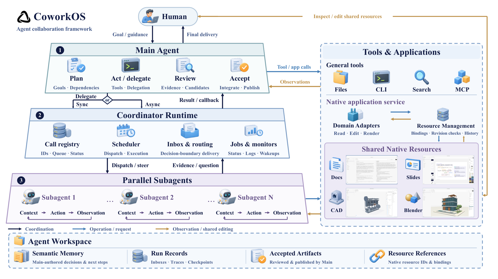
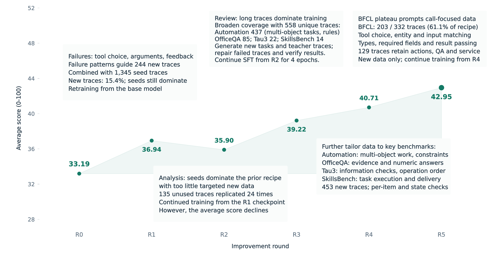

# CoworkOS：把「同事型 Agent」做成一层长期运行的运行时

| 项目 | 内容 |
| --- | --- |
| 标题 | CoworkOS: Scaling Agent Coworkers for Real-world Automation |
| 作者/机构 | CoworkOS Team，40 位作者（共同一作 Jiajie Jin、Guanting Dong、Chengjun Pan；通讯作者 Tao Gui、Yutao Zhu、Zhicheng Dou，见 p.22 的 Author Contributions）。第一机构 Renmin University of China；其余为 Fudan University、Peking University、Shanghai Jiao Tong University、National University of Singapore、East China Normal University |
| 来源 | arXiv:2611.03178v1，[abs](https://arxiv.org/abs/2611.03178v1) / [HTML](https://arxiv.org/html/2611.03178v1) |
| 版本与日期 | v1，2026-11-02 提交；34 页（含附录）；许可 CC BY-NC-SA 4.0（abs 页 view license 指向 by-nc-sa/4.0） |
| 项目页 / 代码 | [coworkos-ai.github.io](https://coworkos-ai.github.io/)（2026-11-04 复核可达，HTTP 200）；[github.com/RUC-NLPIR/CoworkOS](https://github.com/RUC-NLPIR/CoworkOS)（MIT，2026-11-03 创建，2026-11-04 查询时 112 stars；仓库顶层含 `src/`、`desktop/`、`web/`、`e2e/`、`test/`，`package.json` 的开发依赖含 `electron ^41.10.7`。本次只核到存在性与目录结构，未验证其与论文实验的可复现性对应） |
| 阅读日期 | 2026-11-04 |
| 阅读范围 | arXiv v1 全文 34 页（正文 §1–§6 + 附录 A.1–A.3）通读；Table 1（p.15）与 Table 2（p.33）、轮次沿革表（p.34）在 170–200 dpi 渲染页上逐格核对，行内最高值的粗体归属另用 `page.get_text('dict')` 的 span 字体（`XCharter-Bold`）复核；Figure 2 用 arXiv HTML 的 Figure 2 原图（1579×1075）并与 PDF p.3 渲染页对照，Figure 7/8 用论文矢量源（`rsi-benchmarks.svg`、`rsi-average.svg`）以 `magick -density 300` 渲染（输出 2518×1168 / 2656×1418）后读取标签。Table 1/2 的域均值、Δ 列、8 基准均值均按表内数值复算。**未做**像素级曲线读数（Figure 7 的数值标签与 Table 2 完全一致，读数改以表为准）、未复现实验、未运行仓库代码 |
| 版本备注 | 本次抓取的 arXiv v1 PDF：26,956,587 B，sha256 `0db3eb94695af5b2bd6c6da600691091202d5e0df79d850ca734f2a85493cf15`，34 页，2026-11-04 下载；按 arXiv 规则不归档。仓库内 `CoworkOS_paper.pdf` 为同一稿的 1.65 MB 压缩版（34 页，producer `iLovePDF`，创建 2026-11-03）；逐页比对两版抽取文本，唯一差异是正式版 p.1 多一行 arXiv 版本水印（`arXiv:2611.03178v1 [cs.AI] 2 Nov 2026`），其余 33 页文本一致（作者与机构名单在 p.22，不在 p.1） |
| 复核记录 | 2026-11-04 第一轮，见下 |

## 复核记录

- **基准**：arXiv:2611.03178v1。本轮重新下载 PDF，sha256 与笔记记录一致（`0db3eb94…cf15`），确认基准未变；arXiv abs 页复核仍只有 v1。重新以 200 dpi 渲染 p.3（Figure 2）、p.15（Table 1）、p.21（Figure 8）、p.33（Table 2）、p.34（轮次表），Table 1/2 的 48+48 个分数、Δ 与均值另用脚本做「按序子序列」比对并与渲染页逐格对照；粗体归属用 `XCharter-Bold` 判定。图核对凭据按实际输出记录：`magick -density 300` 输出 2518×1168 / 2656×1418（约 225 dpi），不写成「300 dpi」。
- **修正**：① 通讯作者标注（原写「通讯：Jiajie Jin…」有误，Jiajie Jin 是共同一作）；② 两版 PDF 的差异原因（实为 p.1 的 arXiv 水印，不是作者/机构排版）；③ MCP 集成的保证边界（声明资源操作的 MCP 服务**可以**参与修订检查与历史，只有直接控制外部软件的集成才退回 session descriptor）；④ R1 从 base 重训的出处（§4.3.4 正文 p.21 也提到，不只在图注与附录）；⑤「所有实验固定 GLM-5.3」限定为 harness 对比实验；⑥ 雷达图排除 OfficeQA 的理由无法用「量纲」解释；⑦ 工作区作用域写成 agent / Run / session（原先误写为 agent / Run / Task）；⑧ 补写「请求 reset 前先更新记忆」这一要求，并指明它是指令性而非运行时强制。
- **补充**：GDPVal 的无效分数（超时、call-gate exhaustion）按 loss 计；Figure 8 横轴是轮次编号、不代表实际时间；A.1 的逐基准步数/时限/GPU 预算；Blender 视图不是统一校准灯光；R2 的「135 条 × 24 次」与 A.3 表注「新 24× / 旧 1×」的口径差异。
- **未核**：项目页与 GitHub 只核可达性与顶层结构（star 数随时间变化），未验证可复现性；基准侧依赖的外部检索服务（Serper、Jina）与 H200 环境未核。许可已复核：abs 页 `view license` 指向 CC BY-NC-SA 4.0。

## 一、核心结论

CoworkOS 不是一个模型，而是一层**跑在模型和真实工作之间的 harness（运行时）**。它的分工是：**模型只负责决策**（做什么、派给谁、接不接受结果），**运行时负责保存状态、传递反馈、维持长周期执行**。围绕这条分工，论文给出三块东西：

- **三层运行时**：Main Agent（对用户负责、做全局规划与验收）→ Coordinator Runtime（派发、监控、把结果按持久队列送回来）→ 可选的 Subagent（拿独立上下文干局部活，同步或异步）。
- **人机共用同一份应用对象**：文档、演示、参数化 CAD、Blender 场景都走一套带版本号与冲突检测的资源协议，人可以说话下指令，也可以直接改文件；Agent 看到的是「你改了哪一版」。
- **跨会话的持久状态**：分层工作区 + 语义记忆 + 长任务的 Job（有进程、日志、唤醒条件），使得中断、重启、上下文压缩之后还能接着干。

评测有三块（§4.1 基准、§4.2 定性交付物、§4.3 RSI 案例）。其中两块定量评测性质差别很大，读的时候要分开：

1. **静态基准对比**（Table 1，12 个基准 / 4 个域，全部 harness 固定用 GLM-5.3）：CoworkOS 在 Productivity（57.54）和 ML Coding（56.26）两个域均值第一，在 Tool Use（55.22 vs DSH 55.31）和 Search（82.14 vs OpenHands 82.22）第二。按「四个域均值再平均」得 62.79，高于 DSH 的 61.06、OpenHands 的 58.37、Codex 的 52.62（本笔记复算）；按「11 个百分制基准直接平均」也是第一（59.83 vs 58.27）。**但领先幅度不大，且 12 个基准里有 6 个不是第一**，说「最强的整体性能」时要带上这个口径。
2. **一个 RSI 案例研究**（Table 2）：用 GLM-5.3 当控制器与数据老师，驱动 Qwen3.6-35B-A3B 做五轮自动后训练，八个基准的均值从 33.19 升到 42.95（+9.76）。这一块**只有一条轨迹、没有对照组、没有重复实验**，各轮之间同时改动了数据配方、起点（R2 起换检查点）、epoch（R3 起改为 4）、采样倍数与步数（作者在 Figure 8 图注里自己写明「并非孤立因果效应」）。

一句话定位：**它更像一篇「harness 系统工程 + 一个应用示范」的技术报告，而不是一篇方法学论文**——设计描述占了绝大部分篇幅，实验是用来证明「这套东西能用」，而不是用来定位「哪个组件带来了多少增益」。

## 二、问题与动机

论文把 agent 系统的演进分成三段（§1）：**Agent Workflow**（CoT / ReAct / Reflexion 这类轨迹编排）→ **Agent Assistant**（LangGraph、AutoGen 这类带记忆与工具接口的常驻助手）→ **Agent Cowork**（人机共同推进一份不断变化的交付物，如 Claude Code、Codex、OpenHands、DeepSeek Harness）。

它认为 cowork 场景对系统的要求是**两个正交维度**（Figure 2a，p.3）：

- **Task complexity（任务复杂度）**：决策数量与相互依赖、要探索的分支、要组合的工具与证据。写软件、做研究、做设计属于这一类，哪怕不需要等待外部事件。
- **Temporal extent（时间跨度）**：目标要保持多久，包括等计算、等人、等环境变化。监控类任务可能几天只做几个决定，但必须一直「在线」。

两个维度都高的交集，论文举的例子就是 **RSI（recursive self-improvement）**：分析弱点 → 改数据管线 → 等训练与评测 → 用结果决定下一步。

这个二维框架是全文的组织轴，也是它相对「又一个 coding agent」的差异点。**本笔记的判断是**：多数现有 harness 主要优化第一个维度（一次任务的完成质量），CoworkOS 想同时覆盖第二个维度（任务之间的延续性）——原文只提出这两个维度，没有对现有 harness 做统计。

## 三、方法与贡献

### 3.1 三层运行时：把「权威」和「执行」分开

设计动机写得很直白（§3.1）：长周期协作里有一对矛盾——**全局一致性**（必须有一个对用户目标负责的解释）与**局部并行**（上下文很重的调查要能独立跑、能从中断里恢复）。解法是分离权威与执行：Main 拥有任务级决策，Subagent 拥有被圈定的作业，Coordinator 让两者之间的交换变得**持久且可观察**。



**Main Agent** 是系统对用户的唯一责任人：解释指令、在需要全局上下文时自己动手、在用户改目标时修订在途工作；它拿到完整工具集与按需加载的 skill 文档。它的动作抽样写成

```math
a_t^{\mathrm{M}} \sim \pi_{\mathrm{M}}\left(\cdot \mid g,\; h_t^{\mathrm{M}},\; \mathcal{F}_t\right)
```

读法：第 `t` 步的动作由模型策略决定，条件里只有三样东西——用户目标 `g`、Main 保留的交互历史 `h`、以及新到达的反馈 `F`（执行结果、用户指示）。这条式子本身没有新东西，它真正定义的是**什么不该进 Main 的上下文**：Subagent 的中间轨迹不在里面。

**一次委派被定义成一份「证据合同」**：Main 必须写清目标、约束、授予的能力、以及边界上期望拿到什么形式的证据。Subagent 的初始上下文是

```math
c_{i,0}=\Phi_{\mathrm{S}}\left(d_i,\; b(h_{t_i}^{\mathrm{M}}),\; \Gamma_i,\; \mathcal{S}_i\right)
```

读法：作业 `d_i` + 从 Main 截取的**有界**近期背景 `b(·)` + 能力授权 `Γ`（工具与资源）+ 一份精简的 skill 目录 `S`；完整 skill 正文要 Subagent 自己按需去取。返回的贡献是 `r_i = (y_i, P_i, σ_i)`，即报告、输出与支撑记录的引用、执行状态。

**Coordinator** 是控制面：派发时组装 worker 上下文，返回时只把报告、证据引用和精简状态交给 Main，详细轨迹另存。关键在于这些交换要跨多次模型决策和中断存活，所以它有自己的一份持久状态：

```math
\xi_{k+1}=F_{\mathrm{C}}\left(\xi_k,\; e_{k+1}\right)
```

读法：协调器状态 `ξ` 只由事件驱动——委派请求、执行更新、消息、终态结果。队列、租约（lease）、确认（ack）保证「谁拥有这次执行、消息送到没有」不依赖模型的内存记忆。

### 3.2 三条通信路径，以及一个刻意的「不让 Subagent 直接见用户」

§3.1.2 把通信图写成 Main 与 Subagent 的混合图（层级边 + 对等边），并规定三条方向：

| 路径 | 机制 | 设计意图 |
| --- | --- | --- |
| Main → Subagent | 派发时给目标/背景/约束/证据形式/能力授权；运行中可入队「修正、新约束、追加要求」，在 worker 的安全决策边界被吸收；取消走独立控制通道 | 不复制 Main 的完整历史，只传局部决策够用的上下文 |
| Subagent → Subagent | 同一 Task/Run 内的**最小对等通道**：发一段短文本或文件引用给未终止的同伴，由 Coordinator 持久化到收件人 Inbox 并返回消息 ID；收件人在之后的决策边界才看到，且带发送者身份 | 解决「我依赖另一个 worker 的接口/假设」这类局部依赖，但**不把对等通信变成第二套控制层级** |
| Subagent → Main | 完成/失败时返回报告 + 状态 + 输出与诊断引用；异步时先回 ack 与 call ID，终态结果之后进 Main 的 Inbox 并可触发一次新的 Main turn | 让 Main 在等待期间继续做别的事；只在验收依赖它时才显式等待 |

两个细节值得记：

- **Subagent 不直接接收用户输入**。用户的话只进 Main，由 Main 判断它对全局目标的影响，再决定改/继续/取消委派。这是「一个可问责的解释」的工程实现方式。
- **异步 Subagent 可以反向要一个决定，但必须带「有界等待 + 声明式兜底假设」**，避免 worker 把运行时无限期挂住。

### 3.3 应用生态：版本号才是人机协作的接缝

§3.2 的问题设定很准确：长周期协作很少待在一个应用里，**同一份产物会同时被对话讨论、被人手改、被一个 agent 检查、被另一个 agent 精修**；中心问题不是「怎么调工具」，而是**资源状态的连续性**——每个参与者必须基于一个已知版本行动，且自己的贡献在产物被别人改动后仍然可归属。

资源被建模成 `r = (ι, κ, x, v)`：身份、种类、应用自有内容、已提交修订号。所有编辑（人和 agent 一样）走同一条准入规则：

```math
\operatorname{Commit}(r,u,\hat{v},\alpha)=
\begin{cases}
(\iota,\kappa,T_{\kappa}(x,u,\alpha),\,v+1), & \hat{v}=v,\\
\text{conflict}, & \hat{v}\neq v,
\end{cases}
```

读法：`u` 是这次操作，`v̂` 是它声明的基线版本，`α` 是操作者（人或 agent），`T_κ` 按该领域适配器的语义应用改动。**基线过期就返回冲突，而不是静默覆盖**；被拒的提案保留下来，可以对着当前状态重新考虑。这条规则把「人机混编」变成了可审计的接受序列。

配套的两个设计：

- **候选与共享产物分离**：Subagent 可以拿读权限、在自己的私有区做出候选，交回时带报告与证据，由 Main 决定是否入库；入库时再按上式重校验。
- **应用绑定（binding）**：绑定把当前资源与它的工具、skill、工作流指令绑在一起；换绑定时运行时更新作用域并**停用上一个应用的工具**，防止无关应用的能力悄悄混进决策上下文。

集成有两条路：**原生应用**（文档、PPTist 演示、参数化 CAD、Blender，资源归平台管，人可以直接编辑，Agent 通过领域工具读到已提交状态）与 **MCP 集成**（FreeCAD、Blender 用外部原生窗口，CAD 与 OfficeHarness 用内嵌视图；应用自己拥有文档、保存与并发语义）。论文明确划了边界：如果外部应用不暴露资源操作，平台就**不声称**自己提供修订与历史保证。浏览器/桌面操作被定位成正交的交互模式，而不是第三种资源协议——人可以随时接管窗口。

### 3.4 状态管理：Job、检查点、记忆与上下文重建

§3.3 把保留的任务状态写成 `z_k = (W_k, P_k, R_k)`：工作对象与产物引用、进度/决策/证据、在途执行与等待条件。这一节是全文最「工程」的部分，几条机制值得单独拎出来：

- **后台 Job**：长计算有持久身份、进程记录与日志，能跨对话轮次、上下文重置、Main 重启继续跑。Main 靠**进程存活、已用时间、日志活跃度、最近输出**判断该等还是该介入。作者也承认一种失败态：**进程消失但没有记录退出码时，结果就是不确定的**，只能留着日志去查。
- **确定性监控源**：外部状态用脚本按基线采样比对，**没变化就不调用模型**；候选事件可以直接送 Main，也可以先做语义分析。采样节奏与 Main 的目标复盘节奏解耦——这是「长时间在线但少烧 token」的关键。
- **拒绝空等**：Main 停摆前必须记录进度、等待条件、下一步；持续目标必须有一个活跃的观察源或明确的复盘时间，**两者都没有的等待会被运行时拒绝**。
- **检查点与重放**：监控源把游标与已发出的事件一起提交，事件保留到持久 Inbox 接收为止；稳定 ID 抑制重放时的重复投递；反馈在**进入 Main 已保存的上下文之后**才被 ack。回合结束时会 checkpoint 消息轨迹、压缩摘要、以及「摘要段与保留段的分界位置」。
- **工作区作用域**：agent 工作区跨 Run 持久，每个 Run 保留自己的事件、检查点与结果；默认只能写自己的工作区，除非显式授权扩展到被编辑的项目；Subagent 把可复用的产出放进交付区并回引用，由 Main 审阅后发布到 Task 的产物区。

**上下文重建**是它对抗长任务的核心手段。给定持久状态与历史，每次决策的上下文是

```math
c_k=\Phi\left(g,\; h_k,\; z_k\right),\qquad \operatorname{tokens}(c_k)\le L
```

而阶段切换时（显式 reset 或自动压缩），任务上下文被重建为

```math
c_{t,\mathrm{task}}^{\mathrm{M}}=\Phi_{\mathrm{ctx}}\left(m_T,\; \rho_T(t),\; d_T(t)\right)\oplus h_{t,\mathrm{recent}}^{\mathrm{M}}
```

读法：`m_T` 是 Main 自己维护的语义记忆文档（目标、已完成、下一步、约束），`ρ` 投影出运行时的结构化目标状态，`d` 是实验台账的摘要，`⊕` 拼上保留的近期历史；显式 reset 时近期历史为空。请求 reset 之前，Main 被要求先更新记忆——这是给模型的指令性要求，不是运行时强制的校验。摘要不够用时，Main 可以回工作区看材料与完整交互日志，也可以读应用当前状态来对齐「我暂停期间别人改了什么」。

**实验台账（Experimental History）** 这一条对 RSI 场景尤其重要：它按 Task 记录实验目标、被委派的 Run、候选变体、产物与指标，并**区分「从运行产出的指标文件读到的测量值」与「只在叙述报告里出现的值」**。这是一个很小但很实在的防幻觉设计。

## 四、实验与证据

### 4.1 静态基准：12 个基准、4 个域、同一个模型

设置（§4.1.1）：**GLM-5.3，High thinking，256K 上下文，单次回复最多 64K token**；四个 harness（OpenHands、Codex、DeepSeek Harness=DSH、CoworkOS）**都用同一个模型**，因此比的是 harness 差异，而不是模型差异。12 个基准分四域：Tool Use（SkillsBench、τ³-Bench Banking、AutomationBench）、Productivity（JobBench、Harvey Legal Agent Bench、GDPVal、OfficeQA Pro、WorkspaceBench-Lite）、Search（WideSearch、BrowseComp）、ML Coding（MLE-Bench-Lite、MLS-Bench）。

| 域 | 基准 | OpenHands | Codex | DSH | CoworkOS |
| --- | --- | :-: | :-: | :-: | :-: |
| Tool Use | SkillsBench | 63.30 | 53.48 | 56.75 | **64.34** |
| | τ³-Bench Banking | 40.20 | 46.39 | **55.67** | 49.48 |
| | AutomationBench | 50.50 | 30.33 | **53.50** | 51.83 |
| | 均值 | 51.33 | 43.40 | **55.31** | 55.22 |
| Productivity | JobBench | 55.02 | 23.42 | 56.15 | **59.88** |
| | Harvey Legal Agent Bench | **23.75** | 12.70 | 22.30 | 22.74 |
| | GDPVal（Elo） | 1122 | 925 | 1157 | **1164** |
| | OfficeQA Pro | 66.20 | **66.30** | 62.30 | 65.90 |
| | WorkspaceBench-Lite | 64.54 | 58.81 | **68.76** | 67.14 |
| | 均值 | 55.27 | 40.11 | 56.13 | **57.54** |
| Search | WideSearch | 81.43 | 82.05 | 72.48 | **82.47** |
| | BrowseComp | **83.00** | 75.50 | 80.80 | 81.80 |
| | 均值 | **82.22** | 78.78 | 76.64 | 82.14 |
| ML Coding | MLE-Bench-Lite | 60.40 | 67.28 | 76.70 | **76.90** |
| | MLS-Bench | 28.91 | 29.05 | 35.57 | **35.62** |
| | 均值 | 44.66 | 48.17 | 56.14 | **56.26** |

（Table 1，p.15。加粗为本笔记标注的该行最高分，原文用粗体/下划线区分最高与次高；原文数值未改动。）

读这张表要注意三件事：

1. **域均值不是把 12 个基准直接平均**。每个域内部等权平均，GDPVal 进 Productivity 均值时用的是**平局调整胜率**（`100(W+T/2)/(W+L+T)`），不是表里显示的 Elo。论文在表注与 A.1 说了，但表里只给 Elo，所以这个胜率需要自己反推：由 `E=1000+400log10[R]`、`R=score/(1-score)` 得四家约 66.86 / 39.37 / 71.16 / 72.00。代入后四家的 Productivity 均值为 55.27 / 40.12 / 56.13 / 57.53（本笔记复算），与表值 55.27 / 40.11 / 56.13 / 57.54 在 **0.01 的舍入误差内**一致——表值由精确的 W/L/T 计数算出，用整数 Elo 反推无法精确复现。另外，GDPVal 把**超时、call-gate exhaustion 等无效结果一律按 loss 计**（A.1），所以这个胜率同时反映任务质量与执行可靠性。
2. **「整体最强」是口径依赖的**。CoworkOS 只是在 2 个域第一、另外 2 个域第二；它能拿下整体第一，靠的是「四个域均值再等权平均」（Search 只有 2 个基准，却和 5 个基准的 Productivity 同权）。换成「11 个百分制基准直接平均」结论不变（59.83 vs DSH 58.27，本笔记复算），所以这个结论不算虚，但**领先量只有 1.5–1.7 分，且 12 个基准里有 6 个不是它第一**（τ³、AutomationBench、Harvey、OfficeQA、WorkspaceBench-Lite、BrowseComp）。
3. **Harvey 用的是抽样子集**（A.1：按比例抽 120 个法律任务），OfficeQA 是 133 题子集，SkillsBench 只取 79 个文本任务（排除视觉/媒体任务），WideSearch 200 题中英各半，MLE-Bench-Lite 用 22 个 low-split 比赛。A.1 还给出逐基准的执行预算，**各基准并非同一执行条件**：τ³ 每题最多 200 步、1,800 秒模拟/2,400 秒外层限制；JobBench 65 题、7,200 秒；BrowseComp 最多 500 步；WorkspaceBench-Lite 2 CPU / 8 GiB / 2 小时；MLE-Bench-Lite 5 小时 + 1×H200；MLS-Bench 30 个 Lite 任务、5 小时、按任务分配 H200。跨 harness 可比，但**不是各基准的完整测试集，也不是统一执行预算**。

**逐项看，能力画像很清楚**：SkillsBench 第一（技能调用）、JobBench 第一（业务交付）、WideSearch 第一（DSH 在这一项比其余三家低约 9–10 分）、ML Coding 两项都第一但只是微弱领先 DSH（76.90 vs 76.70、35.62 vs 35.57）。没拿第一的六项分布在异质任务上——银行工具协议（τ³-Bench Banking 49.48，比 DSH 低 6.19 分）、浏览器自动化（AutomationBench 51.83，低 1.67 分）、文档问答（OfficeQA 65.90，低于 OpenHands 与 Codex）、法律交付（Harvey 22.74，低于 OpenHands 的 23.75；四家在这个基准上绝对值都偏低）、办公文档（WorkspaceBench-Lite 67.14，低于 DSH 的 68.76）、检索（BrowseComp 81.80，低于 OpenHands 的 83.00）——**不能概括成单一能力缺口**。

### 4.2 定性比较：24 个真实交付物，不是分数

§4.2 与 Figure 6 比较了 24 个案例（案例数与分类见 p.16），六类各若干：4 个前端网站、4 个游戏、4 个 Office 演示、8 个交互可视化、2 个 CAD 装配、2 个 Blender 渲染；「72 份产物（24 个案例 × 3 个 harness）」是 A.2（p.27）的统计。作者逐类给出「CoworkOS 多了什么」的观察，例如：

- 前端：房间卡片把面积、尺寸、时间、剖高、材质方案合并呈现；装箱失败时能区分「剩余体积」与「可用连续空间」，说明是碎片化导致放不下。
- 游戏：场景元素更完整（书架、窗帘、梁、投影）；结果对话框解释「允许漏几个环」并提供可用的重试。
- Office：指标卡内文字不溢出、不换行压到说明文字；关系图把「来水减少」和「蒸发」画成两条分支汇到一个结果，而不是串成一条链。
- 交互可视化：爆炸视图拉远相机、收起长导语，把分离后的部件与说明同时框进一屏；注意力机制图用正面大标签连接位置与 KV/Top-K。
- CAD：涡轮与机器人关节的**外围结构**（弯管、环件、法兰紧固件、侧向接口）更完整。
- Blender：材质层次更分明（金顶、红柱、格栅、彩画檐、浅色石作），After the Fall 的街道纵深与电缆、招牌更连贯。

这些比较的**证据等级要看清**。附录 A.2 把检查协议写得相当克制，甚至主动列了自己的反例：VESPER Speaker 反复 reset/展开/等待/旋转也没能清楚暴露内部；Codex 的 Saturn Atlas 剖面在区分内部层次上更清楚；DSH 对瓦作、彩画檐与红门窗的区分更清楚。作者还明确声明这些观察**不支持**算法等价性、用户理解、历史准确性、网格数量即质量、可制造性或碰撞正确性——CAD 只证明「原生几何能读、能剖、能比外观」，Blender 只用了 GLB 导出（**不含动画轨道**），且视图用的是各交付物自带的材质与展示设置、**不是统一校准灯光**。这些限定让这一节的价值落在「交付物的可读性与组织度」上，而不是「谁更聪明」。

### 4.3 RSI 案例：用 harness 驱动另一个模型的后训练

**设置**（§4.3.2）：GLM-5.3 当**控制器与数据老师**，Qwen3.6-35B-A3B 是被训练的模型。先用 1,345 条工具交互轨迹做种子 SFT 得到 R0 基线，然后五轮「评测 → 能力缺口诊断与数据管线修改 → 数据生成/验证/过滤 → SFT → 再评测」。训练数据统一过 BM25 任务相似度过滤（阈值 0.8，A.3）以控制与评测集的近重复。评测用八个基准：AutomationBench、BFCL v4、OfficeQA、τ³-Banking、Harvey LAB、SkillsBench、GDPVal、JobBench，**取八个百分制分数的算术平均**（每个基准最多 12.5 分）。

| 基准 | R0 | R1 | R2 | R3 | R4 | R5 | Δ R5–R0 |
| --- | :-: | :-: | :-: | :-: | :-: | :-: | :-: |
| Automation | 11.00 | 35.50 | 30.83 | 39.49 | 41.83 | **44.15** | +33.15 |
| BFCL v4 | 63.48 | 61.81 | 61.76 | 62.11 | 61.76 | **70.83** | +7.35 |
| OfficeQA | 55.64 | 53.38 | 52.63 | 56.14 | 59.40 | **62.11** | +6.47 |
| τ³-Banking | 14.43 | 19.59 | 16.49 | 18.57 | **22.68** | **22.68** | +8.25 |
| Harvey LAB | 3.33 | 2.50 | 6.78 | 7.53 | 8.42 | **11.08** | +7.75 |
| SkillsBench | 20.85 | 30.38 | 23.18 | 34.16 | 33.84 | **35.76** | +14.91 |
| GDPVal | 74.11 | 75.43 | **77.27** | 75.14 | 76.45 | 76.45 | +2.34 |
| JobBench | **22.66** | 16.93 | 18.27 | 20.58 | 21.32 | 20.53 | −2.13 |
| 均值 /100 | 33.19 | 36.94 | 35.90 | 39.22 | 40.71 | **42.95** | +9.76 |

（Table 2，p.33。加粗为本笔记标注的该行最高分。GDPVal 在这一节用的是**归一化评分**，与 Table 1 的 Elo 不是同一个指标。）

**复算与核对**（本笔记按表内数值重算，全部吻合原始报告值）：

- 六行均值分别得 33.19 / 36.94 / 35.90 / 39.22 / 40.71 / 42.95，Δ 为 +9.76；
- 「终态超过 R0 的基准有 7 个」成立，唯一例外是 JobBench（20.53 < 22.66）；
- 「在六个回合中拿到最高分的基准有 6 个（含并列）」成立：Automation、BFCL、OfficeQA、Harvey、SkillsBench 在 R5 最高，τ³ 是 R4/R5 并列最高；GDPVal 的最高值在 R2（77.27），JobBench 在 R0（22.66）；
- 文中的比例也能对上：「Automation 占 R3 训练轨迹的 78.3%」= 437/558 = 78.3%；「BFCL 占 R5 新轨迹的 61.1%」= 203/332 = 61.1%；「剩余 129 条」= 332 − 203；「R1 新增 15.4%」= 244/(1345+244) = 15.4%（该数在 Figure 8 标注里）；五个种子来源 320+24+261+627+113 = 1,345。



**轮次沿革**（A.3 的未编号表，p.34，本笔记转写）：

| 轮次 | 起点 | 独立轨迹与构成 | epoch | 采样倍数 | step |
| --- | --- | --- | :-: | :-: | :-: |
| R0 | base | 1,345 条种子（五个来源） | 1 | 1× | 66 |
| R1 | base | 1,345 种子 + 244 新增 | 1 | 1× | 69 |
| R2 | R1 | 135 首用：77 条早前保留 + 58 条新生成 | 1 | 新 24× / 旧 1× | 10 |
| R3 | R2 | 558 首用：AB 437、OQ 85、τ³ 22、SB 14 | 4 | 新 24× / 旧 1× | 24 |
| R4 | R3 | 453 首用（AB、OQ、Tau3、SB） | 4 | 新 24× / 旧 1× | 22 |
| R5 | R4 | 332 新：BFCL 203、AB 84、OQ 26、τ³ 17、JB 2 | 4 | 新 24× / 旧 1× | 20 |

三个分析段落值得单独记住，因为它们是「agent 做研究」而不是「agent 刷分」的证据：

- **从基准表现定优先级**：R3 把 78.3% 的轨迹压在 Automation 上，后续两轮继续加，Automation 从 39.49 连升到 44.15；BFCL 在 R1–R4 一直低于基线，R5 才把重心换成函数调用（61.1% 新轨迹），BFCL 随即跳到 70.83。
- **按失败模式改示范内容**：R4 针对「多物件任务的遗漏、约束违反、执行后不验证」，要求示范做到逐项处理、检查操作约束、动作后回读状态；R5 把约束遵守变成验收条件，因此剔除了一批 Automation 候选。
- **按训练史与监督分布排计划**：R2 发现「种子主导、新数据太少」，只用 135 条未用轨迹重复 24 次，均值反而从 36.94 掉到 35.90；复盘发现 **42 条轨迹贡献了 84.2% 的监督 token**（§4.3.4，p.21），长轨迹吃掉了大部分监督；R3 于是把独立集扩到 558 条、跑 4 个 epoch，均值回到 39.22。

## 五、工程视角

- **形态**：从仓库结构与 `package.json` 看（依赖 `electron ^41.10.7`，脚本含 `desktop`、`ui`、`cli`、`main-worker`，另有 `web/`、`playwright.config.js`），这是一个 Electron 桌面应用 + Web 前端，同时提供 CLI 入口。这与其「人和 agent 共用同一编辑器」的设计一致——CAD、Blender、文档都需要可见的编辑窗口。
- **核心数据结构**：资源四元组 `(ι, κ, x, v)`、任务状态 `(W, P, R)`、协调器事件状态 `ξ`、Task 之下的 agent / Run / session 三级作用域（p.10 Figure 4a、p.13 §3.3.2）、Inbox 消息（带 sender、queued 状态、消费状态）。实现这套东西的成本主要在**状态机与持久化**，不在模型侧——这也解释了为什么论文用大篇幅写「队列、租约、确认、游标、检查点」。
- **成本与延迟**：论文**没有给任何每任务的 token 消耗、时延或成本测量**（无每任务 token、无 wall-clock、无并发数；`cost`/`latency`/`throughput` 在全文零命中）。能从设计推出的只有定性结论：异步委派与确定性监控源是为了压低「等待期的模型调用」；上下文重建 + 摘要压缩是为了把长任务的上下文压在 `L` 以内，代价是**每阶段一次重建开销**和**摘要丢信息的风险**（作者给的兜底是「摘要失败就保留旧历史」「不够就回读工作区与日志」）。
- **可观察的失败模式**（都能在论文里找到对应的机制，而不是我推测的）：
  - 进程消失但没有退出记录 → 结果不确定，只能查日志；
  - 基线版本过期 → 返回 conflict，提案保留待重提，不会自动合并；
  - Subagent 已终止 → 发给它的 peer 消息被拒绝或标为未投递；
  - 没有观察源也没有复盘时间的等待 → 运行时直接拒绝；
  - 摘要失败 → 保留上一版历史，不切换到损坏的压缩态。
- **一个容易被忽略的接口细节**：MCP 集成分两类——**声明资源操作**的 MCP 服务可以参与共享协议（含修订检查与历史）；**直接控制外部软件**的集成只绑一个 session descriptor，文档、保存与并发语义仍归应用自己，平台不承诺修订与历史。所以「共享同一份对象」的强保证取决于集成方式，不是「原生应用 vs MCP」的二分。选型时这条边界比功能列表重要。

## 六、原文自身的表述张力

1. **雷达图是 10 个基准，表格是 12 个**。Figure 2(c) 图注写「across 10 benchmarks in four domains」，Table 1 是 12 个。对照雷达图的 10 条轴可以确认：**GDPVal 与 OfficeQA Pro 被排除在雷达之外**。GDPVal 可以用「Elo 与百分制不同」解释，但 OfficeQA Pro 在 Table 1 里同样是百分制（66.20 / 66.30 / 62.30 / 65.90），为何不在雷达图上**原文没有说明，本笔记也给不出可靠理由**。引用雷达图时不能当成 12 个基准的总览。
2. **「最强的整体性能」依赖聚合口径**。§4.1.2（p.15）说 CoworkOS 拿到「the strongest overall performance among the four evaluated harnesses」，而同段又承认它在 Tool Use 与 Search 只是「closely matching」。按域均值再平均确实第一（62.79 vs 61.06），按 11 个百分制基准直接平均也第一（59.83 vs 58.27），所以结论成立；但**这句话的说服力来自「四域等权」，而 Search 只有 2 个基准、Productivity 有 5 个**。原文没有讨论这个加权选择。
3. **GDPVal 在两个实验里是两个指标**。Table 1 用 Elo（1164），§4.3 与 Table 2 用「按 rubric 归一化的累计分」（74.11→76.45），A.3 还专门声明后者「既不是 Elo 也不是参考胜率」。分开写在两处、都有标注，但读者很容易把 76.45 和 1164 当成同一件事的两种写法。
4. **「五轮」的曲线里有一轮不是累积的**。§4.3.2 的叙述读起来像「种子 SFT → 五轮连续后训练」，但 §4.3.4（p.21）、A.3 的谱系表与 Figure 8 图注都写明：**R1 是重新从 base 起跑**（1,345 种子 + 244 新增），R2 才从 R1 的检查点续训。所以 33.19→36.94 这一段不是「在 R0 上再加一轮」，而是「换一条配方重跑」。原文披露了这一点（§4.3.4 只以「To address R1's retraining from base」一笔带过），但 §4.3.2 的流程叙述没有点明。
5. **R1 的 +3.75 与 R2 的 −1.04 被放在同一条均值曲线里**。Figure 8 用 R0 的虚线做基线、把六个点连成一条趋势线，视觉上像一次连续改进；实际上 R1 与 R0 是两条独立分支。趋势线的斜率因此不能读成「每轮边际收益」；图注还写明 **round index 不代表实际经过时间**，所以也不能读成「时间上的改进速率」。
6. **R2 的「135 条 × 24 次」与表注的采样倍数口径不一致**。§4.3.4（p.21）说「repeats 135 previously untrained trajectories 24 times」，而 A.3 的轮次表把 R2 的采样倍数写成「新 24× / 旧 1×」，并把 135 条拆成「77 条早前保留 + 58 条新生成」。原文没有说明 24× 覆盖哪一部分（若按表注，只有一部分是 24×；若按正文，135 条全部 24×）。
7. **定性比较的措辞已经自带限定**。正文 4.2 的句式偏强（「stands out」「prominent strengths」），但 A.2 逐条加了「不证明算法等价」「不证明用户理解」「不证明历史准确性」「不支持可制造性」等边界，还主动列出 CoworkOS 自己的失败案例。正文与附录的强度不一致，引用时以附录的限定为准。

## 七、局限与待确认

**作者明确承认的**：

- 定性比较的结论限于「可读性与组织度」，且案例间差异很大：A.2 主动列了 CoworkOS 自己的反例（VESPER Speaker、Saturn Atlas）。
- RSI 实验的每轮改动是**并发干预**，不是孤立因果（Figure 8 图注原文：「These changes describe concurrent interventions rather than isolated causal effects」）。
- Blender 评测用的是 GLB 导出，**不含动画**，视图也不是统一校准灯光；CAD 只验证原生可读与外观，不验证参数可编辑、公差、可制造性。

**根据证据提出的判断**：

- **定性比较不是盲评或用户研究**。A.2 的检查协议是评审者检视最终交付物（unretouched images、对齐的 CAD 视图），全文没有盲评、用户研究或多人一致性的报告。
- **「持续监控」这一半主张没有定量证据**。全文的核心论点是「复杂交付 + 长期监控」，但 12 个基准的评测单元都是单次 episode（τ³ 97 题、JobBench 65 题、GDPVal 220 题等，见 A.1），没有跨天监控类任务；唯一的长期案例是五轮后训练，而它只有一条轨迹，也没有与「人来做同样的事」「另一个 harness 做同样的事」对照。**Job、唤醒、断点恢复这些机制没有任何成功率、恢复时延或误唤醒率的测量**。这是设计与主张之间最大的一段空白。
- **RSI 的评测集同时也是诊断集**。§4.3 用这 8 个基准的分数来决定下一轮改什么，再用同一批基准汇报提升。BM25 相似度 0.8 的过滤只挡近重复，挡不住「按测试集调配方」这种自适应过拟合。要证明泛化，需要一组不参与决策的留出基准——论文没有。
- **单模型结论**。harness 对比实验固定 GLM-5.3，harness 的比较因此干净；RSI 实验里 GLM-5.3 只作控制器与数据老师，被训练与评测的是 Qwen3.6-35B-A3B。两组结果都不能说明「这套 harness 对别的模型也成立」。（本笔记推测弱模型会更依赖上下文管理，因而 harness 收益可能更大，但论文没有验证。）
- **没有成本与稳定性数据**。没有每任务 token 消耗、时延、失败率、重试次数、并发上限；对一个主打「跑几天」的系统，这些恰恰是工程上最先被问的。
- **仓库可复现性未验证**。仓库存在、MIT 许可、有 `e2e/` 与 `test/` 目录，但本次没有运行，也没有核对它是否包含论文里的 CAD/Blender 适配器与全部 skill。基准侧还依赖外部检索服务（Serper、Jina）与 H200，复现门槛不低。

## 八、与本仓库其他条目的关系（本笔记补充）

- **00189 HarnessDev / 00218 HarnessPro / 00212 RRSI / 00220 Harness²**：据各自标题与主题，这四篇改的是 **harness 本身**（让 harness 自我演化，或用搜索/帕累托优化 harness 配置）。CoworkOS 的 RSI 章节改的是**被训练的模型**，harness 是固定的执行者。读这几篇时要分清「谁在进化」：CoworkOS 属于「用 agent 做模型研发」，不是「agent 改进自己的脚手架」。
- **00185 LongHorizon-Harness（Alibaba，本仓库尚无笔记）**：主题最接近（长周期真实任务），可作为「长任务 harness」的第二条对照线。
- **00206 Recursive Experiential-Working Memory Evolution for Long-Horizon Agent Harnesses（NUS，尚无笔记）**：与 CoworkOS 的记忆/上下文重建直接可比——两者都把「跨会话的工作记忆」当成一等公民，CoworkOS 的差异是把记忆与**产物版本**绑在一起。
- **00221 Super-agent 设计探索（DeepSeek Harness 团队）**：该文署名方就是 DeepSeek Harness 团队，与本文基线 DSH 同名；两边的「主 agent + 子 agent + 上下文管理」叙事可以互证（未核对该文描述的产品与本文 DSH 的版本对应）。CoworkOS 的 τ³、AutomationBench 分数明显低于 DSH，说明这套分层并不自动等于更强。
- **docs/rsi-methods.md**：本文 §4.3 是一个**RSI 应用案例**（模型后训练闭环），与汇总里以「harness/世界模型自进化」为主的条目不是同一类，是否纳入由后续决定。

## 附：本笔记的核对凭据

- 表格核对：arXiv v1 正式版 p.15（Table 1）、p.33（Table 2）、p.34（轮次表）以 170–200 dpi 渲染后逐格比对；行内最高值的粗体归属另用 `page.get_text('dict')` 的 span 字体（`XCharter-Bold`）复核，次高值的下划线按渲染页读取。另用仓库压缩版交叉复核（逐页文本与正式版一致，仅 p.1 的 arXiv 水印不同）。本笔记未复制原文强调，只用加粗标「本笔记认定的行内最高值」。
- 图核对：Figure 2 面板 (c) 的 10 条轴在 arXiv HTML 的 Figure 2 原图（`cowork_v4.png`，1579×1075）与 PDF p.3 的 200 dpi 渲染页上各读一遍，结果一致；Figure 7/8 由论文矢量源（`rsi-benchmarks.svg` 806.4×374.4 pt、`rsi-average.svg` 849.6×453.6 pt）以 `magick -density 300` 渲染（输出 2518×1168 / 2656×1418，约合 225 dpi），并与 PDF p.20/p.21 的 200 dpi 渲染页对照，数值标签与 Table 2 完全一致，故未另做像素测量。
- 页号均为 PDF **文件页**（该稿正文页码与文件页一致，p.1 为标题页）。
- 否定性断言的检索词：在全文抽取文本中检索 `cost`、`latency`、`throughput`、`variance`、`error bar`、`standard deviation`、`std`、`wall-clock`、`runtime overhead`，命中数均为 0；`token` 仅 4 处，分别是 256K 上下文窗口、64K 输出上限、Eq.(9) 的 `tokens(c_k) ≤ L`、以及「42 条轨迹贡献 84.2% 的监督 token」。这表示本笔记未找到成本/时延/方差的报告，不表示作者未考虑。
