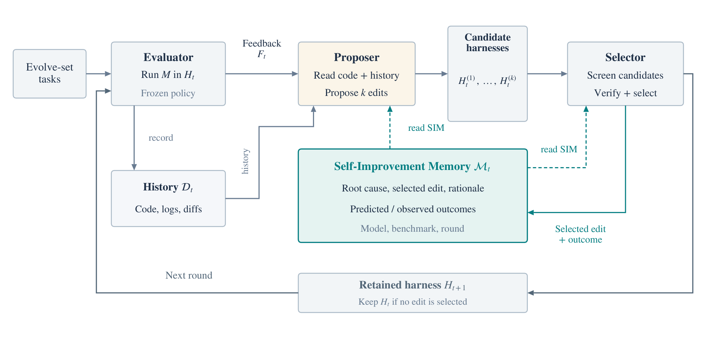
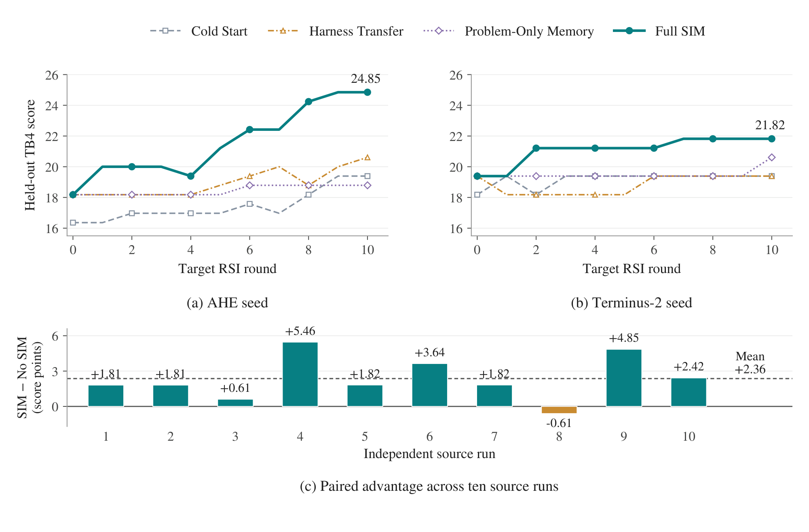

# Self-Improvement Memory Enables Continual Recursive Self-Improvement

## 来源信息

| 项 | 内容 |
| --- | --- |
| 标题 | Self-Improvement Memory Enables Continual Recursive Self-Improvement |
| 作者 | Xin Yu¹,⁴（p.1 脚注是实习说明，不是共同一作标注）、Fei Xia¹、Jiaqi Pan¹、Youbao Tang¹、Chengzhi Liu¹、Adams Yu²、Sicong Jiang²、Yanfei Chen³、Lingzhou Xue⁴、Ting Yu¹；¹ Google Cloud AI，² Google DeepMind，³ Google Cloud AI Research，⁴ The Pennsylvania State University |
| 机构 | Google Cloud AI（第一机构） |
| 来源 | [arXiv:2611.18856v1](https://arxiv.org/abs/2611.18856v1)（cs.LG; cs.AI）；2026-11-13 提交，阅读时只有 v1。PDF 35 页，sha256 与核对凭据见 `audit.md`；同版 HTML 图号整体比 PDF 少 1，本笔记按 PDF 图号 |
| 许可 | [CC BY 4.0](https://creativecommons.org/licenses/by/4.0/)（以 arXiv 许可为准；PDF 页脚另有 © 2026 Google 声明，见 `audit.md`） |
| 代码 / 项目页 | 正文未给出仓库或项目主页；按标题检索未发现作者公开实现（不等于不存在） |
| 阅读日期 | 2026-11-18 |

---

## 核心结论

一句话：**这篇论文把 harness 自进化从「在一个固定设定里搜到收敛」推进到「换数据集或换模型后继续搜」，并提出让优化器带着上一段优化过程的记忆（SIM）进入新设定——记忆按反复出现的 harness 问题组织，记录改动的理由、事前预测与事后观测、以及出处；在四个领域的 10 个设定里，带完整记忆的续优化最终分都高于只带 harness、只带根因诊断的对照。**

- **问题**：已有 RSI 方法只在单一设定内反复「提议—评估—选择」harness 编辑；模型换代、多模型共用 harness 或任务分布漂移时，把已演化的 harness 直接搬过去，源设定的提升并不保证目标设定的起点更好。
- **核心想法**：可迁移的不是 diff，而是「当初为什么这么改、预期修什么、测出来怎样」。SIM 把这些以根因假设为键串起来，跟着 harness 跨设定迁移，并在目标侧继续追加。
- **怎么做到**：proposer 与 selector 的搜索流程不变（$N=10$ 轮、每轮 $k=5$ 个候选），只在两侧注入同一份记忆；只有被选中的编辑连同实测结果写回，预测错误或回归也保留。
- **关键结果**：6 个跨数据集设定与 4 个 Opus→Gemini 设定里 Full SIM 最终分最高；编码域用 10 次独立源优化做配对续优化，9/10 次更好，平均 **+2.36** 分（95% CI [1.05, 3.68]，$p=0.003$）。
- **定位**：贡献几乎全在「跨设定时保留什么信息、怎么记」这一层，proposer/selector 的搜索算法本身没有改动；主设定每条件只跑一次，结论是描述性的。

---

## 问题

**优化总在固定设定里做。** harness 决定模型看到什么上下文、能调什么工具、怎么执行，因此不改权重也能提分；但手工找改动要反复工程与评测（§1）。已有 RSI 方法用执行反馈反复「提议—评估—选择」harness 编辑：Meta-Harness 用共享文件系统暴露历史实现与轨迹（Lee et al., 2026），AHE 让组件与改动结果可观测、并核对编辑级预测（Lin et al., 2026），RRSI 用正则约束搜索轨迹（Xia et al., 2026）。这些方法都假定优化在一个固定 benchmark 与固定策略上完成。

**现实里设定会变。** 同族模型换代、多个模型共用一个 harness、任务分布漂移，都会要求把已演化的 harness 带到新设定继续优化（原文用 "often needs"）。接口不兼容时当然无从迁移；本文只讨论可执行接口兼容的那一类。

**只带 harness 不够。** 作者的切入点是：harness 只是结果，它不解释「当初为什么这么改、预期修什么、测出来怎样」（§1）。缺了这段历史，目标设定里的优化可能：

- 重复源设定已经试过的方向；
- 改动继承来的组件却不知道它的目的；
- 把继承来的机制误记成「自己这一轮发现的」。

第三条来自 F.3 的一次无 SIM 观察，是单次案例，不是 §1 的一般断言。

**两个具体现象**（作者给的例子，都是单次实验）：

- 换模型：Opus 演化的 harness 换到 Gemini 后，workspace 只有 68.41，低于 Gemini 种子 harness 的 73.89（§4.3.1、Table 6）。
- 换数据：FewShotAll 源演化后在目标文本分类上是 72.92，低于种子的 75.72（§4.2、Table 5）。

也就是说，源设定的提升不保证目标设定的起点更好；有用的是「这个修改为什么曾经有用」这类经验，而不只是修改本身。

**与已有 memory 工作的差别。** §2 与附录 A.3 把先前工作分成几类：保留候选工件（Meta-Harness）、编辑历史与拒绝记录（RRSI）、改进图（Causal Improvement Graph）、技能修订记录、playbook（Turbo Harness）、按问题归组的候选 harness 库（HarnessBank）；任务求解侧还有 Reflexion、Voyager、ExpeL、ReasoningBank/ACE 等。作者的区分是：SIM 把 **harness 问题 → 修改 → 预测/观测结果 → 出处** 串起来，让这条记录跟着 harness 跨设定迁移、在目标侧继续追加，并同时喂给 proposer 与 selector。

**本文的设定与前提**：

- 策略模型冻结，改的只是 harness；分数按 benchmark 自己的聚合规则算。
- 任务集分成互不相交的 evolve 集与留出评测集，只有 evolve 集的反馈能进入提议、选择、记忆更新与停止决策（附录 B.2）。
- 源设定跑完得到一份最终 harness，目标设定从它继续；比较的是目标留出集上的「最终分 − 起始分」。
- proposer/selector 的规划与搜索过程保持不变，否则无法把差异归给记忆。

---

## 核心想法

让优化器记住「为什么」，而不只是记住「改成了什么」。

### 直觉

一次优化里，被选中的编辑都附着一小段推理：它想修哪个反复出现的问题、预期哪些任务会变好、评估后实际怎样。最终 harness 留下的只有代码，这段推理随 run 结束而消失。换到新设定后，目标侧的优化器面对的是别人改过的组件，只能从代码反推意图；反推错，就会把继承来的机制当成自己的发现，或者去重试源侧已经失败的方向。

SIM 的做法是把这段推理显式存下来，并让它跟着 harness 一起走。每条记录以根因假设为键，同一个问题下的历次尝试按时间追加；出处（领域、benchmark、策略模型、轮次）一起存，读的人才知道这条经验是在什么条件下得到的。

### 为什么成立

- **可迁移的是因果经验，不是 diff**：同一个根因在不同设定里可能需要不同实现；记住「要保证执行证据」比记住「加一个 137 行的拦截器」更耐用。
- **预测先写、结果后核**：这迫使 proposer 把「我预期修好哪些任务」写成可证伪的句子。即使预测错了、编辑仍有回归，记录也留着——下一个人能看到这条方向试过。
- **记忆跟着 harness 走，而不是跟着 run 走**：源侧的记忆在目标侧继续追加，同一诊断的证据会累积，而不是每次从零开始。
- **两个角色读同一份记录**：proposer 用它避免重复，selector 用它判断候选与既有诊断、回归风险的关系。

### 与已有做法的区别

| 做法 | 带过去的东西 | 目标侧缺什么 |
| --- | --- | --- |
| Cold Start | 只有种子 harness | 源侧的全部经验 |
| Harness Transfer | 源侧演化后的 harness | 改动的理由、预测与结果 |
| Problem-Only Memory | 根因清单 | 修改、结果、出处 |
| **Full SIM** | 完整记录，且目标侧继续追加 | — |

四者的差别只在记忆条件：源侧携带什么、目标侧按同一条件追加什么。因此 `Full SIM` 对 `Harness Transfer` 的差距是记忆机制的总体效果，对 `Problem-Only` 的差距才是「诊断之外的证据与历史」是否也有用。

### 一个走通的例子

编码域从 AHE 种子迁到 TB4。源侧曾发现一个反复出现的问题：agent 在本地命令都成功时就宣布任务完成，而不检查「完成」是否真的被外部验证过；对应的改动是给完成动作加一道执行证据门。目标侧第 2 轮从 SIM 里读到这条根因，没有重新发明门，而是保留「完成必须有证据」的思路、把证据要求改写成目标侧可检查的谓词（F.3）。同一个继承门在无 SIM 的 run 里被反复修改、其中两次是在修死锁，还有一次把继承来的门归因成「自己第 1 轮做的」。

这个例子只说明记忆怎样改变后续编辑；原文明确说案例是编辑史，不估计单个编辑对最终分的贡献，不能当因果证据。

### 代价

- **prompt 线性增长**：每轮把完整 SIM 放进 system prompt，不检索、不截断；记录随轮数与问题数增长，token 成本论文没有报告。
- **只记录入选编辑**：被筛掉、未执行的候选与 selector 的拒绝理由都不在记忆里，SIM 解释的是「试过并采纳了什么」，不是完整搜索树。
- **预测错了不阻断采用**：记忆的作用是留下证据，不是自动纠错；P8 两次入选、合计 4 条预测全部未实现，仍被采用。
- **迁移雷区要重新验证**：依赖具体模型输出格式的解析修复、依赖评测器注册方式的检查、按某一策略失败率校准的阈值，换设定后都可能失效（F.5）。



*图 2（原文 Figure 2，p.4）：SIM 在 agentic 外循环里的位置。评估器在 evolve 集上跑冻结策略，proposer 读代码与历史提 $k$ 个候选，selector 先筛后选，只有被选中的编辑连同实测结果写回 SIM。虚线为读、青色实线为写回。*

---

## 方法

### 符号表

| 符号 | 含义 | 维度 / 取值 |
| --- | --- | --- |
| $\sigma=(M,X)$ | 一个设定：策略模型与任务集 | 跨数据集时 $M$ 相同、$X$ 不同 |
| $M$ | 冻结的策略模型 | 两个阶段默认 Gemini 3.8 Flash |
| $X$ | 任务集 | 分成 $X_{\mathrm{evo}}$ 与 $X_{\mathrm{eval}}$ |
| $X_{\mathrm{evo}},X_{\mathrm{eval}}$ | evolve 集与留出评测集 | 互不相交；只有 evolve 反馈可用 |
| $H_t,H_{t+1}$ | 第 $t$ 轮 / 下一轮的 harness | 可执行代码；$H_0$ 为种子，$H_S$ 为源侧最终版 |
| $J(H;M,X)$ | harness $H$ 在设定 $(M,X)$ 上的分数 | 按 benchmark 自己的聚合规则 |
| $N,k$ | 一次 run 的轮数、每轮候选数 | $N=10$、$k=5$ |
| $t$ | 轮次下标 | $1,\dots,N$ |
| $F_t$ | 第 $t$ 轮的反馈 | 分数、轨迹与错误 |
| $\mathcal{D}_t$ | 本 run 到第 $t$ 轮为止的历史 | 不含 SIM |
| $P$ | proposer | 生成候选；默认 Gemini 3.8 Flash |
| $\mathcal{S}$ | selector | 先筛后选；默认 Gemini 3.8 Flash |
| $\mathcal{C}_t$ | 第 $t$ 轮候选集合 | 由 $P$ 生成，大小 $k$ |
| $F_t^{\mathcal{C}}$ | 已执行候选的反馈 | 被筛掉的候选没有分数 |
| $m_i$ | SIM 的第 $i$ 条问题记录 | 以根因假设为键 |
| $c_i$ | 第 $i$ 条根因假设 | 如「过早宣布完成」 |
| $a_{ij},o_{ij},p_{ij}$ | 第 $j$ 次尝试的修改及理由、预测与观测结果、出处 | 出处含领域、benchmark、策略模型、轮次 |
| $i,j$ | 问题记录序号、同一根因下的尝试序号 | $i$ 标识条目，$j$ 按时间顺序 |
| $\mathcal{M}_t,\mathcal{M}_{t+1}$ | 第 $t$ 轮 / 下一轮的 SIM | 源侧带入，目标侧继续追加 |
| $e_t$ | 第 $t$ 轮写回的记忆条目 | 只含被选中的编辑 |
| $U$ | 记忆更新算子 | 追加到 $m_i$ 或新建条目 |
| $\mathcal{M}_S$ | 源侧最终 SIM | 随 $H_S$ 一起迁移 |
| $\mathcal{M}_S^{c},\mathcal{M}_t^{c}$ | 只保留根因的记忆 | 源侧 / 目标侧，Problem-Only 条件 |
| $\sigma_S,\sigma_T$ | 源设定与目标设定 | — |
| $M_S,M_T$ | 源与目标的策略模型 | 跨模型时不同 |
| $X_S,X_T$ | 源与目标的任务集 | 跨数据集时不同 |
| $p$ | 配对检验的 p 值 | 只出现在结果 |

### 1. 一次 run 的形式化

一个设定记作 $\sigma=(M,X)$：冻结的策略模型 $M$ 与任务集 $X$，后者分成互不相交的 evolve 集 $X_{\mathrm{evo}}$ 与留出评测集 $X_{\mathrm{eval}}$。分数 $J(H;M,X)$ 按 benchmark 自己的聚合规则算；只有 evolve 集的反馈能用于提议、选择、更新 SIM 和停止决策（附录 B.2）。

一次 run 有 $N$ 轮。第 $t$ 轮：评估器在 evolve 集上跑 $H_t$，返回分数、轨迹与错误 $F_t$；proposer $P$ 结合本 run 历史 $\mathcal{D}_t$ 生成 $k$ 个候选；selector $\mathcal{S}$ 先筛掉一部分（不执行的候选没有分数），再在已执行候选里权衡性能、复杂度、领域特定性与回归风险后选。

**原文 Eq (1)**

```math
\mathcal{C}_t = P(H_t, F_t, \mathcal{D}_t), \qquad
H_{t+1} = \mathcal{S}\left(H_t, F_t, \mathcal{C}_t, F_t^{\mathcal{C}}\right)
```

**逐项读法**：

- $\mathcal{C}_t$ 是本轮候选集，只由当前 harness $H_t$、本轮反馈 $F_t$ 与本 run 历史 $\mathcal{D}_t$ 决定；SIM 还没进来。
- $F_t^{\mathcal{C}}$ 是已执行候选的反馈——被筛掉、没执行的候选没有分数，所以 selector 只在「跑过的候选」里选。
- $H_{t+1}$ 是下一轮 harness；没有候选被选中就原地不动，$H_{t+1}=H_t$。
- 这一式只描述单设定内的循环，跨设定的部分不在式子里。

### 2. Continual 设定：跨数据集与跨模型

源设定 $\sigma_S$ 跑完后得到 $H_S$，在目标设定 $\sigma_T$ 从 $H_S$ 继续。两种情形：

- **跨数据集**：$M_S=M_T$、$X_S\ne X_T$，策略固定、benchmark 变。
- **跨模型**：$M_S\ne M_T$、$X_S=X_T$，benchmark 与 split 固定、策略变。

衡量指标是**目标留出集上的「最终分 − 起始分」**，而不是目标侧的绝对分。这样「继承来的 harness 本身好不好」与「续优化把它推到哪里」被分开；共享起点时还能直接对照。前提是两边的可执行接口兼容。

### 3. SIM 的记录结构

**原文 Eq (2)**

```math
m_i = \left(c_i,\ \left[(a_{ij}, o_{ij}, p_{ij})\right]_j\right)
```

**逐项读法**：

- $m_i$ 是一条问题记录，键是根因假设 $c_i$（如「过早宣布完成」），不是某次编辑的 diff。
- $j$ 按时间顺序索引同一根因下的尝试；每次尝试存三样：修改及理由 $a_{ij}$、预测与观测到的任务结果 $o_{ij}$、出处 $p_{ij}$。
- $o_{ij}$ 里的**预测在评估之前写下、评估之后核对**——这是它比「只存 diff」多出来的一层。
- $p_{ij}$ 让读者知道这条经验来自哪个领域、benchmark、策略模型与轮次；换设定后可以据此判断权重。

### 4. 记忆怎样进入提议与选择

**原文 Eq (3)**

```math
\mathcal{C}_t = P(H_t, F_t, \mathcal{D}_t; \mathcal{M}_t), \qquad
H_{t+1} = \mathcal{S}\left(H_t, F_t, \mathcal{C}_t, F_t^{\mathcal{C}}; \mathcal{M}_t\right)
```

**逐项读法**：

- 相对 Eq (1)，proposer 与 selector 都多了一个条件项 $\mathcal{M}_t$（当前记忆）；搜索流程本身没变。
- 每轮 proposer 在 system prompt 里拿到**完整的** $\mathcal{M}_t$，不检索、不截断；selector 评估候选时读同一份记录。
- 更新规则是 $\mathcal{M}_{t+1}=U(\mathcal{M}_t,e_t)$：**被选中的候选才写入** $e_t$，追加到被引用的根因条目下，或新建条目；没选中则不写回、记忆不变。
- 写入内容包括让指标退步或没修好预测任务的情况；根因文本完全相同的条目会被合并但保留全部历史（D.1：是否同一根因由 proposer 自己判断，不设相似度模型，判断结果在评估前写入当轮 change manifest）。

### 5. 四个对照条件

| 条件 | 起始 harness | 目标阶段的记忆 |
| --- | --- | --- |
| Cold Start | 种子 $H_0$ | 无 |
| Harness Transfer | 源演化 $H_S$ | 无 |
| Problem-Only Memory | $H_S$ | 只有根因 $\mathcal{M}_S^{c}$（去掉修改、结果、出处） |
| Full SIM | $H_S$ | 完整记录 $\mathcal{M}_S$，并在目标阶段继续追加 |

四个条件共享目标策略、evolve 任务、轮数与候选预算；**都保留目标 run 的普通历史 $\mathcal{D}_t$**，差别只在记忆条件——源侧携带什么，以及目标侧按同一条件追加什么。`Full SIM` 对 `Problem-Only` 的差距检验「诊断之外的证据与历史」是否有用；对 `Harness Transfer` 的差距才是记忆机制的总体效果。

### 6. 一轮的数据流

1. 评估：在 evolve 集上跑当前 $H_t$，每个任务 5 次 rollout，得到分数、轨迹与错误 $F_t$。
2. 提议：proposer 读 $H_t$、$F_t$、本 run 历史 $\mathcal{D}_t$ 与完整 SIM $\mathcal{M}_t$，生成 $k=5$ 个候选。
3. 选择：selector 先筛掉一部分，再在已执行候选里权衡性能、复杂度、领域特定性与回归风险。
4. 写回：只有入选编辑连同实测结果与事前预测写入 $\mathcal{M}_{t+1}$；回归与未修好也写。
5. 停止：$N=10$ 轮后把最终 harness（与记忆）交给下一设定。

### 7. 与已有方法的结构差异

- **相对前代**：不改 proposer/selector 的搜索流程（仍是 $N$ 轮 × $k$ 候选、先筛后选），只在两侧注入记忆；新增的是跨设定的「记忆载体 + 更新规则 + 记录格式」。
- **相对 Harness Transfer**：多带的是可读的历史（理由、预测、观测、出处），而不只是代码。
- **相对 Problem-Only**：多带修改与结果，使「同一根因试过哪些实现、哪些失败」可见。
- **相对任务侧记忆**（Reflexion、Voyager、ExpeL 等）：SIM 是给 harness 优化器的记忆，不是给任务策略的记忆；它记录的是 harness 改动的因果，不是解题经验。

**论文自报的效率数字**：编码域一轮约 4 小时，其中评测 1.7 小时、候选采样 34 分钟（附录 C.1）。轮数与候选数在各方法间对齐，但 token 用量与运行时长可以不同，论文没有报告 token，也没有报告 SIM 本身的 prompt 开销。

---

## 主要结果

**设置**（§4.1、附录 B/C）：四个领域——编码（TB2.1 → TB4）、文本分类（3 个源数据集 → 8 个目标数据集）、agentic workspace（Harvey LAB → JobBench + GDPval + APEX-Agents 等权平均）、工程设计（EngDesign → Frontier-Eng）。跨数据集两阶段都用 Gemini 3.8 Flash 作策略；跨模型用 Claude Opus 5.5 做源优化、Gemini 3.8 Flash 做目标优化。每次 run $N=10$ 轮、每轮 $k=5$ 个候选，每个任务 5 次 rollout。除专门的配对研究外，**每个条件只跑一次完整 RSI**，单 run 结果只作描述性报告（附录 C.4）。

**1. 跨数据集：6 个设定里 Full SIM 全胜。** 下表是目标留出集上的「起始 → 最终」分；四个条件共享目标策略、evolve 任务、轮数与候选预算。

| 领域 / 种子 | Cold Start | Harness Transfer | Problem-Only | Full SIM |
| --- | --- | --- | --- | --- |
| 编码 / AHE | 16.36 → 19.39 | 18.18 → 20.61 | 18.18 → 18.79 | 18.18 → **24.85** |
| 编码 / Terminus-2 | 18.18 → 19.39 | 19.39 → 19.39 | 19.39 → 20.61 | 19.39 → **21.82** |
| 文本 / NoMemory | 68.60 → 72.00 | 71.40 → 71.00 | 71.40 → 73.40 | 71.40 → **73.60** |
| 文本 / FewShotAll | 75.72 → 75.92 | 72.92 → 74.12 | 72.92 → 75.52 | 72.92 → **77.92** |
| Workspace / ReAct | 73.89 → 82.98 | 74.93 → 85.07 | 74.93 → 85.54 | 74.93 → **87.89** |
| 工程 / ReAct | 39.13 → 40.87 | 39.13 → 42.61 | 39.13 → 42.61 | 39.13 → **46.96** |

Full SIM 比 Harness Transfer 高 **2.43–4.35** 分，比 Problem-Only 高 **0.20–6.06** 分（按表复算，逐项吻合）。Problem-Only 相对 Harness Transfer 从 −1.82 到 +2.40，作用不稳定——只带根因不足以稳定迁移。

**2. 源提升不等于目标起点更好。** 六组源留出分都涨了 2.75–6.41，但 FewShotAll 带到目标反而低于种子（72.92 vs 75.72）；无记忆续优化到 74.12，仍低于 Cold Start 的 75.92，Full SIM 到 77.92。这正是「要带记忆」的直接动机。

**3. 跨模型：Opus → Gemini 四个领域 Full SIM 都最高。** Opus 演化的 harness 换到 Gemini 后四个领域都低于 Gemini 自己的种子，缺口 0.60（文本）到 5.48（workspace）分。续优化并不总能补回：Harness Transfer 在编码、文本、workspace 三个领域仍低于 Cold Start；Full SIM 比 harness-only 高 **3.60–11.33** 分。workspace 差距最大：同起点 68.41，Full SIM 到 84.75，Harness Transfer 只到 73.42。



*图 5（原文 Figure 5，p.9）：(a)(b) 两个编码种子下逐轮保留版本的留出 TB4 分，round 0 是起点；(c) 十个独立源 run 上 SIM − No SIM 的终局差，虚线为均值 +2.36。*

**4. 配对研究：同一继承 harness 上有没有 SIM。** 从 Terminus-2 在 TB2.1 上独立跑 10 次源优化，每个源 harness 初始化两条 TB4 续优化（有/无 SIM），起点、策略、benchmark、轮数与候选预算都配对。9/10 次更好，唯一例外低 0.61；均值差 **+2.36**（95% CI [1.05, 3.68]，双侧配对 t 检验自由度 9、$p=0.003$；符号秩检验 $p=0.006$；效应量 1.28）。分析单位是独立源 run（10 个），不是 10×5 次 rollout。

**5. 模型代际链与共享 harness：方向对，但有反例。** 在 TB2.1 上按 Gemini 2.5 Flash → 3.5 Flash → 3.8 Flash → 4 Argon 依次传递 harness 与 SIM；第一代 CRSI 22.4 vs Fresh RSI 21.4，后三代 CRSI 两胜一负（3.5 Flash +3.5、3.8 Flash +1.6、4 Argon −0.8），作者没有解释末代回退。目标文本分类套件上让三个模型共用一个 harness：S2（每轮合并三个模型的轨迹反馈）留出 75.24、B1（每模型各自演化）75.20，作者据此说「相近」；按 All 列 S2 反而高 0.78，正文只引留出列。

**6. 只记根因不够。** 10 个设定里 Full SIM 都高于 no-memory 与 root-cause-only；作者在 Limitations 说明该对照评估的是 SIM 这一完整过程，不是单字段消融。源侧保留与优化代理换 Opus 的消融细节见 `audit.md`。

---

## 边界与局限

**作者明确写的（Limitations）**：

- 受算力限制，**独立重复只做了编码域**；其他领域的每个条件只有一次 run，无法给跨 run 区间。
- 只研究**接口兼容**的设定，且优化器的规划与搜索过程保持不变，否则无法把差异归给记忆。
- 比较的是 **SIM 这个完整过程**（继承记忆 + 目标侧更新），不是单个字段的消融。
- Ethics Statement 另提醒：自改的 harness 可能迎合评测器；workspace 分数可能受 LLM judge 偏差影响，而它恰是 Full SIM 增益最大的领域（+12.96，Figure 11a）。

**读者判断**：

- 10 个主设定都是单 run，「Full SIM 全胜」是描述性结果；唯一有重复的实验只在编码/Terminus-2 上。
- 代际链只有 4 代，末代回退 0.8；更长的链、跨厂商多跳链没测（单跳 Opus→Gemini 已测）。
- 没有成本对账：SIM 让 prompt 变长，论文未量化 token 与运行时长，也没做同等 token 预算的对照。
- 案例只说明机制，不估计单个编辑的贡献；P8 两次尝试都没修好目标任务，不能与总分直接连线。

---

## 与其他工作的关系

- **RRSI**（00212，[笔记](../2609.24972-v3-rrsi/note.md)）：同一机构体系（Google Cloud AI / Google Cloud AI Research）的相关工作；RRSI 第一作者是 Peng Xia，本文第一作者是 Xin Yu，两篇只在 Yanfei Chen 一位作者上重合，不是同一团队。本文在 workspace 与工程两个领域采用 RRSI 的环境、种子 harness 与评测接口（workspace 的 judge 改为统一用 Gemini 3.8 Flash，RRSI 是混合 judge 配置）。差别在问题：RRSI 约束搜索轨迹怎么走，本文关心换设定后带什么过去。
- **Harness²**（00220，[笔记](../2610.14224-v1-harness2/note.md)）：本文把它归为「保留已采纳 harness 与改法经验、在 benchmark 间复用」的一类（附录 A.2）。SIM 的差别是记录粒度与使用方式：以根因为键，把理由、预测、观测、出处绑在一起，并让 proposer 与 selector 同时读取。
- **Self-Harness**（[笔记](../2606.09498-v3-self-harness/note.md)）：本文引作「弱点挖掘 + harness 提议 + 回归验证」的代表；两者都利用失败证据，但 Self-Harness 关注一次优化循环内的验证，本文关注跨设定的经验携带。
- **Evo-Harness 提醒**：本文引用的是 EvoHarnessBench（Ke et al., 2026），与本仓库已读的 Evo-Harness（[笔记](../2608.15071-v2-evo-harness/note.md)）不是同一篇。
- **HarnessDev / HarnessX / HarnessPro 等**：本文没有直接引用；本篇可看作给这类 harness 自进化方法加一个跨设定记忆层的通用补丁，而不是新的搜索器。

<!-- 复核档案见同目录 audit.md（不随站点发布） -->
