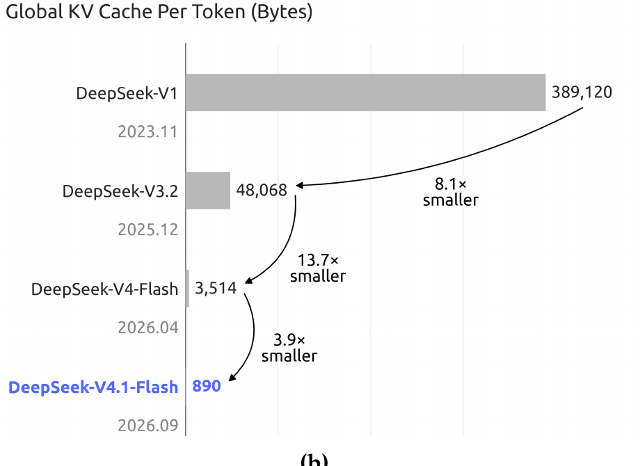
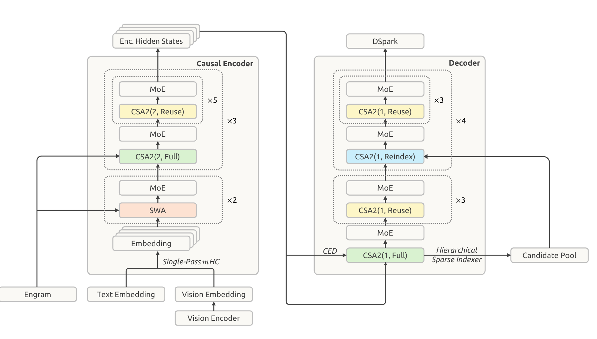

# DeepSeek-V4.1-Flash: Pushing the Limits of KV Cache Compression

## 来源信息

| 项 | 内容 |
| --- | --- |
| 标题 | DeepSeek-V4.1-Flash: Pushing the Limits of KV Cache Compression |
| 作者 / 机构 | DeepSeek-AI（research@deepseek.com） |
| 来源 | [Hugging Face 技术报告 PDF](https://huggingface.co/deepseek-ai/DeepSeek-V4.1-Flash/blob/main/DeepSeek_V41_Tech_Report.pdf)；checkpoint <https://huggingface.co/deepseek-ai/DeepSeek-V4.1-Flash>（本机两个链接均未联网核验） |
| 归档 | 非 arXiv 来源，原文已归档：[原文 PDF](../../../papers/00191-DeepSeek_V41.pdf)（51 页，sha256 `ba68e2e4…eac08d`，仓库编号 00191） |
| 版本 | PDF 元数据 CreationDate 2026-09-10；另有 arXiv 2609.19969 之说，本机不可达、未核验；版本与许可细节见 `audit.md` |
| 阅读日期 | 2026-10-06 |

---

## 核心结论

一句话：**这篇报告的主题不是「模型更强」，而是把长上下文推理的成本从「算」转移到「省」——用 CED 砍掉近一半 prefill 计算，用 CSA2 的跨层 KV/索引复用把 decoder 的 KV 生产层压到 1 层，再用 FP4 主 KV 缓存把每个字节再砍一半；部署侧用近似的 SWA Bounded Replay 换掉 SSD 上的持久缓存。**

- **问题**：长程 agent 是 input-heavy 负载，稀疏注意力已经把计算压得差不多，global KV 的存储、持久化与搬运成了主瓶颈。
- **核心想法**：KV 占用由「**生产 KV 的层数**」而不是「总层数」决定；把 entry 大小（FP4）、序列压缩（$m$）、跨层复用（Full/Reindex/Reuse）三个乘法维度一起压。
- **怎么做到**：40 层拆成 20 层 encoder + 20 层 decoder，decoder 的全局 KV 全部从 encoder 末层隐藏态投影；decoder 只有第一个 CSA2 层真正产 KV，其余 19 层复用它的 KV（4 个 Reindex 层自行重打分，15 个 Reuse 层连索引一起复用）。
- **关键结果**：全局 KV 降到 **890 bytes/token**（V4-Flash 3,514 的约 1/4，V1 的 **1/437**），持久 KV 降到 ~1/8；整体表现优于 V4-Flash（DeepSWE v1.1 74.2、Terminal-Bench 2.1 90.6），但并非每项都赢。
- **定位**：价值在架构、精度、缓存策略的联合设计，以及部署侧「近似重建换掉持久化」的取舍；代价是引入了两处缺少定量证据的近似。

---

## 问题

### 长程 agent 把成本推到存储与搬运（§1）

长程 agent 的工作负载是 **input-heavy**：大量工具调用、每轮 prompt 很长、上下文持续增长。于是三类成本同时上升——**prefill 计算**（每轮新输入都要重算前向，KV 未命中时代价尤其高）、**KV 存储**（global KV 驻 HBM，随序列长度线性增长；用于 prefix 复用的 persistent KV cache 驻 SSD/主机内存）、**数据搬运**（迁移与加载受 I/O 与互联带宽限制）。

DeepSeek-V4 的结构是「全局注意力分支 + 滑窗注意力（SWA）分支」：全局分支维护 global KV（**main KV + indexer K**），SWA 维护局部 KV。SWA 的占用与序列长度无关，所以序列一长，**global KV 就主导运行时占用**；再加上 persistent KV，HBM 与 SSD 双双成为瓶颈。作者的判断是：稀疏注意力已经把「算」压得差不多了，**存储与搬运成了新的主要矛盾**。

### 缺口一：KV 压缩是三个维度的乘积，还没有人同时压（§2.3）

KV 压缩有三条**乘法**维度——entry 大小、序列（每 $m$ 个 token 压成一条目）、层。已有工作各占一角：

| 做法 | 压了什么 | 没压什么 |
| --- | --- | --- |
| IndexCache（Bai et al., 2026） | 复用 Top-K 索引 | main KV 仍逐层存 |
| YOIO（Sun et al., 2026b） | 全网共享一次路由 | 共享选路限制性能 |
| HySparse（Gao et al., 2026） | 稀疏层复用稠密层 KV | 仍保留完整注意力层 |
| **CSA2（本文）** | 三个维度同时压 | 近似代价未单独量化 |

### 缺口二：持久缓存的策略与价值错配（§3.2.1）

V4 把 SWA KV 和 global KV 分治，SWA KV 只在「prompt 末尾」和「输出末尾」两个位置缓存以支持多轮。但 SWA KV 的复用窗口只有会话内的分钟级，一旦会话结束或进入下一轮就失效——**它被按「72 小时」的长期保留策略存着，却只有分钟级的价值**，还占了持久缓存容量的一半。V4 报告提出的 Zero SWA Caching 想靠重算避免存储，但精确恢复需要回放 $L\times n_{\mathrm{win}}$ 个 token（$L$ 为层数），在生产中代价不可接受。

### 本文的设定与前提

- **接受近似**：有界重放会截断 SWA 视野，稀疏选路会漏选；两者都用后训练阶段模拟同一近似来对齐分布。
- **简化全局分支**：V4 的 CSA–HCA 混合架构被替换为**纯 CSA2**，全局注意力只剩一种形态，压缩行为全部由「压缩比 × 模式分配」表达。
- **训练感知**：分层索引的候选池在训练与推理使用同一口径，深层 indexer 在自己推理时会看到的搜索域里被优化。



*Figure 1(b)（原文第 1 页）：每 token 全局 KV 字节数，标注值取自图中标签——V1 (2023.11) 389,120 → V3.2 (2025.12) 48,068 → V4-Flash (2026.04) 3,514 → V4.1-Flash (2026.09) 890。*

---

## 核心想法

### 一句话

**KV 的容量由「谁在生产 KV」决定，而不是由「有多少层」决定。**

V4 里每一层都往全局上下文里写自己的 KV；于是层数就是存储的乘数。V4.1-Flash 把这件事改成：encoder 负责把上下文压进隐藏态，decoder 只从这一份表示上做不同投影——**写一次，读 20 次**。存储随「写」的次数走，于是 20 层 decoder 只付 1 层的 KV 钱。

### 为什么这个直觉能成立

- **encoder 已经看过全序列**：第 $L/2$ 层的隐藏态包含完整因果上下文，decoder 需要的是「不同粒度的读法」，不必是「不同的内容」。
- **不同层需要的是不同投影，不是不同信息**：每层有自己的 $W_l^{KV}$、$W_l^{Z}$，同一份 $H_{L/2}$ 投出各自需要的 KV 条目与压缩权重。
- **局部信息仍然逐层生成**：SWA 的 K、V 保留取自本层 $H_l$，所以局部感受野的「生成深度」没有被压掉；被压掉的只是全局分支。
- **代价是可控的**：decoder 不再往全局上下文写新信息，只能通过 SWA 与残差间接影响后续层。作者用「整体表现不劣于 V4-Flash」来支撑这个取舍，但没有分析它在哪类任务上会咬人。

### 与已有做法的区别

- **不改注意力形式，改「谁生产 KV」**：IndexCache 省的是索引计算，YOIO 省的是路由次数，但全网共享一份选路会限制性能，HySparse 省的是稀疏层的 KV 但保留完整层。CSA2 把「缓存共享」和「索引复用」拆成两个独立开关：Reindex 共享 KV、但用自己的 query 重打分；Reuse 连索引一起共享。
- **不追求精确重建**：Zero SWA Caching 要回放 $L\times n_{\mathrm{win}}$ 个 token 才能数学等价；本文只回放 $n_{\mathrm{win}}$ 个并把 SWA 视野截断到回放段，明确承认「不是数学等价重建」。
- **精度选择按用途分**：indexer 的 Q/K 要跑 FP4 矩阵乘，所以用覆盖硬件最广的 MXFP4；主 KV 的 FP4 只用于省存储（注意力前先反量化），所以能选更准的 E2M1 + 每 16 通道一个 E4M3 scale。

### 一个走通的账：890 B/token 从哪来

原文只给总量与两个乘性因子，没给逐项账目。按原文标注的格式与规模参数可以精确还原到 890（**本笔记推算，非原文数据**；完整推导与两处口径说明见 `audit.md`）：

| 项 | 取值 | 依据 |
| --- | --- | --- |
| 每 token 的 main KV 条目数 | **2.5** = encoder 3 个 Full 层 ÷ 压缩比 2 + decoder 1 个 Full 层 ÷ 压缩比 1 | Reuse/Reindex 层不新增 KV |
| 每个 main KV 条目 | 512 通道 × 4 bit + 32 个 E4M3 scale = **288 B** | 主 KV 用 E2M1 + E4M3/16 通道 |
| 每 token 的 indexer K 条目数 | **2.5**（indexer K 由 main KV 投影） | §2.3 |
| 每个 indexer K 条目 | 128 通道 × 4 bit + MXFP4 的 E8M0 scale = **68 B** | indexer head dim 128 |
| 合计 | 2.5 × (288 + 68) = **890 B/token** | 与正文完全一致 |

这笔账说明降幅的大头不是 FP4：**decoder 从 20 个 KV 生产层压到 1 个才是 4× 量级的来源，FP4 只是在此之上再砍一半多**。

### 代价

- **把容量换成了带宽**：每层都要读同一份 KV，省的是存储与搬运，不是 attention 本身的算力。
- **两处近似都没有定量证据**：有界重放的质量影响只有「negligible」这类措辞；候选池 16,384 只选 512，也没有池大小扫描。
- **训练分布是硬约束**：后训练阶段模拟了同样的回放与候选池限制，自行改动推理栈就会离开训练分布。
- **精度论证绑死在当前实现**：去掉 global scale 依赖「RMSNorm 权重 ~1、latent L2 ≤ √512、实测最大幅值 ~10」这组量级，换 latent 维度或 RoPE 方案就要重算。

---

## 方法

### 符号表

| 符号 | 含义 | 维度 / 取值 |
| --- | --- | --- |
| $L$ | 总层数 | 40（20 encoder + 20 decoder） |
| $l$ | 层下标 | $l>L/2$ 指 decoder |
| $H_l$ | 第 $l$ 层的隐藏态 | hidden 5120 |
| $H_{L/2}$ | encoder 最后一层的隐藏态 | CED 的唯一 KV 来源 |
| $C_l$ | 式 (1)：第 $l$ 层的 KV 条目；式 (2)(6)：mHC 的分支系数——**原文同名复用，含义不同** | — |
| $Z_l$ | 第 $l$ 层 KV 对应的压缩权重 | — |
| $W_l^{KV},W_l^{Z}$ | 由 $H_{L/2}$ 投出第 $l$ 层 KV / 压缩权重的投影矩阵 | 逐层不同 |
| $N$ | 序列长度 | 训练 64K 起，34T token 时扩到 1M |
| $n_{\mathrm{win}}$ | SWA 窗口大小 | 128 |
| $m$ | CSA2 的序列压缩比 | encoder 2；decoder 1（即不压缩） |
| $X_l$ | mHC 第 $l$ 个 block 的残差流 | $\mathbb{R}^{n\times d}$ |
| $n,d$ | mHC 残差流条数 / 宽度 | mHC 扩展因子 4 |
| $A_l,B_l$ | mHC 的输入混合系数 / 残差系数 | — |
| $F_l$ | 第 $l$ 个 block 的子层（注意力或 FFN） | — |
| $b$ | 推理强度档位 | $b\in\{1,\dots,100\}$ |
| $b_{\min}$ | 档位下界 | 原文未给数值 |
| $x$ | 题目 / prompt 下标 | — |
| $r^{len}_{b,j}$ | 档位 $b$ 下第 $j$ 条回复的长度惩罚 | 非正 |
| $\ell_{b,j}$ | 该回复的推理 token 数 | — |
| $L_{\mathrm{norm}}$ | 参考长度 | 原文未给数值 |
| $C_{\max}$ | 惩罚上限 | 原文未给数值 |
| $k(b)$ | 档位相关的惩罚系数 | 随 $b$ 指数衰减 |
| $k_0$ | 整体压缩压力 | 原文未给数值 |
| $\tau$ | 档位衰减尺度 | $\lambda\overline{\Delta b}$ |
| $\lambda$ | 原文未定义；按上下文理解为「档位间隔」与「衰减尺度」之间的比例系数 | 原文未给数值 |
| $\overline{\Delta b}$ | 原文未定义；按上下文理解为档位间隔的均值 | 原文未给数值 |
| $M_b$ | 档位 $b$ 下每个 prompt 的采样条数 | 原文未给数值 |
| $p_x(\ell)$ | 题目 $x$ 在推理长度 $\ell$ 下的解题概率 | 附录 C |
| $a_x,s_x,C_x$ | 边际增益的幅度 / 衰减尺度 / 长度偏移 | 原文未给数值 |
| $\ell^*_x(b)$ | 一阶条件下的最优推理长度 | 附录 C |

### 数据流：一次 prefill 到 decode

1. **encoder（20 层）**：前 2 层纯 SWA；其余 18 层用 CSA2、$m=2$，分 3 组各 6 层，每组**首层 Full + 5 层 Reuse**。3 个 Full 层各自产 main KV 与 indexer K。
2. **CED 投影**：decoder 的 20 层不再由本层隐藏态生成全局 KV，全部从 $H_{L/2}$ 投影（原文 Eq (1)）。
3. **decoder（20 层）**：CSA2、$m=1$，分 5 组各 4 层。第一组首层 Full（同时建候选池）+ 3 层 Reuse；其余四组首层 Reindex + 3 层 Reuse。**只有第一个 Full 层真正产出全局 KV**。
4. **注意力**：所有模式都在当层算 main Q 与 SWA KV；输出 = 选中的 Top-512 个 main KV 条目 + 本层 SWA KV。
5. **缓存**：main KV 以 FP4 存（注意力前反量化），SWA KV 保持 FP8；global KV 进持久缓存（≥72 小时），SWA KV 只放主机 DRAM 池。

### CED：把 decoder 的全局 KV「外包」给 encoder（§2.2）

灵感来自 YoCo：让上半层直接共享下半层产生的 KV。CED 在此之上提升 KV 的**生成深度**（从更靠后的 $L/2$ 层取）与整体 KV 容量。对全局注意力，底部 $L/2$ 层当作 causal encoder；对 decoder（$l>L/2$），KV 条目与其压缩权重不再取自本层 $H_l$，而是：

```math
C_l = H_{L/2}W_l^{KV},\qquad Z_l = H_{L/2}W_l^{Z},\qquad l>\tfrac{L}{2}
```

**逐项读法**：$C_l$ 是第 $l$ 层要用的 KV 条目，$Z_l$ 是对应的压缩权重；$W_l^{KV}$ 与 $W_l^{Z}$ 逐层不同，所以 20 层 decoder 拿到的是同一份 $H_{L/2}$ 的 20 种投影，而不是 20 份新信息。**直觉**：decoder 的全局上下文表示只需要「一份」，不同层通过各自的投影得到自己需要的版本；代价是 decoder 各层不再往上下文里写新信息（只写 SWA 与输出）。

SWA 侧刻意保留逐层计算（K、V 来自本层 $H_l$），以保留局部 KV 的生成深度。副作用是 decoder 的 SWA KV 需要额外 $n_{\mathrm{win}}\times L/2$ 个 token 的前向；作者引用 PowerAttention「SWA 的有效感受野远小于理论值」的结论，做出 **Decoder SWA Bounded Replay**：prefill 时只对 prompt 最后 $n_{\mathrm{win}}$ 个 token 计算 SWA。

整体复杂度（$N\gg n_{\mathrm{win}}$）：$O(NL)$ → $O(NL/2+n_{\mathrm{win}}\cdot L/2)\approx O(NL/2)$，**prefill 计算近乎减半**；激活参数因此是 **prefill 8B / decode 16B**。

### CSA2：三种模式与一次配置

CSA2 相对 V4 的 CSA 做了两点简化：去掉相邻压缩条目的源区间重叠、去掉压缩时的绝对位置嵌入；indexer K 改为**由 main KV 条目投影**（而非从隐藏态走独立压缩路径）。下面三种模式每层静态分配、运行期不变：

| 模式 | main KV | indexer K | Top-K 索引 | 本层要算什么 |
| --- | --- | --- | --- | --- |
| Full | 自产 | 自产（由 main KV 投影） | 自负分产生 | main Q、SWA KV、indexer Q |
| Reindex | 复用前层最近的 main KV | 随之复用 | 用自己的 indexer Q 重打分后**重新产生** | main Q、SWA KV、indexer Q |
| Reuse | 复用 | 复用 | **复用**（不重打分） | main Q、SWA KV |

设计要点是**把「缓存共享」与「索引复用」解耦**：Reindex 在保持 KV 共享的同时允许选中的条目逐层变化；Reuse 连索引计算也省掉。与 CED 结合后产生关键后果：**decoder 的 KV 存储量与层数解耦**——这是 890 B/token 的结构性来源。稀疏注意力每次选 **Top-512** 个条目；indexer 32 个 query head、head dim 128。



*Figure 3（原文第 7 页）：左为 20 层 encoder（前 2 层 SWA，其余 3 组 CSA2(2, Full) + Reuse×5），右为 20 层 decoder（首个 CSA2(1, Full) 承接 CED 投影并建池，之上 1 组 Full + Reuse×3、4 组 Reindex + Reuse×3）。*

### 分层稀疏索引：把深层的索引成本变成常数（§2.3.2）

跨层复用减少了索引次数，但剩下的 indexer 仍要对整段可见上下文打分。作者观察：decoder 中**浅层 indexer 的信息天然可以限制深层的候选范围，且不需要额外状态**。

机制：decoder 第一个 Full 层照常对全部可见位置打分并选出自己的 Top-512；同时对 **block（8 个位置一块）**取最大分数，选出分数最高的若干块，收集成**候选池**（2,048 块 × 8 位置 = **16,384 个候选位置**，远大于最终 Top-512）。后续 Reindex 层**只在这个池里打分**并各自选 Top-512；Reuse 层不重新索引。效果：对固定池大小，深层 indexer 每 query 的打分成本**与上下文长度无关**，只有第一层 Full 仍扫全量。该机制「training-aware 且在后训练阶段引入」，训练与推理使用同一候选限制。

### FP4 主 KV：为什么敢用 4 bit（§2.4.4）

- **格式**：主 KV 缓存用 **E2M1 + 每 16 通道一个 E4M3 scale**，即 NVFP4 去掉第二级 global scale。可表示到 $448\times 6=2688$，而去掉 global scale 的量级论证是：训练中最大 RMSNorm 权重幅值约 1；经 RMS 归一化后 512 通道 KV latent 的 L2 范数 ≤ √512；RoPE 是旋转、保持范数，故旋转后单通道最大幅值也只有约 √512 ≈ 22.6；训练中观察到的实际最大幅值约 **10**。余量充足，去掉 global scale 无可测精度损失。
- **QAT 位置**：post-training 启用 QAT，**在 RoPE 之后量化**（RoPE 前量化只有边际收益却增加解码开销）；non-RoPE 与 RoPE 分量用同一格式。
- **SWA KV 保持 FP8**（对量化敏感）。相对 V4 的 FP8 主 KV，HBM 与 SSD 侧存储都近乎减半。

### Single-Pass mHC：让残差更新能边读边算（§2.4.1）

mHC 在相邻 block 间维持 $n$ 条残差流，理想实现是一次读写、激活访存 `(2n+2)d`。V4 的实现是串行的多 kernel（残差更新 / 系数预测 / 输入混合），合计 `(4n+4)d`；两趟实现可到 `(3n+2)d`，但仍要二次读 $X_l$，因为输入混合系数 $A_l$ 要等全部 hidden 维归约完才可用。Single-Pass mHC 把输入混合系数**错位一个 block**（原文 Eq (6)）：

```math
X_{l+1} = B_l X_l + C_l F_l(A_{l-1}X_l)
```

**逐项读法**：与原文 Eq (2) 的理想形式 $X_{l+1}=B_lX_l+C_lF_l(A_lX_l)$ 相比，唯一变化是 $A_l$ 换成 $A_{l-1}$——本 block 用的混合系数来自上一个 block。于是「先算完 $A$ 再读 $X$」的依赖消失，每个 tile 可边读边用；部署侧融合成 **Mega-mHC 单 kernel**，访存 `(2n+2)d` 达到理论下界，**激活访存相对原实现减半**（作者称性能退化可忽略）。预训练仍用原多 kernel 实现，因为错位只改变各 block 用哪组混合系数。

### 推理强度：一个标量旋钮（§5.1.4，原文式 (8)(9)）

系统提示加一行 `Reasoning Effort: {effort} (range 1–100; ...)`，标量 $b$ 作为显式条件信号。对每个 prompt $x$ 在每个档位 $b$ 采 $M_b$ 条回复（原文 Eq (8)），**同一 $(x,b)$ 子组内做奖励均值中心化**（不同档位不直接比较），档位差异由长度惩罚项施加（原文 Eq (9)）：

```math
r^{len}_{b,j}=-\min\Big[C_{\max},\,k(b)\frac{\ell_{b,j}}{L_{\mathrm{norm}}}\Big],
\qquad k(b)=k_0\exp\Big(-\frac{b-b_{\min}}{\tau}\Big),\ \ \tau=\lambda\overline{\Delta b}
```

**逐项读法**：$\ell_{b,j}$ 是该回复的推理 token 数，$L_{\mathrm{norm}}$ 是参考长度，$C_{\max}$ 封顶；负号表示这是扣分项。$k(b)$ 随档位 $b$ 指数衰减——**档位越高惩罚越轻**，$b$ 增加 $\tau$ 则系数乘 $e^{-1}$。$k_0$ 控制整体压缩压力，$\tau$ 越小则档位之间的行为分离越大。附录 C 给出该指数形式的边际效用动机：设解题概率 $p_x(\ell)$ 的边际增益近似指数衰减 $p'_x(\ell)\approx a_x e^{-\ell/s_x}$，则一阶条件下最优推理长度（原文 Eq (13)–(17)）

```math
\ell^{*}_{x}(b) \approx C_{x} - s_{x}\log k_{0} + \frac{s_{x}}{\tau}(b-b_{\min})
```

**逐项读法**：$s_x$ 是边际收益的衰减尺度，$C_x$ 是长度偏移；$\ell^*$ 对 $b$ 呈一阶仿射，斜率 $s_x/\tau$。作者声明这是局部近似，**不保证实测长度线性或逐点单调**。公开 API 暴露三档（max=100 / high=75 / low=50），不改权重、不改解码配置即可切换成本–质量工作点。

### 与 V4 的结构差异

| 维度 | DeepSeek-V4 | V4.1-Flash |
| --- | --- | --- |
| 全局注意力形态 | CSA–HCA 混合 | 纯 CSA2 |
| 压缩条目 | 相邻条目源区间重叠、带绝对位置嵌入 | 去掉重叠与绝对位置嵌入；indexer K 由 main KV 投影 |
| KV 生产层 | 各层各自产全局 KV | decoder 20 层只有 1 层产，其余复用（CED） |
| 主 KV 精度 | FP8 | FP4（E2M1 + E4M3/16 通道），SWA KV 仍 FP8 |
| mHC 实现 | 串行多 kernel，`(4n+4)d` | Mega-mHC 单 kernel，`(2n+2)d` |
| SWA KV 持久化 | 进持久缓存（分钟级价值按 72 小时策略存） | 移出持久缓存，放主机 DRAM 池 + 有界重放 |

### 其他写入架构的部分（只列读者需要知道的）

- **Engram（§2.4.2）**：条件记忆模块，**196B 参数**平均分给两个模块，放在第 1、14 层（0-indexed）以平衡流水线各 stage 显存；表与投影均 FP8，推理时可从主机内存 RDMA 预取。
- **DSpark（§2.4.3）**：投机解码模块，drafter 为 3 层 Transformer、滑窗 128，一次前向并行给出 **5 个 draft 位置**的 base logits；预训练后单独训练（backbone 冻结），post-training 期间联合训练但梯度不回传 backbone。
- **训练（§4.2）**：45T token 多模态语料（文本:多模态 ≈ 7:1），batch 100.6M token，从零以稀疏注意力在 64K 训练、34T token 时扩到 1M；Muon + AdamW + Sinkhorn 平衡更新。合计 **552B backbone（+196B Engram）**。
- **后训练（§5）**：作者明确「**不引入任何后训练算法创新**」，配方是 SFT → RL → on-policy distillation（40+ teacher），全部实质性改动在数据管线——任务合成与环境构建。

---

## 主要结果

**评测口径**（§4.3、§5.3.1）：基座对比（Table 1）在同一内部评测框架下进行，**分差 ≤0.3 视为同档**；后训练结果见 Table 3。推理类 GPQA Diamond / HLE / Codeforces / MathArena Apex 的温度与 top-p 均为 1.0；agent 类的 **scaffold 因基准而异**（code agent 默认 DeepSeek Harness Minimal，1M 上下文、T=1.0、top-p=0.95；DeepSWE v1.1 改用 mini-SWE，SEC-Bench Pro 用 Claude Code；视觉 agent 用 Claude Code 512k）。Table 4 表注：DeepSWE 每任务 N=8 次采样、TB v2.1 N=3、max_steps=500、TB v2.1 评测无网络。下表为 Max 档节选，**加粗=该行最高分（本笔记按表内数值判定）**：

| 基准 | Opus-5 | GPT-5.6 Sol | Kimi-K3 | GLM-5.3 | V4-Pro | V4-Flash | **V4.1-Flash** |
| --- | --- | --- | --- | --- | --- | --- | --- |
| GPQA Diamond | 93.4 | **94.1** | 92.9 | 88.1 | 92.4 | 89.9 | 90.9 |
| HLE（†=纯文本子集） | **56.3** | 44.5 | 43.5 | 42.0† | 42.7† | 37.8† | 36.8（纯文本 39.1†） |
| Codeforces（Rating） | – | – | – | – | 3348 | 3289 | **3471** |
| MathArena Apex | – | – | **65.6** | – | 65.3 | 58.6 | **65.6** |
| Terminal-Bench 2.1 | 89.1 | 88.8 | 88.3 | 88.2 | 87.9 | 82.7 | **90.6** |
| Terminal-Bench 4.0 | **51.8** | 39.9 | 12.6 | 37.9 | 12.4 | 7.0 | 31.2 |
| DeepSWE v1.1 | 74.0 | 73.0 | 67.5 | 66.9 | 62.7 | 54.4 | **74.2** |
| CyberGym | – | 84.5 | 80.0 | 84.5 | 83.3 | 76.7 | **88.1** |
| HLE w/ tools | 63.6 | – | 59.8 | 62.5 | 60.0 | 51.5 | **63.9** |
| Automation-Bench | 50.3 | 45.8 | 46.7 | 48.8 | 43.2 | 37.7 | **54.8** |
| Agents' Last Exam | 28.6 | 26.7 | 27.6 | 28.5 | 25.7 | 25.2 | **31.8** |

- **效率侧的收益是全文主线**：全局 KV 890 B/token 相当于 V4-Flash 3,514 的 1/3.95、V1 的 1/437；持久 KV 降到 ~1/8；prefill 计算近乎减半。Decode FLOPs 不随上下文爆炸——原文称 4K→1M（256×）只增约 1/4，本笔记按 Figure 2 读数约 21→27 GFLOPs（对照 V4-Flash 约 18→50）。**省下的不是 attention 算力，而是 KV 的容量与搬运。**
- **能力整体优于前代，但不是每项都赢**：base 侧 MMLU-Pro 74.1、HumanEval 79.4、GSM8K 93.0 高于 V4-Flash，AGIEval 83.4、DROP 87.9、MGSM 80.2 更低；LongBench-V2 45.2 虽高于 V4-Flash 的 44.7，仍明显低于 V4-Pro 的 51.5。chat 侧 HLE 36.8 低于同表所有对手，TB 4.0 只有 Opus-5 的六成。这与 §1 自述的能力画像一致（科学导向的 agent 任务仍与巨型模型有差距）。
- **强项集中在代码/终端 agent**：Codeforces、DeepSWE v1.1、TB 2.1、CyberGym、HLE w/ tools、Automation-Bench、Agents' Last Exam 七项为行内最高（MathArena Apex 与 Kimi-K3 并列）。视觉 agent 三项均超过 Kimi-K3（Chartography 78.9 / BabyVision 89.6 / ZeroBench 49.0，对局明细见 `audit.md`），但对 Opus-5 三项全落后、对 GPT-5.6 Sol 互有胜负。
- **推理强度确实换到精度，但收益前置**：档位 25→100，八项推理基准均值 Pass@1 67.1% → 76.3%、DeepSWE 66.0% → 74.2%、TB 2.1 82.4% → 90.6%，代价约 **2.5× 输出 token**；60–80 档已拿到大部分精度。
- **单点分数不可直接横比**：同一模型换 harness，DeepSWE 在 65.5–74.2 之间波动（约 9 个点），**大于模型与对手的差距**；Table 3 里 DeepSWE 的 74.2 恰是 8 种 scaffold 中最高的一档（mini-SWE）。
- **推理强度档位也不是万能**：跨 scaffold 时输出长度随档位单调增长，但 Pass@1 只弱相关，多数面板在中档出现平台或回落；到高 effort 时 scaffold 之间的差异不亚于档位之间的差异（附录 B.2）。

---

## 边界与局限

**作者明确承认的（§6）**：

- 新架构「尚未被完整刻画的鲁棒性边界」；CSA2 的选择错误与 SWA 有界重放的近似重建是两处已知风险，后续重点压测稀疏检索与缓存恢复边界。
- 评测基准趋于饱和；日常体验接近顶级闭源模型，但 benchmark 上的接近不等于在复杂高难推理与边缘案例上追平。
- 多智能体结果是 **preliminary**，且比较的是「观测到的最强多智能体配置 vs 可用最强单智能体基线」。

**读者判断（论文无相应证据）**：

- **两处最省钱的近似恰恰最缺量化证据**：SWA Bounded Replay 与分层索引的候选池（16,384 选 512）都没有消融——精确 vs 近似、池大小扫描、回放长度扫描全缺。
- **CED 的表达力代价未被讨论**：decoder 无法把新信息写进全局上下文，论文只给「性能与基线相当」的结论，没有分析这种「上下文写入瓶颈」在哪类任务上会咬人。
- **效率数字与对照口径都要打折**：890 B/token、1/8 持久 KV、prefill 减半、15/11 个 kernel 均无第三方复现，且 890 无逐项账目（本文的还原是读者推算）；不同 benchmark 用不同 harness，对手模型的 harness 未逐项说明，排名应视为「作者选定口径下的结果」而非受控对照。

---

## 与其他工作的关系

- **vs YoCo / PowerAttention**：YoCo 让上半层直接共享下半层产生的 KV，CED 在此之上提升 KV 的生成深度（取更靠后的第 $L/2$ 层）与整体容量；PowerAttention 的「SWA 有效感受野远小于理论值」是有界重放的前提。
- **vs IndexCache / YOIO / HySparse**：三者各压一个维度（索引次数、路由次数、稠密层 KV），CSA2 把三个维度一起压，并用 Reindex/Reuse 把「共享 KV」与「共享索引」拆开。
- **vs V4 的 Zero SWA Caching**：同样想摆脱 SWA KV 的持久化，V4 走精确重算（$L\times n_{\mathrm{win}}$ 个 token），本文走近似有界重放（$n_{\mathrm{win}}$ 个 token）并用后训练对齐分布。

<!-- 复核档案见同目录 audit.md（不随站点发布） -->
