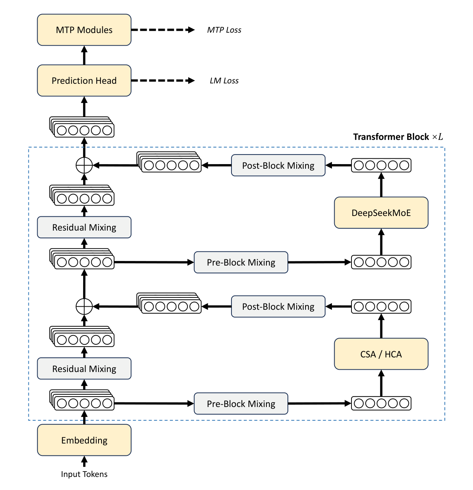
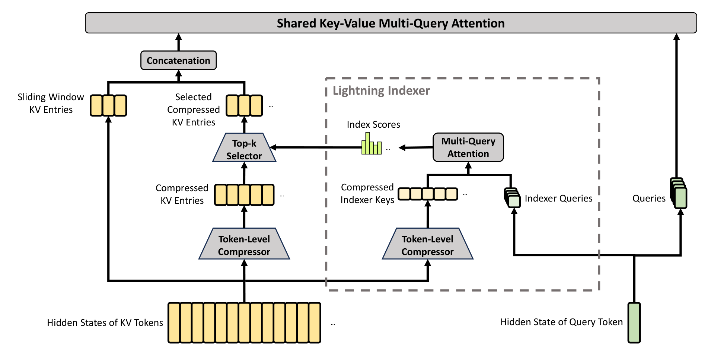

# DeepSeek-V4: Towards Highly Efficient Million-Token Context Intelligence

## 来源信息

| 项 | 内容 |
| --- | --- |
| 标题 | DeepSeek-V4: Towards Highly Efficient Million-Token Context Intelligence |
| 作者 / 机构 | DeepSeek-AI（arXiv 元信息 319 条 = 团队名 + 318 位个人；附录 A.1 分 Research & Engineering 270 人与 Business & Compliance 48 人） |
| 来源 | [arXiv:2606.19348v1](https://arxiv.org/abs/2606.19348v1)；首次收录时来自 [HF 技术报告 PDF](https://huggingface.co/deepseek-ai/DeepSeek-V4-Pro/blob/main/DeepSeek_V4.pdf) |
| 基准版本 | 本地 HF build，58 页（2026-11-08 按用户要求删除，sha256 与两版差异见 `audit.md`）；arXiv v1 同为 58 页，抽查的关键表格数字一致 |
| 许可 | 原文未写许可，arXiv abs 页为 `nonexclusive-distrib/1.0`；权重许可未核验 |
| 阅读日期 | 2026-11-08 |

---

## 核心结论

一句话：**V4 不是「再堆一个更大的 MoE」，而是一次效率优先的重构——用 CSA（4:1 压缩 + top-k 稀疏）与 HCA（128:1 压缩 + 稠密注意力）交替替换 MLA，用 mHC 把残差映射约束到双随机矩阵流形上，用 Muon 替换大部分模块的 AdamW，把 1M 上下文的单 token FLOPs 压到 V3.2 的 27%、KV cache 压到 10%（Pro）；后训练则把 V3.2 的混合 RL 整个换成多教师 on-policy distillation。**

- **问题**：推理模型与长程 agent 都要把大量内容留在上下文里，而「每 token 一份 KV」的注意力在 1M 长度下同时撞上算力与存储（容量、带宽）两堵墙。
- **核心想法**：分两级压 KV——先把 $m$ 个 token 压成一个 entry（CSA $m=4$、HCA $m'=128$），再让 CSA 只在压缩 entry 上做 top-k 稀疏选择；候选数随「上下文长度 / 4」增长，不再随原始 token 数增长。
- **怎么做到**：CSA/HCA 交替 + 128 token 滑窗分支；mHC 用 Sinkhorn-Knopp 把残差混合矩阵投影成双随机矩阵（谱范数 ≤1）；CSA/HCA 允许直接对 query 与 compressed KV entry 做 RMSNorm，因此 Muon 不再需要 QK-Clip。
- **关键结果**：相对 V3.2，Pro 的 1M 单 token FLOPs 为 27%、KV cache 为 10%（Flash 为 10% 与 7%）；SimpleQA-Verified 57.9 明显高于开源对手，Codeforces 3206 与 LiveCodeBench 93.5 是表内最高。
- **定位与代价**：这是一次效率优先、架构明显变复杂的重构，作者自己承认组件太多；主结果并非全面领先——GPQA 90.1 低于 K2.6 的 90.5，Apex 38.3 远低于 GPT-5.4 的 54.1。

---

## 问题

论文的出发点是一个被两头夹住的约束。

1. **测试时扩展依赖长上下文**：推理模型把更多算力花在更长的思维链上，长程 agent 又要把大量工具结果、文件与跨文档材料留在上下文里。vanilla attention 的二次复杂度让这两条路都很贵。
2. **已有的稀疏注意力只解决了「算」，没解决「存」**：V3.2 的 DSA 已经在 token 级做 top-k（2048），但每个被选中的 token 仍要保留完整 KV；上下文到 1M 时，KV cache 的容量与带宽成为新的主矛盾。
3. **只压缩也不够**：4:1 压缩只省 4 倍，1M 仍有 26 万个 entry，而且压缩本身有损、细粒度信息被平均掉；只稀疏不压缩，候选集仍随原始 token 数线性增长。
4. **万亿参数 MoE 的训练稳定性仍是经验问题**：V4 在训练中遇到 loss spike，作者把它归因到 MoE 层的 outlier 与路由的相互放大，但只给出两个「有效但机理未明」的技巧。
5. **精度也是成本**：KV 的存储精度、专家权重的存储精度、indexer 的 QK 计算精度，都是 1M 推理账单上可压缩的项，但降精度会威胁训练稳定与召回质量。
6. **后训练还要把多个专家合成一个**：每个领域单独训专家容易，但把多套奖励函数拼进同一个策略会互相牵制，权重平均又要求各专家同构。
7. **异构 KV 让现成推理栈失效**：不同层的压缩率不同，PagedAttention 假设「所有层 KV 结构一致」，缓存分配、前缀复用与 kernel 都要重写。

于是本文的取舍是：同时压缩 KV 的**长度**（CSA/HCA）与**精度**（KV 用 BF16 RoPE 维 + FP8 其余维；FP4 用在 MoE 权重与 CSA indexer 的 QK 路径），再用更强的残差约束（mHC）与优化器（Muon）把训练稳定性补回来。

前提是保留 V3 的骨架：Transformer、DeepSeekMoE、MTP 都不换，改动集中在注意力、残差与优化器三处。MoE 侧只有四个小改动：affinity 从 `Sigmoid` 换成 `Sqrt(Softplus)`；保留 auxiliary-loss-free 负载均衡，另加一个权重 `1e-4` 的 sequence-wise balance loss；去掉路由目标节点数的约束；最初几个 block 的 dense FFN 也换成 MoE，并对前 3 个 MoE 层使用按 token ID 的 Hash routing。

两件读者需要先知道的口径：这是被标为 preview version 的预览版而非最终版，§6 说为了降低风险保留了很多「初步验证过」的组件与技巧、导致架构不够优雅，未来要「蒸馏到最本质的设计」；效率数字都是相对 **DeepSeek-V3.2**（DSA）与一个 BF16 GQA8 基线给出的，换基线会得到不同倍数。

---

## 核心想法

### 直觉：把「每 token 一个 KV」拆成两级

长上下文贵的根源是两件事同时发生：每个 token 都要留一份 KV（存储），每个 query 都要看全部 KV（计算）。V4 把这两件事分开处理——先按固定块把 KV **压短**，再在压短的序列上**选少数**。压缩解决「存」，稀疏解决「算」。

### 为什么两级都要

- **只压缩**：4:1 只省 4 倍，1M 仍有 262,144 个 entry；且压缩是有损的，细节被加权平均掉。
- **只稀疏**：V3.2 已经这么做了，但被选中的 token 仍各存一份 KV，存储没省；候选集大小还随原始 token 数增长。
- **压缩后再稀疏**：候选集从「1M 个 token」变成「26 万个 entry」，top-k 的绝对数量可以保持很小（Pro 1024），压缩本身又把存储降了下来。两级叠加才同时动到算力与容量。

### 两种压缩率的分工

CSA 用 $m=4$，压得轻、保细节，再用 top-k 在全部历史里挑出相关的 1024 个 entry；HCA 用 $m'=128$，压得重、只给低分辨率的全局背景，但因为是稠密注意力，不需要 indexer。两类层交替堆叠，相当于让模型同时拥有两种分辨率：**CSA 负责「细粒度地选」，HCA 负责「粗粒度地看」**。

交替比例原文没有给（只说 "interleaved manner"），这是复现时首先要确认的参数；实现细节指向 HF 上的 inference 代码，本机不可达，未能核对。

### 一个走通的账（1M 上下文）

- V3.2 的 token 级稀疏：每层要为约 1,024K 个 token 各留一份 KV（只有被 top-k 选中的 2048 个参与计算，但存储仍在）。
- CSA：先压成约 262,144 个 entry。每个 entry 由 `2m` 个原始 token 压成（相邻 entry 的窗口重叠），净压缩率仍是 1/4。核心注意力只看 top-k 个 entry 加 128 token 滑窗。
- 信息容量：Pro 的 $k=1024$、$m=4$，选中 entry 的等效压缩长度 $k\cdot m=4096$ 个 token；但每个 entry 实际由 `2m=8` 个原始 token 压成，若选中的 entry 不相邻，原始 token 覆盖上界是 $2mk=8192$。top-k 的选择范围是**全部历史**，不是最近 4096 token。
- HCA：1M 下约 8192 个 entry，稠密注意力的成本可以接受。
- 合起来：相对 V3.2，Pro 的单 token FLOPs 是 27%、KV cache 是 10%；Flash 是 10% 与 7%。相对 BF16 GQA8（head dim 128）基线，1M 下 KV cache 约为该基线的 2%。

### 为什么残差要加双随机约束

残差流一扩宽（mHC 扩 4 倍），层间就多了一个可学习的混合矩阵；这个矩阵如果谱范数大于 1，信号会沿层指数放大。把矩阵投影到双随机矩阵（行、列和都为 1 且非负）后，谱范数不超过 1，残差变换是非扩张的；双随机矩阵对乘法封闭，所以叠多少层都还稳。这是一个有明确数学保证的约束，代价只是 20 步 Sinkhorn 迭代与一点工程开销（墙钟 6.7%）。

### 为什么 Muon 这次不需要 QK-Clip

MuonClip 的 QK-Clip 是为 MLA 准备的补丁：MLA 推理时不物化 K，套不上 QK-Norm，只能按头缩放 Q/K 投影来压 logit。V4 换成 CSA/HCA 后，核心注意力前可以直接对 query 与 compressed KV entry 做 RMSNorm，logit 天然不会爆，于是 Muon 可以按标准形式用，省掉了这套补丁。

### 与已有做法的区别

| 环节 | 已有做法 | V4 的做法 |
| --- | --- | --- |
| 稀疏 | 在原始 token 上 top-k（DSA） | 在压缩 entry 上 top-k，候选数少一个量级 |
| 长上下文成本 | 只压 KV 精度或只做稀疏 | 长度（CSA/HCA）+ 精度（FP8/FP4）+ 落盘复用一起动 |
| 残差稳定性 | 标准残差 / HC | mHC：混合矩阵约束到双随机矩阵 |
| 后训练 | 混合 RL / 权重平均 | 领域专家 + 多教师 full-vocabulary OPD |

### 后训练为什么换 OPD

混合 RL 要把多个能力塞进同一个策略，奖励设计互相牵制；权重平均则要求各专家同构。OPD 把「每个领域先训一个专家」和「最后合成一个学生」解耦：学生在自己采样的轨迹上学多个教师的完整输出分布，不需要把教师的奖励函数拼在一起。代价是教师权重的存储与调度，以及 full-vocabulary KL 的显存开销。

### 代价

- **架构复杂、超参多但没有消融**：两种注意力 + 滑窗分支 + mHC + FP4 + 多教师 OPD，任何一处都要专门的 kernel 与并行策略；而交替比例、$m$/$m'$、top-k、$n_{\mathrm{win}}$、Sinkhorn 步数都没有扫参，调参只能靠经验。
- **压缩质量是新的依赖**：top-k 选的是学出来的 entry，压缩权重学不好，选得再准也没用；原文没有给压缩重建误差一类的指标。

---

## 方法

### 符号表

| 符号 | 含义 | 维度 / 取值 |
| --- | --- | --- |
| $X_l,F_l$ | 第 $l$ 层输入的扩宽残差流；该层的子层（注意力或 MoE） | $X_l$ 为 $n_{\mathrm{hc}}\times d$ |
| $n_{\mathrm{hc}},d$ | 残差流扩宽倍数；hidden size | 4；4096（Flash）/ 7168（Pro） |
| $A_l,C_l,B_l$ | 把残差压回 $d$ 维喂给子层、把子层输出写回扩宽流、残差混合三个映射 | $B_l$ 为 $n\times n$（原文用 $n$） |
| $\tilde A_l,\tilde B_l,\tilde C_l$ | 三个映射的未约束参数（动态项与静态 bias $S$ 合并后） | — |
| $\alpha,\sigma,T_r,T_c,t_{\max}$ | 动态项的门控；Sigmoid；行/列归一化算子；Sinkhorn-Knopp 步数 | 原文未给 $\alpha$；$t_{\max}=20$ |
| $C^a,C^b,Z^a,Z^b,B^a,B^b$ | CSA 的两条 KV 序列、两段压缩权重、两段可学习位置 bias | 每条 $m$ 个 token 一块 |
| $S^a_j,S^b_j$ | CSA 压缩时的行 softmax 权重（逐元素乘到 $C^a_j$、$C^b_j$ 上） | — |
| $m,m',k,n_{\mathrm{win}}$ | CSA / HCA 的压缩率；CSA 的 top-k；滑窗 token 数 | 4 / 128；1024（Pro）或 512（Flash）；128 |
| $C_i^{\mathrm{Comp}}$ | 第 $i$ 个 compressed entry | — |
| $S_j,C_j,Z_j,B$（HCA） | HCA 单条 KV 序列的行 softmax 权重、KV、压缩权重、位置 bias（与 CSA 同名不同物） | — |
| $n_I,w^I_{t,h},q^I_{t,h},K_s^{\mathrm{IComp}},I_{t,s}$ | indexer 头数；第 $h$ 个 head 的可学习权重；query 在该 head 的投影；第 $s$ 个压缩块的 indexer key；query $t$ 对块 $s$ 的索引分 | $n_I=64$ |
| $c^Q_t,n_h,c,g,d_g$ | query 的压缩表示；核心注意力头数与 head dim；输出投影分组数与组维 | 1024/1536；64 或 128；512；8 或 16 / 1024 |
| $\mu,G_t,M_t$ | Muon 的动量系数；第 $t$ 步梯度；动量累积 | $\mu=0.95$ |
| $O'_t,O_t,\gamma$ | Newton-Schulz 输出；重缩放后的更新；更新矩阵的 RMS 目标 | $\gamma=0.18$ |
| $\eta,\lambda$ | 学习率；decoupled weight decay | $\lambda=0.1$；原文未给 $\eta$ |
| $n,m$（Muon） | 更新矩阵的行、列数 | 与压缩率 $m,m'$ 同名不同物 |
| $\pi_\theta,\pi_{E_i},w_i,N,D_{\mathrm{KL}}$ | 学生策略；第 $i$ 个教师；教师权重；教师数；KL 散度（reverse，学生在左） | $N$ 在 10 个以上 |
| $M^{(t)},W_t$ | 第 $t$ 步 Sinkhorn 迭代矩阵（$M^{(0)}$ 为指数后的初值）；第 $t$ 步更新后的参数矩阵 | $M^{(t)}$ 与 Muon 的 $M_t$ 同名不同物 |

### 1. 总体架构：保留 V3 骨架，替换注意力、残差与优化器

V4 保留 Transformer、DeepSeekMoE 与 MTP，改动集中在三处：注意力（CSA/HCA 交替替代 MLA，每层另带一条 128 token 滑窗分支）、残差（mHC 把残差流扩到 $n_{\mathrm{hc}}=4$ 倍，并对块间混合矩阵加双随机约束）、优化器（除 embedding、prediction head、mHC 的静态 bias/门控与 RMSNorm 外，大部分模块用 Muon 替代 AdamW）。前向数据流是 token → embedding → 逐层 [CSA 或 HCA（+ 滑窗分支）→ mHC 残差混合] → MoE（1 个共享专家 + 6 个路由专家）→ MTP 预测头。下表摘录原文 Table 1 的架构与参数行（原文的参数/架构行已并入本表），逐项数值见 `audit.md`：

| 配置 | V4-Flash | V4-Pro |
| --- | --- | --- |
| 层数 / hidden size | 43 / 4096 | 61 / 7168 |
| 前两层注意力 | 纯 SWA | HCA |
| 共享 + 路由专家（每 token 激活） | 1 + 256（6） | 1 + 384（6） |
| 总参数 / 激活参数 | 284B / 13B | 1.6T / 49B |
| 预训练 token | 32T | 33T |



*Figure 2（原文 p6）：总体架构，标出 mHC、CSA/HCA、DeepSeekMoE 与 MTP 的相对位置。*

### 2. mHC：把残差映射约束到双随机矩阵

Hyper-Connections（HC）先把残差流从 $d$ 维扩成 $n_{\mathrm{hc}}\times d$，用三个线性映射 $A_l$、$B_l$、$C_l$ 分别控制输入、残差变换与输出：

```math
X_{l+1} = B_l X_l + C_l F_l(A_l X_l)
```

**逐项读法**：$A_l$ 把扩宽后的残差压回 $d$ 维喂给第 $l$ 层，$F_l$ 是该层（MoE 或注意力），$C_l$ 把层输出写回扩宽的残差流，$B_l$ 决定旧残差如何混合到下一层。HC 与 mHC 共用这一形式，差别只在 $B_l$ 受什么约束。

HC 的问题是深层堆叠时训练会频繁出现数值不稳定（原文只说现象，没有给机理）。一个常见的解释是 $B_l$ 的谱范数可能大于 1、信号沿层指数放大——**这一步是笔记推断，原文没有给出**。mHC 把 $B_l$ 限制在 Birkhoff 多面体上：每一行、每一列都和为 1 且非负，也就是双随机矩阵。它的谱范数不超过 1，残差变换是非扩张的，前向与反向都更稳；双随机矩阵对乘法封闭，所以多层堆叠仍然稳。参数化是「动态 + 静态」两部分：$X_l$ flatten 后做 RMSNorm，再用可学习矩阵生成动态项；动态项先乘一个初始化为小值的门控 $\alpha$，再与静态 bias $S$ 相加。顺序很重要——$\alpha$ 乘在动态项上，而不是乘在「动态项 + 静态 bias」之和上（原文式 3–5 的语序是 $\alpha\cdot(\cdot)+S$）。约束通过 Sigmoid 与 Sinkhorn-Knopp 完成：

```math
\begin{aligned}
A_l &= \sigma(\tilde{A}_l), \qquad C_l = 2\sigma(\tilde{C}_l),\\
M^{(0)} &= \exp(\tilde{B}_l), \qquad M^{(t)} = T_r(T_c(M^{(t-1)})),\\
B_l &= M^{(t_{\max})}, \qquad t_{\max} = 20
\end{aligned}
```

**逐项读法**：$A_l$ 与 $C_l$ 用 Sigmoid 保证非负且有界（$C_l$ 乘 2，把值域加倍）；$B_l$ 先取指数保证严格正，再交替做列归一化 $T_c$ 与行归一化 $T_r$，20 步后得到近似的双随机矩阵。原文的写法是先列后行（$T_r(T_c(\cdot))$）；$\tilde A_l$、$\tilde B_l$、$\tilde C_l$ 是动态项与静态 bias 合并后的可学习参数。工程代价是额外的激活内存与流水线通信；作者用融合 kernel、选择性重算（重算层间 hidden state 与归一化后的层输入，不重算计算密集算子）以及调整 DualPipe 1F1B 抵消，最终墙钟开销是重叠后 1F1B 阶段的 **6.7%**。

### 3. CSA：先压缩，再在压缩 entry 上做稀疏选择



*Figure 3（原文 p9）：先按 4:1 分块压缩，再由 indexer 给每个压缩块打分、选 top-k，只对被选中的 entry 做共享 KV MQA；另有一条 128 token 滑窗分支补局部细节。*

CSA 的目标是把「每个 token 一个 KV」变成「每 $m$ 个 token 一个 compressed entry」。它同时保留两条 KV 序列 $C^a$、$C^b$ 与对应的压缩权重 $Z^a$、$Z^b$；每个 entry 由当前块的 $m$ 个 $C^a$ 与前一块的 $m$ 个 $C^b$ 共同决定：

```math
\begin{aligned}
[S^a_{mi:m(i+1)-1}; S^b_{m(i-1):mi-1}] &= \operatorname{Softmax}_{row}([Z^a_{mi:m(i+1)-1}+B^a;\ Z^b_{m(i-1):mi-1}+B^b]),\\
C_i^{\mathrm{Comp}} &= \sum_{j=mi}^{m(i+1)-1} S^a_j \odot C^a_j + \sum_{j=m(i-1)}^{mi-1} S^b_j \odot C^b_j
\end{aligned}
```

**逐项读法**：方括号里是两段拼接的 logits——$Z^a$ 段是当前块的压缩权重加位置 bias $B^a$，$Z^b$ 段是前一块的权重加 $B^b$；在拼接后的 `2m` 个位置上做行 softmax 得到 $S^a$、$S^b$；再用它们分别对 $C^a$、$C^b$ 加权求和（$\odot$ 是逐元素乘）。于是每个 entry 实际看了 `2m` 个原始 KV，但相邻 entry 的 $C^b$ 与 $C^a$ 窗口重叠，净压缩率仍是 1/m。

压缩之后是 **Lightning Indexer**：query 先降维到 $c^Q_t$，再上投影成 $n_I$ 个 indexer head；每个 head 与 compressed indexer key 做点积、ReLU、按可学习权重求和，得到 query 对每个压缩块的分数：

```math
I_{t,s} = \sum_{h=1}^{n_I} w^I_{t,h} \cdot \operatorname{ReLU}\left(q^I_{t,h} \cdot K_s^{\mathrm{IComp}}\right)
```

**逐项读法**：$I_{t,s}$ 是 query $t$ 对第 $s$ 个压缩块的「选谁」分数，不是最终注意力权重；$w^I_{t,h}$ 是每个 head 的可学习权重；ReLU 让分数不必归一化，top-k 只看相对大小，因此可以跑得很便宜。选出 top-k 个 entry 后，CSA 用**共享 KV MQA** 做核心注意力：每个被选中的 entry 同时当 key 与 value，query 从同一个 $c^Q_t$ 上投影出 $n_h$ 个头。因为 $c\cdot n_h$ 很大，输出不做一次性投影，而是先分成 $g$ 组投到 $d_g$ 维，再拼起来投回 $d$（grouped output projection）。

五个容易漏的细节：

- **滑窗分支**：每个 query 额外保留最近 $n_{\mathrm{win}}=128$ 个未压缩 KV，和选中的 entry 一起做核心注意力。原因是因果性要求 query 只能看「之前的完整压缩块」，它看不到自己所在块内的其他 token。
- **部分 RoPE**：只对 query、KV entry 与核心注意力输出的最后 64 维加 RoPE；因为 KV entry 同时当 key 与 value，输出会带上绝对位置，所以再对输出加位置 `-i` 的 RoPE，把绝对位置抵消成相对位置。
- **Attention sink**：每个头有一组可学习 sink logit 加在 softmax 分母上，允许该头的注意力总和不等于 1，甚至可以接近 0。
- **QK RMSNorm**：核心注意力之前对每个 query head 与 compressed KV entry 做 RMSNorm，防止 logit 爆炸；这也是后面 Muon 不需要 QK-Clip 的原因。
- **选择范围**：top-k 选的是 compressed entry，不是原始 token，且范围是全部历史（index score 对当前块之前的所有压缩块计算）。Pro 的 $k=1024$、$m=4$ 对应约 4096 token 的等效压缩长度；1M 下 compressed entry 总数约 262,144，top-k 是在这全部 entry 里选。

### 4. HCA：128:1 压缩，但不做稀疏

HCA 的压缩方式与 CSA 类似，但只用一条 KV 序列、不做重叠压缩，压缩率 $m'=128$（远大于 CSA 的 4），压缩后直接做稠密注意力，不经过 indexer 与 top-k：

```math
S_{m'i:m'(i+1)-1} = \operatorname{Softmax}_{row}(Z_{m'i:m'(i+1)-1}+B), \qquad
C_i^{\mathrm{Comp}} = \sum_{j=m'i}^{m'(i+1)-1} S_j \odot C_j
```

**逐项读法**：每 128 个 token 的 KV 被加权求和成一个 entry；一个 HCA 层在 1M 上下文下只有约 8192 个 entry，稠密注意力的成本可以接受。HCA 复用 CSA 的共享 KV MQA、grouped output projection 与滑窗分支，只是没有 indexer。分工可以这样理解（本笔记的解读）：**CSA 负责「细粒度地选」——4:1 压缩后仍有 top-k，能在长历史里挑出相关片段；HCA 负责「粗粒度地看」——128:1 压缩后稠密扫全历史，提供低分辨率的全局背景。** 交替堆叠相当于让模型同时拥有这两种分辨率。

### 5. 效率从哪来：四个叠加项

压缩（CSA 1/4、HCA 1/128）、稀疏（只对 top-k 个 entry 做核心注意力）、低精度存储（KV entry 的 RoPE 维用 BF16、其余维用 FP8，整体约为纯 BF16 的一半）、低精度计算（indexer 的 QK 路径用 FP4）。汇总口径是：以 BF16 GQA8（head dim 128）为基线，V4 在 1M 下的 KV cache 约为该基线的 **2%**（原文写作 "approximately 2% times of that baseline"，措辞拗口，应读作「约为基线的 2%」）；相对 V3.2，Pro 的 KV 是 10%、Flash 是 7%，单 token FLOPs 分别是 27% 与 10%。KV 布局也因此变异构：`state cache` 放滑窗的最近 $n_{\mathrm{win}}$ 个 KV 与「还没凑够一个压缩块」的尾部状态；`classical KV cache` 放 compressed entry，每个 block 覆盖 $\operatorname{lcm}(m,m')$ 个原始 token（按 $m=4$、$m'=128$ 即每块 32 个 CSA entry + 1 个 HCA entry，本笔记复算）；compressed entry 还能全部落盘做共享前缀复用。

### 6. Muon：不需要 QK-Clip 的版本

与 K2 的 MuonClip 最大的区别是**不做 QK-Clip**：CSA/HCA 允许在核心注意力前直接对 query 与 compressed KV entry 做 RMSNorm，logit 不会爆；而 K2 的 MLA 在推理时不物化 K，没法套 QK-Norm，只能退回按头缩放 Q/K 投影的 QK-Clip。

算法主体是标准 Muon + Nesterov + weight decay + RMS 重缩放：

```math
\begin{aligned}
M_t &= \mu M_{t-1} + G_t,\\
O'_t &= \operatorname{HybridNewtonSchulz}(\mu M_t + G_t),\\
O_t &= O'_t \cdot \sqrt{\max(n,m)} \cdot \gamma,\\
W_t &= W_{t-1}(1-\eta\lambda) - \eta O_t
\end{aligned}
```

**逐项读法**：先累积动量 $M_t$，再用 Nesterov 组合 $\mu M_t+G_t$；`HybridNewtonSchulz` 把矩阵近似正交化成 $UV^{T}$；随后乘 $\sqrt{\max(n,m)}\cdot\gamma$ 把更新矩阵的 RMS 缩放到 $\gamma$，以便复用 AdamW 的学习率；最后做 decoupled weight decay 并更新。原文 Algorithm 1 第 6 行只有这个乘法、没有除以 $\|O'_t\|_{\mathrm{RMS}}$：NS 输出近似正交，其 RMS 约为 $1/\sqrt{\max(n,m)}$，乘上 $\sqrt{\max(n,m)}$ 后 RMS 约为 1，再乘 $\gamma$ 即达到目标。

混合 Newton-Schulz 共 10 步：前 8 步用 `(3.4445, -4.7750, 2.0315)` 把奇异值快速推到 1 附近，后 2 步用 `(2, -1.5, 0.5)` 精确稳定在 1。超参是 momentum `0.95`、weight decay `0.1`、RMS 目标 `0.18`；embedding、prediction head、mHC 的静态参数与门控、RMSNorm 仍用 AdamW。工程上，Muon 需要完整梯度矩阵，所以稠密参数用 knapsack 分片（每 rank 最多 5 个矩阵，padding 开销 <10%），MoE 梯度在同步前用随机舍入降到 BF16 以减半通信（细节见 `audit.md`）。

### 7. 后训练：GRM 与多教师 on-policy distillation

每个领域（数学、代码、agent、指令跟随等）先做 SFT + GRPO 训出专家；难验证任务不再训标量 reward model，而是用 rubric 指导的 RL 数据让 actor 自己当 **Generative Reward Model（GRM）**——同一个网络既生成回答又评估回答；最后用 10 个以上教师做 on-policy distillation，而不是混合 RL 或权重平均：

```math
\mathcal{L}_{\mathrm{OPD}}(\theta) = \sum_{i=1}^{N} w_i \cdot D_{\mathrm{KL}}\left(\pi_\theta \,\|\, \pi_{E_i}\right)
```

**逐项读法**：对每个教师算 reverse KL（学生在前、教师在后），按教师权重 $w_i$ 加权求和；轨迹由学生自己采样，所以是 on-policy。原文强调 **full-vocabulary logit distillation**：保留完整 logit 分布算 KL，而不是只取每个 token 位置的标量估计（把教师与学生概率的对数比当 advantage 塞进策略损失）；后者省资源但梯度方差大、训练不稳。三种推理模式（Non-think / Think High / Think Max）通过不同的长度惩罚与上下文窗口训出来；Think Max 用一段要求「绝对最大推理努力、不许走捷径、完整写出 deliberation、逐项压力测试」的 system prompt，适合离线高价值任务。

### 8. 与 V3/V3.2 的结构差异

注意力从 MLA + token 级 DSA 换成 CSA（4:1 压缩 + entry 级 top-k）与 HCA（128:1 稠密）交替，外加 128 token 滑窗；残差从标准残差换成 mHC（流宽 ×4、混合矩阵投影到双随机矩阵）；优化器从 AdamW 换成 Muon 为主（少数模块保留 AdamW，且不需要 QK-Clip）；后训练从混合 RL 换成「领域专家 SFT+GRPO → GRM → 多教师 OPD」；KV 从每 token 一份换成 compressed entry（BF16 RoPE 维 + FP8 其余）加落盘复用。结构上的净效果是：稀疏从「token 粒度」上移到「压缩块粒度」，于是 top-k 的数量不再随原始上下文线性增长。

---

## 主要结果

评测设置（完整口径见 `audit.md`）：知识与推理任务温度 1.0，Non-think / High / Max 的上下文窗口分别为 8K / 128K / 384K；代码 agent 用内部框架（bash + file-edit，最多 500 步、512K 上下文）；Codeforces 取 14 场 Div.1、每题 32 个候选抽 10 个排序；MRCR 与 CorpusQA 上 Opus 4.6、Gemini 3.1 Pro 的数字是作者按统一配置重测，不是官方成绩。原文没有给硬件型号、GPU 数或训练时长。

1. **长上下文的成本确实压下来了**：1M 下单 token FLOPs 与 KV cache 相对 V3.2 分别降到 27% / 10%（Pro）与 10% / 7%（Flash）；相对 BF16 GQA8 基线，KV 约为 2%。这是全文最硬的一组数字。
2. **知识是「超开源、追不上闭源」**：SimpleQA-Verified 57.9，比 K2.6（36.9）与 GLM-5.1（38.1）高约 20 个百分点，但 Gemini-3.1-Pro 是 75.6；GPQA Diamond 90.1 **低于 K2.6 的 90.5**；HLE 37.7 低于三家闭源。
3. **代码与竞赛数学是强项，开放式长探索是短板**：LiveCodeBench 93.5 与 Codeforces 3206 是表内最高，HMMT 95.2、IMOAnswerBench 89.8 略低于 GPT-5.4（97.7 / 91.4）；但 Apex 只有 38.3，远低于 GPT-5.4 的 54.1 与 Gemini 的 60.9，而 Apex Shortlist 90.2 又是表内最高——差距集中在需要开放式长探索的题。
4. **长上下文强于 Gemini、弱于 Opus**：MRCR 1M 83.5（Opus 92.9、Gemini 76.3）、CorpusQA 1M 62.0（Opus 71.7、Gemini 53.8）。注意 Table 6 的 83.5 与 Figure 9 在 1024k 的读数（约 59%）对不上，差 24.5 个百分点，原文没有解释口径（见 `audit.md`）。
5. **尺寸的收益主要在知识，推理靠后训练与预算**：Flash-Max → Pro-Max 的 SimpleQA 从 34.1 升到 57.9，但 HMMT 只从 94.8 到 95.2；agent 任务仍吃规模（Terminal Bench 56.9 → 67.9、BrowseComp 73.2 → 83.4）。Max 模式的代价是 token——HLE 上 Pro 从约 0.6k token 的 7.8 涨到约 53k token 的 37.9，边际收益递减。

原文 Table 6 共 22 个 benchmark 行，下表摘录 11 行（略去 Chinese-SimpleQA、HMMT 2026 Feb、IMOAnswerBench、Apex Shortlist、CorpusQA 1M、SWE Verified、SWE Multilingual、BrowseComp、GDPval-AA、MCPAtlas Public、Toolathlon）；粗体是行内最高，原文的下划线第二名在此省略，`-` 为原文空格：

| Benchmark | Opus-4.6 | GPT-5.4 | Gemini-3.1-Pro | K2.6 | GLM-5.1 | V4-Pro-Max |
| --- | --- | --- | --- | --- | --- | --- |
| MMLU-Pro (EM) | 89.1 | 87.5 | **91.0** | 87.1 | 86.0 | 87.5 |
| SimpleQA-Verified (Pass@1) | 46.2 | 45.3 | **75.6** | 36.9 | 38.1 | 57.9 |
| GPQA Diamond (Pass@1) | 91.3 | 93.0 | **94.3** | 90.5 | 86.2 | 90.1 |
| HLE (Pass@1) | 40.0 | 39.8 | **44.4** | 36.4 | 34.7 | 37.7 |
| LiveCodeBench (Pass@1) | 88.8 | - | 91.7 | 89.6 | - | **93.5** |
| Codeforces (Rating) | - | 3168 | 3052 | - | - | **3206** |
| Apex (Pass@1) | 34.5 | 54.1 | **60.9** | 24.0 | 11.5 | 38.3 |
| MRCR 1M (MMR) | **92.9** | - | 76.3 | - | - | 83.5 |
| Terminal Bench 2.0 (Acc) | 65.4 | **75.1** | 68.5 | 66.7 | 63.5 | 67.9 |
| SWE Pro (Resolved) | 57.3 | 57.7 | 54.2 | **58.6** | 58.4 | 55.4 |
| HLE w/ tools (Pass@1) | 53.1 | 52.0 | 51.6 | **54.0** | 50.4 | 48.2 |

几点必须一起读的口径：**GPT-5.4 的空格不是零分**（空格是 LiveCodeBench、SWE 系列、MRCR、CorpusQA 未测，Codeforces 有值 3168；原文只在 1M 长上下文一节说明 GPT-5.4 的 API 大面积失败，LiveCodeBench 与 SWE 两列未说明原因）；**Agent 数字依赖内部 harness**（SWE/Terminal 用内部 bash + file-edit 框架，BrowseComp 与 HLE w/ tools 用 websearch + Python harness，与公开 leaderboard 的 scaffold 不同，跨模型比较要打折扣；Terminal-Bench 2.0 还有环境问题，作者承认后仍按原始数据集报告）。

---

## 边界与局限

**作者明确承认的**：

- **架构复杂，且本版没有多模态**：为了降低风险保留了很多「初步验证过」的组件与技巧，导致架构不够优雅，未来要做「蒸馏到最本质的设计」；多模态只在未来方向里提到。
- **稳定性技巧的机理不清**：Anticipatory Routing 与 SwiGLU Clamping 有效，但 §4.2.3 说它们的机理「a comprehensive theoretical understanding … remains an open question」，§6 又说「their underlying principles remain insufficiently understood」。

**读者根据证据提出的**：

- **几乎没有消融，也没有方差**：CSA/HCA 交替比例、$m$/$m'$、top-k、$n_{\mathrm{win}}$、indexer 头数、mHC 的 $n_{\mathrm{hc}}$ 与 $t_{\max}$、FP4 对质量的影响，都没有扫参（Table 7 的「尺寸 × 模式」是不同模型，不是同模型改一个变量）；原文也未给方差、误差棒或随机种子，未说明是否多次运行取平均。
- **主结果要打折**：GPQA 低于 K2.6，Apex 远低于闭源，SWE Pro 与 HLE w/ tools 落后，Table 6 也没有 V3.2-Think 的后训练对照；MRCR 更有一处口径冲突——表格 83.5 与 Figure 9 在 1024k 约 59 差 24.5 个百分点，原文没有解释，这不影响「128K 内稳定、之后退化」的定性结论，但影响「1M 还能保留多少」的定量判断。
- **自评 GRM 的偏差未讨论**：actor 同时当 judge，可能奖励「自己偏好的推理风格」，原文只给了「少量人工标注 + 泛化好」的正面说法。

---

## 与其他工作的关系

- **DeepSeek-V3.2**（00133，[笔记](../2512.02556-v1-deepseek-v3.2/note.md)）：V4 的直接前代。DSA 是 token 级 top-k（2048）、KV 每 token 一份；V4 改成「先压缩再 top-k」，top-k 作用在 compressed entry 上。后训练上，V3.2 用混合 RL，V4 整个换成多教师 OPD。
- **DeepSeek-V4.1-Flash**（00191，[笔记](../deepseek-v4.1-flash/note.md)）：V4 的后继。CED、CSA2 与 FP4 主 KV 都是在 V4 的「全局 + SWA 分支」与异构 KV 布局上做替换或再压缩，不是另起一套架构。
- **Kimi K2**（00083，[笔记](../2507.20534-v2-kimi-k2/note.md)）：同为 61 层的万亿 MoE，但路线相反——K2 用 MLA + MuonClip（QK-Clip），V4 用 CSA/HCA + Muon（靠 QK RMSNorm）；K2 每 token 激活 8 个专家 + 1 个共享，V4 是 6 个路由 + 1 个共享。
- **mHC**（00148）：V4 的残差模块来自这篇独立论文；本笔记只覆盖 V4 里的用法与工程实现，动机、理论性质与消融要看原文。

<!-- 复核档案见同目录 audit.md（不随站点发布） -->
