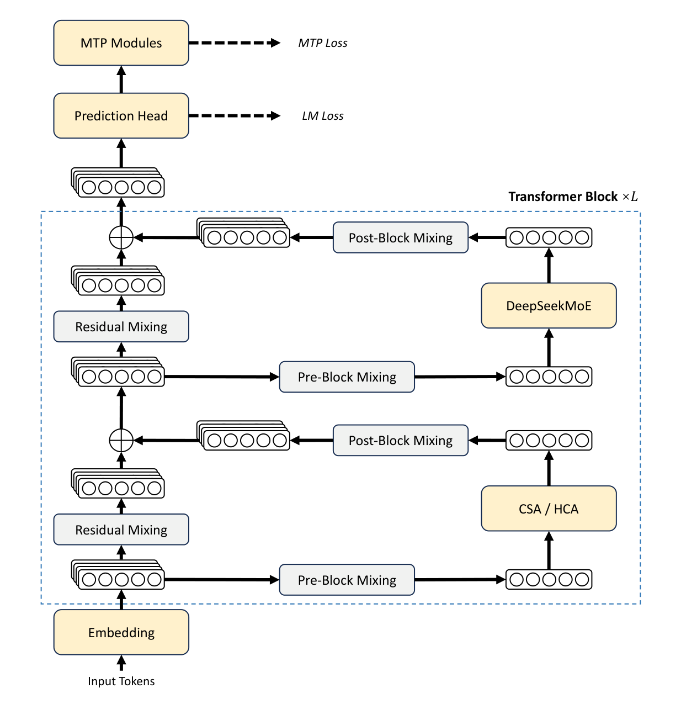
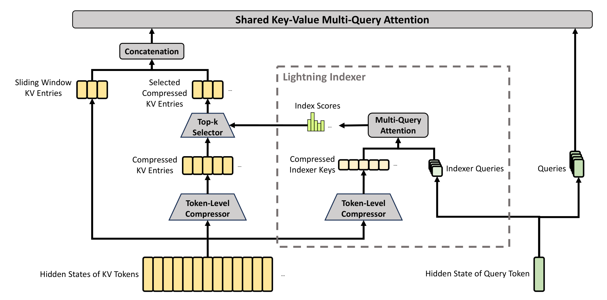
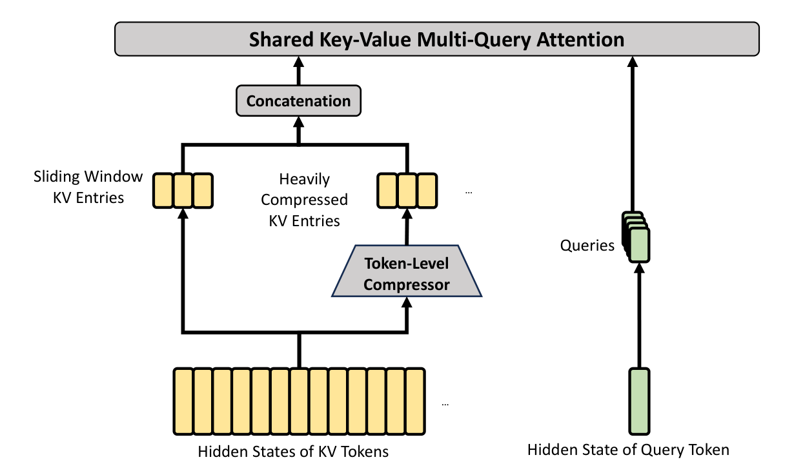
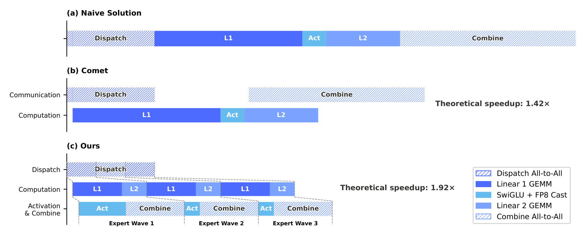
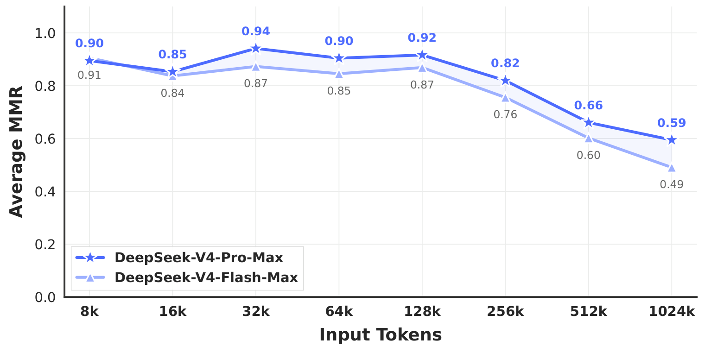

# DeepSeek-V4: Towards Highly Efficient Million-Token Context Intelligence

## 来源信息

| 项 | 内容 |
| --- | --- |
| 标题 | DeepSeek-V4: Towards Highly Efficient Million-Token Context Intelligence |
| 作者 | DeepSeek-AI（arXiv 元信息 319 条 = 团队名 DeepSeek-AI + 318 位个人；PDF 附录 A.1 按首字母排序，分 Research & Engineering 270 人与 Business & Compliance 48 人，共 318 人，`*` 标注已离开团队者） |
| 机构 | DeepSeek-AI（首页只写团队名与 `research@deepseek.com`，没有个人机构行） |
| 来源 | [arXiv:2606.19348v1](https://arxiv.org/abs/2606.19348v1)（官方页；README 00172 的编号列与标题列自 2026-11-08 均改指此处，见「归档说明」）；首次收录时来自 [Hugging Face 技术报告 PDF](https://huggingface.co/deepseek-ai/DeepSeek-V4-Pro/blob/main/DeepSeek_V4.pdf) |
| 版本历史 | 本笔记基于 HF build 的本地归档 `papers/00172-DeepSeek_V4.pdf`（**该文件已于 2026-11-08 按用户要求删除**，下列尺寸与 sha256 为删除前记录）：58 页，4,479,907 B，sha256 `f4cbe4fcbd2888b25b2890a98cc6ef4ce0489df7c93e140b6f853c451d3f5c52`，PDF 创建时间 2026-04-24 09:57 UTC。完整 arXiv v1 于 2026-04-26 提交，58 页，4,713,349 B，sha256 `55b2d72f772ac00de2e470b3ee08443c648d971c7f57c52d6202895665e5978d`，creator `arXiv GenPDF`、无 `creationDate`；两版关系见下节 |
| 许可 | PDF 未写许可；arXiv abs 页为 `nonexclusive-distrib/1.0`；HF 页面 2026-11-08 本机不可达（curl 000），权重许可未核验 |
| 阅读日期 | 2026-11-08 |
| 阅读范围 | 删除前的本地 HF build 58 页全文：§1–§6（p4–45）、References（p45–53）、附录 A–B（p54–58）。Table 1/6/7/8/9/10/11/12/13/14 对渲染页逐格核对，Table 2/3/4/5 对渲染页核对；Figure 1/2/3/4/5/6/7/8/9/10/11/12 已看渲染页，Figure 13 在 p43 渲染页上看到但未逐张分析，Figure 14/15 只按图注引用；References 未逐条阅读 |
| 核对凭据 | 删除前的本地 HF build：58 页、4,479,907 B、sha256 见上。渲染页：p1（Figure 1，170 dpi）、p6/9/11/15/23/30/31/32/33/40/41/43（170–200 dpi）、p28/38/39/44/55/57/58（170 dpi）；Figure 10 另用 PDF 矢量 marker 质心 + 刻度文字中心定标（p41，200 dpi 渲染交叉核对；HLE 横轴 0=117.8 pt、20k=154.7 pt，纵轴 5=241.9、40=112.5；TB2 横轴 20k=355.4、40k=427.9，纵轴 30=239.0、70=112.8）。裁剪（300 dpi，单位 pt）：Figure 2 从 p6，框 150–446 × 78–384，成品 1234×1275；Figure 3 从 p9，70–530 × 80–308，1918×951；Figure 4 从 p11，150–445 × 78–254，1230×734；Figure 5 从 p15，66–526 × 366–551，1917×771；Figure 9 从 p40，115–480 × 330–516，1521×775。每张按元素清单点名（图内标题、图例、坐标轴标题与刻度、图内注记、共享轴标签），边缘无黑边，重裁像素差 ≈0。否定性断言检索词：`QK-Clip`、`H800`/`H100`/`H20`、`GPU hours`、`ablation`、`variance`/`seed`/`error bar`、`license`、`multimodal`、`interleav` |
| 归档说明 | 2026-11-08 按用户要求把 README 00172 的编号列从本地归档 `./papers/00172-DeepSeek_V4.pdf` 改指 [arXiv 官方页](https://arxiv.org/abs/2606.19348)。同日按用户要求删除本地归档 `papers/00172-DeepSeek_V4.pdf`（该文件是本次阅读与复核的实际基准，删除前记录的页数、字节数与 sha256 见上两行；此后仓库不再保留原文，可复现的官方版本只有 arXiv v1）。HF 2026-11-08 本机不可达，无法确认 HF 上是否已有更新版本；arXiv 侧只查到 v1 |

---

## 复核记录

**2026-11-08（第 1 轮，依 check-paper-note，基准本地 `papers/00172-DeepSeek_V4.pdf`（该文件已于同日按用户要求删除），sha256 `f4cbe4fcbd2888b25b2890a98cc6ef4ce0489df7c93e140b6f853c451d3f5c52`）**：重读 58 页全文；Table 1/6/7/8/9/10/11/12/13/14 对渲染页逐格核对，Table 2/3/4/5 对 p30/31/33 渲染页核对；Figure 1/2/3/4/5/6/7/8/9/10/11/12 对渲染页核对，Figure 10 另用 PDF 矢量 marker 质心 + 刻度文字中心定标。另从 arXiv 完整重下 v1（58 页，4,713,349 B，sha256 `55b2d72f772ac00de2e470b3ee08443c648d971c7f57c52d6202895665e5978d`），修正了第一轮把 2,040,544 B 半截下载误当完整 v1 的证据错误。

两个独立只读子 agent（全篇 A–H + 关键数字/图表读数）的主要发现已逐条复验并修正：

- arXiv v1 记录改为完整文件；删除「字体嵌入有问题」「PDF 内部创建时间 2026-04-23 → 本地版更晚」两条由截断文件造成的错误证据；版本关系改写为「章节重组 + 引用增删，构建先后无法判定」。
- Figure 10 横轴与 V3.2 读数重测：HLE Pro 7.8@0.6k / 34.7@35k / 37.9@53k；V3.2 Think 25.1@21k、Speciale 30.6@35k；TB2 Flash High/Max 47k/57k、V3.2 None 35.0@15k。初稿把图内文字标签的位置当成了数据点。
- GPT-5.4 的 Codeforces 不是空格（3168）；缺测列改为 LiveCodeBench、SWE-Verified、SWE Multilingual、MRCR、CorpusQA。
- CSA「4096 token 有效感受野」改为「1024 个 entry 的信息容量约 4096 token；top-k 的选择范围是全部历史」。
- Table 12「最高是邮件书信」加「n≥100」限定；Figure 12 的「弱在视觉排版」改为「格式美观高于 Opus，但绝对值仍有提升空间」；「非负率」改为「不败率」。
- MRCR「差一个量级」改为「83.5% vs 59%，差 24.5 个百分点」；Table 1 的 BBH 反例按 0.3 同档规则降为同档内小幅落后。
- Muon 公式去掉原文没有的 `‖O'_t‖_RMS` 分母，并说明 NS 正交性使 `sqrt(max(n,m))·γ` 自然达到 RMS = γ。
- 补充：MRCR/CorpusQA 的 Opus/Gemini 为作者重测；BrowseComp/HLE w/tools 的 harness；Terminal-Bench 2.0 环境问题；作者数 319 条 = 团队名 + 318 人；README 00172 的 HF 链接在标题列；「comprehensive superiority」在 p5 而非 §4.3.2。
- 补 5 张配图（Figure 2/3/4/5/9），与 PDF 同坐标重裁的像素差为 0。

**本轮教训（值得进 skill）**：arXiv 大 PDF 下载必须同时校验「退出码 0 + 下载字节数等于 `Content-Length` + 文件尾 `%%EOF` + 页数合理」。首次用 `--max-time 120` 下载 4.7 MB 的 v1 时被截断到 2,040,544 B（完整下载需约 128 s），当时只看了 `-w` 的 HTTP 200、没有检查 curl 退出码，于是把半截文件当完整版，并从中读出并不存在的 `creationDate` 与字体错误。

**未修/未核**：HF 页面本机不可达（curl 000），权重内容与许可未验证；Figure 6/7 未做像素测量（只按渲染页目视）；Figure 13/14/15 未逐张分析；References 未逐条阅读；未复现任何实验；训练框架是否开源未核验。

**2026-11-08（第 2 轮，同一基准 sha256 `f4cbe4…f5c52`；完整 arXiv v1 `55b2d7…5978d`；复核前快照 md5 `6f2e689aa02eb0bbc9d0f7abf91e65fd`）**：两个独立只读审计（全篇 A–H + 跨篇关系/残留断言）逐条复验后，修复以下问题：

- **mHC**：动态项先乘门控 `α`，再与静态 bias `S` 相加（原文式 3–5 是 `α·(X̂W)+S`），初稿的语序会读成 `α·(X̂W+S)`。
- **版本关系**：MiniLLM 作者从 `Wei et al.` 改为 `Gu et al.`（arXiv v1 p48 为 Y. Gu, L. Dong, F. Wei, M. Huang）；FP4 细节的方向改为「整体上移为 §3.4，原 §5.2.1 只保留集成说明」；浮动体描述收窄为 Figure 6/7、Table 5 换页（Table 1/6/7 页码未变）；「另起一段 FP4」改为「同段末追加」。
- **局限引文**：`comprehensive theoretical understanding…` 的出处改为 §4.2.3（p26）并补全 `of their underlying mechanisms`；§6（p44）另引 `their underlying principles remain insufficiently understood`。
- **评测口径**：GPT-5.4 的 API 说明范围改为 1M 长上下文一节（MRCR/CorpusQA），LiveCodeBench 与 SWE 两列未说明原因；Figure 5 的 1.42×/1.92× 补「按 DeepSeek-V4-Flash 架构评估」；Table 1 的「完整表」改为「24 个 benchmark 行（参数/架构 3 行已并入上方配置表）」。
- **CSA**：补「4096 是等效压缩长度 `k·m`；每个 entry 由 `2m` 个原始 token 压成，若选中的 entry 不相邻，原始 token 覆盖上界为 `2mk = 8192`」。
- **写作评测**：Table 12 的「全表最高」改为「最高 100.00%（n=1）、次高 85.71%（n=7）」，并补「学术辅助 73.33%（n=15）」与两个「介绍评价」的类别；Table 13 的基数改为「指令遵循 2,837 次、写作质量 2,198 次」。
- **跨篇关系**：K2 的 8 个激活专家改为「8 个激活专家 + 1 共享（原文写 Experts Active per Token 8；「8 路由」是按 V3 惯例的推断）」；V4.1-Flash 的 CED/CSA2/FP4 改为「在 V4 的全局 + SWA 分支与异构 KV 布局上做替换/压缩」，不再说 CED 直接建立在 CSA/HCA 上。
- **措辞**：Figure 10 的「分数随 token 线性增长」改为「边际收益递减」；「所有 benchmark 都是单次报告」改为「原文未说明是否多次运行取平均」；CMath 补「比 Flash 低 2.7、比 V3.2 低 1.7」；速查表的「前 1T 稠密」改为「Flash 前 1T、Pro 更长」。

**第 2 轮未修/未核**：同第 1 轮（HF 不可达、Figure 6/7 未做像素测量、Figure 13/14/15 未逐张分析、References 未逐条阅读、未复现实验、训练框架是否开源未核验）。

---

## 版本关系：HF build 与 arXiv v1

两版同为 58 页、同题、同摘要，抽查的 Table 1（p28）、Table 6（p38）、Table 7（p39）数字一致。完整 arXiv v1 是 4,713,349 B、sha256 `55b2d72f772ac00de2e470b3ee08443c648d971c7f57c52d6202895665e5978d`，creator 为 `arXiv GenPDF`，顶层没有 `creationDate`；本地版（2026-11-08 已删除）4,479,907 B、sha256 `f4cbe4…`，PDF 创建时间 2026-04-24 09:57 UTC。**完整 v1 的文本层是正常的**——早期复核时下到过一份 2,040,544 B 的半截文件，`pymupdf` 报 `unknown cid font type` / `object is not a stream`，那是截断伪影，不是 arXiv 文件本身的问题。

能确认的实质差异是**章节重组与引用增删**，不只是排版：

- **FP4 QAT 的位置整体上移**：arXiv v1 的 §3.4 是 Training Framework，FP4 QAT 放在 §5.2.1；本地版把 FP4 QAT 提升为 §3.4，Training Framework 顺延为 §3.5，§5.2 改名为 “RL and OPD Infrastructures”；FP4 细节整体上移为 §3.4，原 §5.2.1 只保留一段集成说明并改名 “FP4 Quantization Integration”。这解释了 §3.5/§5 的页码整体后移约 1–2 页。
- **引言贡献列表的顺序**：arXiv v1 是「前三条 + 第四/第五条训练/推理 + 同段末追加一句 FP4」；本地版把 FP4 并入第四条，训练与推理顺延为第五/最后一条。
- **OPD 引用**：arXiv v1 在 p5、§5 开头、§5.1.2 三处都保留 `Gu et al., 2024` 与 `Lu and Lab, 2025`（§5 开头写作 `(OPD; Gu et al., 2024; Lu and Lab, 2025)`）；本地版 p5 只保留 `Lu and Lab, 2025`，§5 开头与 §5.1.2 则把两个引用都删成 `(OPD)`。
- **个别句子的扩写**：本地版把 activation function 建议扩成「同参数预算下去掉 gate projection 可以增大中间维 `d`、进一步放宽带宽要求」；pull-based 通信从「reads activations」改成「reads data」。
- **浮动体位置不同**：Figure 6（arXiv p22 → 本地 p23）、Figure 7（p31 → p32）与 Table 5（p32 → p33）换页；Table 1/6/7 与 GRM/Quick Instruction 段落仍在同一页，但 Table 1 与 §4.3.2 的相对位置不同（arXiv 先文后表，本地先表后文）。
- **参考文献**：arXiv v1 有 MiniLLM（Gu et al., 2024；Y. Gu, L. Dong, F. Wei, M. Huang），本地版没有这一条。
- **无法判定构建先后**：完整 v1 没有 `creationDate`；arXiv 提交日期（2026-04-26）晚于本地 PDF 创建时间（2026-04-24），但 v1 的章节结构看起来更像「FP4 还在 post-training」的旧稿。没有源码历史，不能仅凭日期判断谁更新。

结论：两版是同一稿的两个编辑版本，关键表格数字一致；本笔记以本地 HF 版为准（该 PDF 已删除，仅存上述哈希与页数记录；若之后 arXiv 出现 v2，需要重新核对章节号与引用）。

---

## 核心结论

一句话：**V4 不是「再堆一个更大的 MoE」，而是一次效率优先的重构——用 CSA（4:1 压缩 + top-k 稀疏）与 HCA（128:1 压缩 + 稠密注意力）交替替换 MLA，用 mHC 把残差映射约束到双随机矩阵流形上，用 Muon 替换大部分模块的 AdamW，把 1M 上下文的单 token FLOPs 压到 V3.2 的 27%、KV cache 压到 10%（Pro）；后训练则把 V3.2 的混合 RL 整个换成多教师 on-policy distillation。**

- **注意力是主贡献**：CSA 先把每 4 个 token 压成 1 个 KV entry，再在压缩后的 entry 上做 top-k 稀疏选择（Pro 选 1024 个、Flash 选 512 个），并保留 128 token 的滑窗分支补局部细节；HCA 把 128 个 token 压成 1 个 entry，但不做稀疏，直接稠密注意力。两类层交替堆叠，Flash 的前两层是纯 SWA，Pro 的前两层是 HCA。
- **1M 上下文的效率数字**：相对 DeepSeek-V3.2，Pro 只需 27% 的单 token 推理 FLOPs 与 10% 的 KV cache，Flash 只需 10% 与 7%（Figure 1 的右图写作 3.7×/9.5× 与 9.8×/13.7×，与百分比是取整关系）。
- **mHC 是「给残差连接加谱范数约束」**：把 HC 的残差映射矩阵 `B_l` 投影到 Birkhoff 多面体（双随机矩阵），用 Sinkhorn-Knopp 迭代 20 步实现，保证谱范数不超过 1；配套的融合 kernel、重算与 DualPipe 调整把墙钟开销压到 1F1B 流水阶段的 6.7%。
- **Muon 在这篇里不再需要 QK-Clip**：CSA/HCA 允许直接对 query 与 compressed KV entry 做 RMSNorm，注意力 logit 不会爆；Muon 用 8 步快速收敛 + 2 步精确稳定的混合 Newton-Schulz，并对 MoE 梯度做 BF16 随机舍入以减半通信。
- **后训练的关键替换是 GRM + OPD**：每个领域先 SFT 再 GRPO 训出专家；难验证任务不再训标量 reward model，而是让 actor 自己当 Generative Reward Model（GRM）；最后用 10 个以上教师做 full-vocabulary 的 on-policy distillation，而不是混合 RL 或权重平均。
- **工程上最值得抄的是「确定性」与「可抢占」**：端到端 bitwise batch-invariant / deterministic kernel、token 级 WAL 的 rollout 服务、以及把压缩 KV 落盘做共享前缀复用。
- **主结果要打折看**：SimpleQA-Verified 57.9 明显高于开源对手（K2.6 36.9、GLM-5.1 38.1），但 GPQA 90.1 低于 K2.6 的 90.5；Apex 38.3 远低于 GPT-5.4 的 54.1 与 Gemini-3.1-Pro 的 60.9；MRCR 1M 的表格值（83.5）与 Figure 9 在 1024k 的读数（约 59）对不上，差约 24.5 个百分点（见「原文自身的表述张力」）。

---

## 问题与动机

论文的出发点是一个被两头夹住的约束：

1. **测试时扩展依赖长上下文**：推理模型把更多算力花在更长的思维链上，长程 agent 又要把大量工具结果、文件与跨文档材料留在上下文里；vanilla attention 的二次复杂度让这两条路都很贵。
2. **已有的稀疏注意力只解决了「算」，没解决「存」**：V3.2 的 DSA 已经在 token 级做 top-k（2048），但每个被选中的 token 仍要保留完整 KV；上下文到 1M 时，KV cache 的容量与带宽成为新的主矛盾。
3. **万亿参数 MoE 的训练稳定性仍是经验问题**：V4 在训练中遇到 loss spike，作者把它归因到 MoE 层的 outlier 与路由的相互放大，但只给出两个「有效但机理未明」的技巧。

因此 V4 的取舍是：**同时压缩 KV 的长度（CSA/HCA）与存储精度（KV 用 BF16 RoPE 维 + FP8 其余维；FP4 用在 MoE 权重与 CSA indexer 的 QK 路径），再用更强的残差约束（mHC）与优化器（Muon）保住训练稳定性**。代价是架构明显变复杂——作者在结论里自己承认这一点。

---

## 方法与机制

### 1. 总体架构：保留 V3 骨架，替换注意力、残差与优化器

V4 保留 Transformer、DeepSeekMoE 与 MTP，改动集中在三处：

- **注意力**：CSA 与 HCA 交替，替代 V3 的 MLA；每个 CSA/HCA 层另有一条 128 token 的滑窗分支。
- **残差**：mHC 把残差流宽度扩到 `n_hc = 4` 倍，并对块间混合矩阵加双随机约束。
- **优化器**：除 embedding、prediction head、mHC 的静态 bias/门控与 RMSNorm 外，大部分模块用 Muon 替代 AdamW。

MoE 侧相对 V3 还有四个小改动：affinity 的激活从 `Sigmoid` 换成 `Sqrt(Softplus)`；保留 auxiliary-loss-free 负载均衡，但加一个很小的 sequence-wise balance loss（权重 `1e-4`）；去掉路由目标节点数的约束；把最初几个 block 的 dense FFN 也换成 MoE，并对前 3 个 MoE 层使用按 token ID 的 Hash routing。

| 配置 | DeepSeek-V4-Flash | DeepSeek-V4-Pro |
| --- | --- | --- |
| Transformer 层数 | 43 | 61 |
| hidden size | 4096 | 7168 |
| 前两层注意力 | 纯 SWA | HCA |
| 后续层 | CSA/HCA 交替 | CSA/HCA 交替 |
| query heads `n_h` | 64 | 128 |
| head dim `c` | 512 | 512 |
| query 压缩维 `d_c` | 1024 | 1536 |
| 输出分组 `g` / `d_g` | 8 / 1024 | 16 / 1024 |
| CSA 压缩率 `m` / top-k | 4 / 512 | 4 / 1024 |
| HCA 压缩率 `m'` | 128 | 128 |
| 滑窗 `n_win` | 128 | 128 |
| indexer heads / dim | 64 / 128 | 64 / 128 |
| 共享专家 + 路由专家 | 1 + 256 | 1 + 384 |
| 每 token 激活的路由专家 | 6 | 6 |
| 专家中间维 | 2048 | 3072 |
| MTP 深度 | 1 | 1 |
| mHC `n_hc` / Sinkhorn 步数 | 4 / 20 | 4 / 20 |
| 总参数 / 激活参数 | 284B / 13B | 1.6T / 49B |
| 预训练 token | 32T | 33T |



一个原文没有给的细节是 **CSA 与 HCA 的交替比例**：正文只说 “interleaved manner”，没有说几层 CSA 配几层 HCA。实现细节指向 HF 上的 inference 代码（`DeepSeek-V4-Pro/tree/main/inference`），但本机 HF 不可达，未能核对。这一点会影响「每层看到的历史分辨率」，属于复现时首先要确认的参数。

### 2. mHC：把残差映射约束到双随机矩阵

标准 Hyper-Connections 把残差流从 `d` 维扩成 `n_hc × d`，用三个线性映射 `A_l`、`B_l`、`C_l` 控制输入、残差变换与输出：

```math
X_{l+1} = B_l X_l + C_l F_l(A_l X_l)
```

白话读法：`A_l` 把扩宽后的残差压回 `d` 维喂给第 `l` 层，`F_l` 是该层（MoE 或注意力），`C_l` 把层输出写回扩宽的残差流，`B_l` 决定旧残差如何混合到下一层。

HC 的问题是深层堆叠时训练会频繁出现数值不稳定（原文只说现象）。一个常见的解释是 `B_l` 的谱范数可能大于 1、信号沿层指数放大——**这一步是笔记推断，原文没有给出**。mHC 的做法是把 `B_l` 限制在 Birkhoff 多面体上：

```math
\mathcal{M} = \{ M \in \mathbb{R}^{n \times n} \mid M\mathbf{1}_n = \mathbf{1}_n,\ \mathbf{1}_n^\top M = \mathbf{1}_n^\top,\ M \ge 0 \}
```

白话读法：`M` 的每一行、每一列都和为 1 且非负，因此 `M` 是双随机矩阵；它的谱范数不超过 1，残差变换是非扩张的，前向与反向都更稳。双随机矩阵对乘法封闭，所以多层堆叠仍然稳。

实现上，三个映射的参数是「动态 + 静态」两部分：先把输入 `X_l` flatten 后做 RMSNorm，再用可学习矩阵生成动态项；动态项先乘一个初始化为小值的门控 `α`，再与静态 bias `S` 相加（即 `α·(X̂W) + S`）。约束通过 Sigmoid 与 Sinkhorn-Knopp 完成：

```math
\begin{aligned}
A_l &= \sigma(\tilde{A}_l), \qquad C_l = 2\sigma(\tilde{C}_l),\\
M^{(0)} &= \exp(\tilde{B}_l), \qquad M^{(t)} = T_r(T_c(M^{(t-1)})),\\
B_l &= M^{(t_{\max})}, \qquad t_{\max} = 20
\end{aligned}
```

白话读法：`A_l` 与 `C_l` 用 Sigmoid 保证非负且有界；`B_l` 先取指数保证正，再交替做列归一化 `T_c` 与行归一化 `T_r`，20 步后得到近似的双随机矩阵。原文的写法是先列后行（`T_r(T_c(·))`）。

工程代价：mHC 增加激活内存与流水线通信。作者用融合 kernel、选择性重算（重算层间 hidden state 与归一化后的层输入，不重算计算密集算子）以及调整 DualPipe 1F1B 来抵消，最终墙钟开销为重叠后 1F1B 阶段的 **6.7%**。

### 3. CSA：先压缩，再在压缩 entry 上做稀疏选择



CSA 的目标是把「每个 token 一个 KV」变成「每 `m` 个 token 一个 compressed entry」，再只对少数 entry 做核心注意力。它同时保留两条 KV 序列 `C^a`、`C^b` 与对应的压缩权重 `Z^a`、`Z^b`，每个 compressed entry 由当前块的 `m` 个 `C^a` 与前一块的 `m` 个 `C^b` 共同决定：

```math
\begin{aligned}
[S^a_{mi:m(i+1)-1}; S^b_{m(i-1):mi-1}] &= \operatorname{Softmax}_{row}([Z^a_{mi:m(i+1)-1}+B^a;\ Z^b_{m(i-1):mi-1}+B^b]),\\
C_i^{\mathrm{Comp}} &= \sum_{j=mi}^{m(i+1)-1} S^a_j \odot C^a_j + \sum_{j=m(i-1)}^{mi-1} S^b_j \odot C^b_j
\end{aligned}
```

白话读法：每个 compressed entry 实际上看了 `2m` 个原始 KV，但相邻 entry 的 `C^b` 与 `C^a` 窗口重叠，净效果仍是把序列压到 `1/m`。`B^a`、`B^b` 是可学习的位置 bias，`⊙` 是逐元素乘。

压缩之后是 **Lightning Indexer**：query 先降维到 `c_t^Q`，再上投影成多个 indexer head；每个 head 与 compressed indexer key 做点积、ReLU、按可学习权重求和，得到 query 对每个 compressed block 的分数：

```math
I_{t,s} = \sum_{h=1}^{n_I} w^I_{t,h} \cdot \operatorname{ReLU}\left(q^I_{t,h} \cdot K_s^{\mathrm{IComp}}\right)
```

白话读法：indexer 只负责「选谁」，不算最终输出；ReLU 让分数不必归一化，top-k 只看相对大小，因此可以跑得很便宜。选出 top-k 个 compressed entry 后，CSA 用 **shared KV MQA** 做核心注意力：每个被选中的 compressed entry 同时当 key 与 value，query 则从同一个 `c_t^Q` 上投影出 `n_h` 个头。由于 `c · n_h` 很大，输出不做一次性投影，而是先分成 `g` 组投到 `d_g` 维，再拼起来投回 `d`（grouped output projection）。

另外还有四个容易漏的细节：

- **滑窗分支**：每个 query 额外保留最近 `n_win = 128` 个未压缩 KV，和选中的 compressed entry 一起做核心注意力。原因是因果性要求 query 只能看「之前的完整压缩块」，它看不到自己所在块内的其他 token。
- **部分 RoPE**：只对 query、KV entry 与核心注意力输出的最后 64 维加 RoPE；因为 KV entry 同时当 key 与 value，输出会带上绝对位置，所以再对输出加位置 `-i` 的 RoPE，把绝对位置抵消成相对位置。
- **Attention sink**：每个头有一组可学习 sink logit，加在 softmax 分母上，允许该头的注意力总和不等于 1，甚至可以接近 0。
- **QK RMSNorm**：核心注意力之前对每个 query head 与 compressed KV entry 做 RMSNorm，防止 logit 爆炸；这也是后面 Muon 不需要 QK-Clip 的原因。

一个重要口径：**top-k 选的是 compressed entry，不是原始 token，而且选择范围是全部历史**（式 16 的 index score 对 `s < Floor(t/m)` 的所有 preceding compressed block 计算）。Pro 的 `k = 1024`、`m = 4`，意味着被选中的 1024 个 entry 最多携带约 `1024 × 4 = 4096` 个原始 token 的**信息量**（本笔记复算），再加 128 token 滑窗；Flash 的 `k = 512` 对应约 2048 token 的信息容量。但 1M 上下文下 compressed entry 总数约 262,144（`1,024K / 4`），top-k 是在这全部 entry 里选，不是只在最近 4096 token 里选。4096 是等效压缩长度 `k·m`；每个 entry 由 `2m` 个原始 token 压成，若选中的 entry 不相邻，原始 token 覆盖上界为 `2mk = 8192`。这个「信息容量」比 V3.2 的 token 级 top-k 2048 更结构化，但也更依赖压缩质量。

### 4. HCA：128:1 压缩，但不做稀疏



HCA 的压缩方式与 CSA 类似，但只用一条 KV 序列、不做重叠压缩，压缩率 `m' = 128`（远大于 CSA 的 4），并且压缩后直接做稠密注意力，不经过 indexer 与 top-k：

```math
S_{m'i:m'(i+1)-1} = \operatorname{Softmax}_{row}(Z_{m'i:m'(i+1)-1}+B), \qquad
C_i^{\mathrm{Comp}} = \sum_{j=m'i}^{m'(i+1)-1} S_j \odot C_j
```

白话读法：每 128 个 token 的 KV 被加权求和成一个 entry；一个 HCA 层在 1M 上下文下只有约 8192 个 entry，稠密注意力的成本可以接受。HCA 复用 CSA 的 shared KV MQA、grouped output projection 与滑窗分支，只是没有 indexer。

两类层的分工可以这样理解（本笔记的解读）：**CSA 负责「细粒度地选」——4:1 压缩后仍有 top-k，能在长历史里挑出相关片段；HCA 负责「粗粒度地看」——128:1 压缩后稠密扫全历史，提供低分辨率的全局背景。** 交替堆叠相当于让模型同时拥有这两种分辨率。

### 5. 注意力效率与混合 KV 布局

效率上有四个叠加的来源：

1. **压缩**：CSA 把序列压到 `1/4`，HCA 压到 `1/128`。
2. **稀疏**：CSA 只对 top-k 个 compressed entry 做核心注意力，`k` 比 V3.2 的 token 级 top-k 小。
3. **低精度存储**：KV entry 的 RoPE 维用 BF16，其余维用 FP8，整体约为纯 BF16 的一半。
4. **低精度计算**：indexer 的 QK 路径用 FP4。

原文给的汇总口径是：以 BF16 GQA8（head dim 128）为基线，V4 在 1M 上下文下的 KV cache 约为该基线的 **2%**（原文写作 “approximately 2% times of that baseline”，措辞略拗口）。相对 V3.2，Pro 的 KV 是 10%、Flash 是 7%；单 token FLOPs 分别是 27% 与 10%。

KV cache 的布局也随混合注意力变得异构（Figure 6）：

- **state cache**：给 SWA 的最近 `n_win` 个 KV，以及 CSA/HCA 中「还没凑够一个压缩块」的尾部未压缩状态。每个请求预分配固定大小的块，动态绑定。
- **classical KV cache**：给 CSA/HCA 的 compressed entry。每个 cache block 覆盖 `lcm(m, m')` 个原始 token，产生 `k_1 = lcm(m,m')/m` 个 CSA entry 与 `k_2 = lcm(m,m')/m'` 个 HCA entry。按 V4 的 `m = 4`、`m' = 128`，`lcm = 128`，即每块 32 个 CSA entry + 1 个 HCA entry（本笔记复算）。
- **磁盘 KV**：compressed entry 全部落盘，命中共享前缀时直接读回，直到最后一个完整压缩块；尾部不完整块仍需重算。SWA 的 KV 不压缩、每层都有，体积约为 compressed KV 的 **8 倍**，因此给了三种策略：全量缓存（零重算、写放大严重）、周期 checkpoint（每 `p` 个 token 存一次最近 `n_win` 个 KV，尾部重算）、零缓存（只靠 compressed KV 重算最近 `n_win × L` 个 token）。

### 6. Muon：不需要 QK-Clip 的版本

V4 的 Muon 与 K2 的 MuonClip 最大的区别是：**不做 QK-Clip**。原因是 CSA/HCA 允许在核心注意力前直接对 query 与 compressed KV entry 做 RMSNorm，logit 不会爆；而 K2 的 MLA 在推理时不物化 K，没法套 QK-Norm，只能退回「按头缩放 Q/K 投影」的 QK-Clip。

算法主体是标准的 Muon + Nesterov + weight decay + RMS 重缩放：

```math
\begin{aligned}
M_t &= \mu M_{t-1} + G_t,\\
O'_t &= \operatorname{HybridNewtonSchulz}(\mu M_t + G_t),\\
O_t &= O'_t \cdot \sqrt{\max(n,m)} \cdot \gamma,\\
W_t &= W_{t-1}(1-\eta\lambda) - \eta O_t
\end{aligned}
```

白话读法：先累积动量 `M_t`，再用 Nesterov 组合 `μM_t + G_t`；`HybridNewtonSchulz` 把矩阵近似正交化成 `UV^T`；随后乘 `sqrt(max(n,m))·γ` 把更新矩阵的 RMS 缩放到 `γ`，以便复用 AdamW 的学习率；最后做 decoupled weight decay 并更新。注意原文 Algorithm 1 第 6 行只有这个乘法、没有除以 `‖O'_t‖_RMS`：NS 输出近似正交，其 RMS 约为 `1/sqrt(max(n,m))`，乘上 `sqrt(max(n,m))` 后 RMS 约为 1，再乘 `γ` 即达到目标；本笔记按渲染页原样抄写。

混合 Newton-Schulz 共 10 步：前 8 步用 `(3.4445, -4.7750, 2.0315)` 快速把奇异值推到 1 附近，后 2 步用 `(2, -1.5, 0.5)` 精确稳定在 1。超参：momentum `0.95`、weight decay `0.1`、RMS 目标 `0.18`；embedding、prediction head、mHC 的静态参数与门控、RMSNorm 仍用 AdamW。

工程上有三个细节：

- **Hybrid ZeRO**：Muon 需要完整梯度矩阵，不能像 AdamW 那样按元素切分。稠密参数用 knapsack 把矩阵分到各 rank，每 rank 最多 5 个矩阵，padding 开销 <10%；数据并行超过 ZeRO 上限时，多出来的组冗余计算 Muon 更新，用算力换显存。MoE 参数按专家独立处理，先把所有专家的 down/up/gate 投影 flatten，再整体切分。
- **BF16 梯度**：Newton-Schulz 在 BF16 矩阵乘下仍然稳定，因此 MoE 梯度同步前用随机舍入降到 BF16，通信量减半；为避免低精度加法累积误差，reduce-scatter 改成「先 all-to-all 交换、再各 rank 本地 FP32 求和」的两阶段。
- **批处理**：同形状的连续参数自动合并，Newton-Schulz 可以批量执行。

### 7. 训练基础设施

这一节是全文工程密度最高的部分，按「通信 → 编译 → 数值 → 量化 → 并行 → 重算」顺序看。

**7.1 EP 的细粒度通信-计算重叠。** 原文把 MoE 层拆成四个 stage（Dispatch、Combine 两个通信段 + Linear-1、Linear-2 两个计算段），Figure 5 另外画出夹在中间的 Activation；作者把专家切成 wave，wave 内通信一完成就开始算，稳态下「当前 wave 计算、下一 wave 传输、已完成专家回传」同时进行。Figure 5 的理论加速比是 **1.92×**（Comet 为 1.42×；均按 DeepSeek-V4-Flash 架构评估），实测在通用推理负载上是 **1.50–1.73×**，延迟敏感的 RL rollout / agent serving 上最高 **1.96×**。作者还给了硬件设计建议：通信能否被完全隐藏取决于计算通信比，而不是单纯看带宽；对 Pro，每个 token-expert 对约 `6hd` FLOPs、`3h` 字节通信，条件化简为 `C/B ≤ 2d = 6144 FLOPs/Byte`（按 `2d = 6144` 反推，这里的 `d` 应是专家中间维 3072，而不是 §2 的 hidden size 7168；原文没有显式说明这个同名冲突，本句为笔记判断），即每 GB/s 互联带宽可隐藏约 6.1 TFLOP/s 的计算。



**7.2 TileLang。** 用 DSL 写融合 kernel，重点是 Host Codegen：把 host 侧的校验与参数编排下沉到生成的 host 代码，CPU 侧每次调用的开销从几十/几百微秒降到 **<1 微秒**。编译器里集成 Z3，把整数表达式翻译成 QF_NIA 做形式化分析（布局推断、内存冲突、边界分析）。数值上默认关闭 fast-math，需要 IEEE 语义时用显式 intrinsic；布局标注可以固定 lowering 决策，做到与手写 CUDA 逐位一致。

**7.3 batch-invariant 与确定性 kernel。** 目标不是「平均意义上可复现」，而是「同一个 token 在 batch 里换位置，输出逐位相同」。三个难点与对策：

- **注意力**：不能用 split-KV（会把一个序列拆到多个 SM），但放弃它会有 wave quantization。作者用双 kernel：第一个 kernel 在单 SM 内算完整序列，保证高吞吐；第二个 kernel 用多 SM 处理最后不满的 wave，并精心设计累加顺序与分布式共享内存，使两个 kernel 逐位一致。
- **矩阵乘**：cuBLAS 不保证 batch invariance，整体换成 DeepGEMM；小 batch 下放弃 split-k，再用其他优化补回性能。
- **反向的原子加**：注意力反向给 KV 梯度用 `atomicAdd` 会引入非确定性，改成每个 SM 独立缓冲、最后全局确定性求和；MoE 反向用 token 顺序预处理 + 多 rank 缓冲隔离；mHC 的小矩阵（输出维只有 24）不得不用 split-k，就把每个 split 的输出分开存，再用一个后续 kernel 做确定性归约。

**7.4 FP4 QAT。** 对两个部分做 MXFP4：MoE 专家权重（显存大头）与 CSA indexer 的 QK 路径（KV 激活要缓存、加载、相乘）。QAT 发生在 post-training：FP32 master weight 先量化到 FP4，再反量化到 FP8 参与计算。作者强调 **FP4 → FP8 是无损的**：FP8 (E4M3) 比 FP4 (E2M1) 多 2 个指数位，只要每个 FP8 量化块（128×128）内 FP4 子块（1×32）的 scale 最大/最小比值不超过一定阈值，细粒度 scale 就能被 FP8 的动态范围吸收；实测当前权重满足。这样整条 QAT 管线可以复用现有 FP8 训练框架，反向直接对 FP8 权重求梯度、回传到 FP32 master，相当于 STE。推理与 RL rollout 阶段直接用真实 FP4 权重，保证采样行为与线上部署一致。index score 还从 FP32 降到 BF16，top-k selector 约 **2×** 加速，KV entry 召回率 **99.7%**。

**7.5 长上下文注意力的 contextual parallelism。** 常规 CP 按序列切分，但压缩要求 `m` 个连续 KV 一起处理，且不同 rank 的压缩长度可能不同。作者用两阶段通信：第一阶段每个 rank 把最后 `m` 个未压缩 KV 发给下一个 rank，后者连同本地 `s` 个 KV 一起压成固定长度 `s/m + 1` 个 entry（含 padding）；第二阶段 all-gather 所有本地压缩结果，再用 fused select-and-pad 重排成总长 `cp_size × s/m` 的完整压缩 KV。HCA 与 CSA indexer 的可见范围可以按规则预计算，CSA 的稀疏部分则由 top-k 显式给出索引。

**7.6 tensor 级激活重算。** 常规 checkpoint 以整个 module 为粒度，V4 做到 tensor 粒度：开发者只写 forward，并标注哪些 tensor 需要 checkpoint；框架用 TorchFX 追踪完整计算图，为每个标注 tensor 反向找出最小重算子图，插到对应梯度计算之前。重算直接释放并复用存储指针，不做 GPU 拷贝；共享存储的 tensor（如 reshape 的输入输出）会自动去重。

### 8. 推理框架：异构 KV cache 与磁盘复用

除了 §5 的布局，推理侧还有两个值得记的设计：

- **state cache 池化**：SWA 与「未凑够压缩块」的尾部状态被当成 sequence-specific state，预分配固定大小池、按请求动态绑定；这绕开了 PagedAttention 假设「所有层 KV 结构一致」的前提。
- **sparse attention kernel 协同设计**：不同层的压缩率不同，不能假设每块固定 token 数；通过与 kernel 协同设计，允许每块 token 数是 `lcm(m, m')` 的任意倍数，并按 cache line 对齐做 padding。

磁盘侧的选择取决于部署场景：全量 SWA 缓存适合读多写少、追求零重算；周期 checkpoint 用 `p` 调存储/计算折中；零缓存最省存储，但每个命中前缀要重算 `n_win × L` 个 token 的 SWA KV。

### 9. 预训练

**数据**：在 V3 语料上继续清洗（去掉批量生成/模板化网页内容，降低 model collapse 风险），加强数学、代码、多语言与长文档（论文、技术报告）；mid-training 阶段加入 agentic 数据。总量 >32T token，tokenizer 仍是 128K 词表，沿用 token-splitting 与 FIM；与 V3 不同的是使用 sample-level attention masking。

**配方**：

| 项 | V4-Flash | V4-Pro |
| --- | --- | --- |
| 训练 token | 32T | 33T |
| 最大 batch | 75.5M token | 94.4M token |
| 峰值学习率 | `2.7e-4` | `2.0e-4` |
| 末端学习率 | `2.7e-5` | `2.0e-5` |
| 序列长度 | 4K → 16K → 64K → 1M | 同左 |
| 稠密注意力预热 | 前 1T token | 比 Flash 更长 |
| 稀疏注意力引入 | 64K 序列长度起 | 同左 |
| bias 更新速度 | 0.001 | 0.001 |
| balance loss 权重 | `1e-4` | `1e-4` |
| MTP loss 权重 | 0.3（衰减后 0.1） | 同左 |

稀疏注意力不是从第一步就开：先用稠密注意力训 1T token，到 64K 序列长度时引入；引入时先短阶段预热 CSA 的 lightning indexer，再切到稀疏训练。

**稳定性**：作者观察到 spike 与 MoE 层 outlier 强相关，路由机制会放大 outlier。两个对策：

- **Anticipatory Routing**：把 backbone 与 routing 的更新解耦——第 `t` 步用当前参数 `θ_t` 算特征，但路由索引用历史参数 `θ_{t-Δt}` 计算并应用。实现上在 `t-Δt` 步提前取第 `t` 步的数据、预算并缓存路由索引，避免加载两遍模型；额外墙钟开销约 **20%**。系统还会自动检测 spike，触发短回滚并临时启用该模式，稳定一段时间后恢复标准训练。
- **SwiGLU Clamping**：把 SwiGLU 的线性分量截到 `[-10, 10]`，gate 分量的上界截到 10。作者说这能消除 outlier、显著稳定训练且不损性能。

两个技巧都有效，但作者明确说机理「仍是一个开放问题」。

### 10. 后训练

**10.1 专家训练。** 每个领域（数学、代码、agent、指令跟随等）独立做 SFT + GRPO，奖励来自领域特定的规则/测试/GRM。三种推理模式通过不同的长度惩罚与上下文窗口训出来：

| 模式 | 特点 | 典型场景 | 响应格式 |
| --- | --- | --- | --- |
| Non-think | 快、直觉、基于习惯或简单规则 | 日常任务、紧急反应、低风险决策 | `</think>` 后接 summary |
| Think High | 有意识的逻辑分析，慢但更准 | 复杂问题求解、规划、中风险决策 | `<think>` thinking tokens `</think>` summary |
| Think Max | 把推理推到极限，慢但最强 | 探索模型推理能力边界 | 特殊 system prompt + `<think>` thinking tokens `</think>` summary |

Think Max 的 system prompt 要求「绝对最大推理努力、不许走捷径、完整写出 deliberation、逐项压力测试、记录每个中间步骤与被否定的假设」。这是一个很重的提示，适合离线高价值任务，不适合低延迟场景。

**10.2 Generative Reward Model。** 难验证任务不再训标量 RM，而是用 rubric 指导的 RL 数据，让 actor 自己当 GRM 给轨迹打分；也就是说，同一个网络既生成回答又评估回答，评判能力与生成能力一起优化。作者的说法是：模型的内部推理会自然融入评估过程，因此只需要很少的多样人工标注就能泛化到复杂任务。代价是「自评」可能带来偏好自洽（本笔记的判断，原文没有讨论）。

**10.3 工具调用与交错思考。** 新的 tool-call schema 用特殊 token `|DSML|` + XML 格式（Table 4），作者说这能减少转义失败与工具调用错误。交错思考分两种场景：

- **带工具**：所有 reasoning 内容在整个对话中保留，包括跨 user message 边界；这样长程 agent 不会在每个新用户轮次丢掉问题状态。
- **不带工具**：沿用 V3.2 的策略，新 user message 到来时丢掉之前的 reasoning，保持上下文简洁。

原文还提醒：像 Terminus 这种「用 user message 模拟工具交互」的框架可能触发不了 tool-calling 路径，因此享受不到 reasoning 持久化，仍建议用 non-think 模型。

**10.4 Quick Instruction。** 聊天场景里有一堆辅助任务（是否触发搜索、意图识别、生成搜索 query、判断来源权威性/领域、是否抓取 URL 等）。常规做法是单独训一个小模型，但它无法复用已有 KV cache，要重复 prefill。V4 直接在输入序列末尾追加专用特殊 token（`<|action|>`、`<|title|>`、`<|query|>`、`<|authority|>`、`<|domain|>`、`<|extracted_url|>`、`<|read_url|>`），复用已算好的 KV cache，避免重复 prefill，还能并行执行多个辅助任务，降低 TTFT，也省掉维护小模型的工程开销。

**10.5 On-Policy Distillation。** 最后一步不是混合 RL，而是多教师 OPD：学生 `π_θ` 在自己的轨迹上学习多个教师 `π_Ei` 的输出分布，

```math
\mathcal{L}_{\mathrm{OPD}}(\theta) = \sum_{i=1}^{N} w_i \cdot D_{\mathrm{KL}}\left(\pi_\theta \,\|\, \pi_{E_i}\right)
```

白话读法：对每个教师算 reverse KL（学生在前、教师在后），按教师权重 `w_i` 加权求和；轨迹由学生自己采样，所以是 on-policy。原文用 10 个以上教师覆盖不同领域，并强调 **full-vocabulary logit distillation**：把完整 logit 分布保留下来算 KL，而不是像常见做法那样只取每个 token 位置的标量估计（把 `sg[log(π_E/π_θ)]` 当 advantage 塞进策略损失）。后者省资源但梯度方差大、训练不稳；前者更稳，也更忠实。

### 11. RL 与 OPD 基础设施

- **FP4 集成**：rollout 与所有 inference-only 前向（包括教师与 reference model）直接用 FP4 权重；训练步用无损 FP4→FP8 模拟量化，复用 FP8 混合精度框架。
- **教师调度**：教师权重放在集中式分布式存储，按需加载，并用 ZeRO 式分片降低 I/O 与 DRAM 压力；不在显存里物化 `|V| > 100k` 的完整 logits，而是只缓存最后一层 hidden state，训练时再按需过 prediction head 重建 logits；按教师索引给样本排序，保证每个 mini-batch 只加载一次教师 head、显存里最多一个 head；KL 用专用 TileLang kernel 算。
- **可抢占、可容错的 rollout**：每个请求维护 token 粒度的 WAL，生成一个 token 就追加；被抢占时暂停引擎、保存未完成请求的 KV cache；恢复时用 WAL + KV cache 继续解码；硬件故障时用 WAL 里的 token 重跑 prefill 重建 KV。作者特别指出：**不能把未完成请求从头重生成**，因为短回答更容易在中断中存活，重生成会引入长度偏差；即使 batch-invariant + 确定性允许用固定 seed 重生成，也仍然浪费 decode 算力，不如 WAL。
- **百万 token RL**：rollout 数据拆成轻量 metadata 与重型 per-token 字段；dispatch 时只加载 metadata 做全局 shuffle 与 packing 布局，per-token 字段用共享内存 loader 按 mini-batch 消费后立即释放；on-device mini-batch 数按 workload 动态决定。
- **DSec 沙箱**：三个 Rust 组件（Apiserver、Edge、Watcher）+ 自定义 RPC，跑在 3FS 上；单集群管理数十万并发沙箱。四种执行底座（Function Call、Container、microVM、fullVM）共享一套 Python SDK；容器用 EROFS 按需加载，microVM 用 overlaybd + copy-on-write；轨迹日志支持 fast-forward、provenance 与确定性重放。

---

## 实验与证据

### 1. 评测设置

- **基座**：世界知识（AGIEval、C-Eval、CMMLU、MMLU、MMLU-Redux、MMLU-Pro、MMMLU、MultiLoKo、SimpleQA-Verified、SuperGPQA、FACTS Parametric、TriviaQA）、语言理解与推理（BBH、DROP、HellaSwag、CLUEWSC、WinoGrande）、代码与数学（BigCodeBench、HumanEval、GSM8K、MATH、MGSM、CMath）、长上下文（LongBench-V2）。
- **后训练**：知识/推理（MMLU-Pro、GPQA、HLE、SimpleQA、Chinese-SimpleQA、LiveCodeBench-v6、内部 Codeforces、HMMT 2026 Feb、Apex、Apex Shortlist、IMOAnswerBench、PutnamBench）、长上下文（MRCR、CorpusQA）、agent（Terminal Bench 2.0、SWE-Verified、SWE Multilingual、SWE-Pro、BrowseComp、MCPAtlas、GDPval-AA、Tool-Decathlon）。
- **推理预算**：知识与推理任务温度 1.0，Non-think / High / Max 的上下文窗口分别为 8K / 128K / 384K；数学任务用 `\boxed{}` 模板，Pro-Max 另用更严格的「证明 + 答案」模板。
- **代码 agent**：内部框架只给 bash 与 file-edit 两个工具，最多 500 步、最大 512K 上下文。Terminal-Bench 2.0 报的是原始数据集；在 Verified 子集上 Pro 约 **72.0**（正文，不在表里）。
- **Codeforces**：14 场 Div.1、114 题（2025-05 至 2025-11）；每题生成 32 个候选，随机抽 10 个排序提交，按人类同题同失败次数的中位分记分，再转成 contest rank 与 Elo；总体评分是 14 场期望评分的平均。
- **形式化数学**：Lean v4.28.0-rc1，最多 500 次工具调用；另一种更贵的 pipeline 先生成自然语言解、用 self-verification 过滤（引 DeepSeekMath-V2），再交给 formal agent；两种情况都要求 Comparator 接受才算对。
- **缺测**：K2.6 与 GLM-5.1 的部分格子因 API 太忙留空；GPT-5.4 的空格是 LiveCodeBench、SWE-Verified、SWE Multilingual、MRCR、CorpusQA（Codeforces 有值 3168），原文只在 1M 长上下文一节（MRCR/CorpusQA，p37）说明 GPT-5.4 的 API 大面积失败；LiveCodeBench 与 SWE 两列未说明原因。原文没有给硬件型号、GPU 数或训练时长。
- **跨模型重测**：MRCR 与 CorpusQA 上 Claude Opus 4.6、Gemini 3.1 Pro 的数字是作者按统一配置**重新评测**的，不是官方 leaderboard 成绩（p37）。
- **agent 评测的 harness 不止一种**：SWE/Terminal 用内部 bash + file-edit 框架（500 步、512K）；BrowseComp 与 HLE w/ tools 用 websearch + Python harness（500 步、512K），且 BrowseComp 沿用 V3.2 的 discard-all 上下文管理（p37）。
- **Terminal-Bench 2.0 的环境问题**：作者承认 GLM-5.1 指出的环境相关问题，但仍按原始数据集报告，以便与既有结果一致（p37）。

### 2. 基座模型（Table 1）

24 个 benchmark 行（参数/架构 3 行已并入上方配置表；本表只标行内最高（粗体），原文的第二名下划线在此省略）：

| Benchmark | # Shots | V3.2-Base | V4-Flash-Base | V4-Pro-Base |
| --- | --- | --- | --- | --- |
| AGIEval (EM) | 0-shot | 80.1 | 82.6 | **83.1** |
| MMLU (EM) | 5-shot | 87.8 | 88.7 | **90.1** |
| MMLU-Redux (EM) | 5-shot | 87.5 | 89.4 | **90.8** |
| MMLU-Pro (EM) | 5-shot | 65.5 | 68.3 | **73.5** |
| MMMLU (EM) | 5-shot | 87.9 | 88.8 | **90.3** |
| C-Eval (EM) | 5-shot | 90.4 | 92.1 | **93.1** |
| CMMLU (EM) | 5-shot | 88.9 | 90.4 | **90.8** |
| MultiLoKo (EM) | 5-shot | 38.7 | 42.2 | **51.1** |
| Simple-QA verified (EM) | 25-shot | 28.3 | 30.1 | **55.2** |
| SuperGPQA (EM) | 5-shot | 45.0 | 46.5 | **53.9** |
| FACTS Parametric (EM) | 25-shot | 27.1 | 33.9 | **62.6** |
| TriviaQA (EM) | 5-shot | 83.3 | 82.8 | **85.6** |
| BBH (EM) | 3-shot | **87.6** | 86.9 | 87.5 |
| DROP (F1) | 1-shot | 88.2 | 88.6 | **88.7** |
| HellaSwag (EM) | 0-shot | 86.4 | 85.7 | **88.0** |
| WinoGrande (EM) | 0-shot | 78.9 | 79.5 | **81.5** |
| CLUEWSC (EM) | 5-shot | 83.5 | 82.2 | **85.2** |
| BigCodeBench (Pass@1) | 3-shot | **63.9** | 56.8 | 59.2 |
| HumanEval (Pass@1) | 0-shot | 62.8 | 69.5 | **76.8** |
| GSM8K (EM) | 8-shot | 91.1 | 90.8 | **92.6** |
| MATH (EM) | 4-shot | 60.5 | 57.4 | **64.5** |
| MGSM (EM) | 8-shot | 81.3 | **85.7** | 84.4 |
| CMath (EM) | 3-shot | 92.6 | **93.6** | 90.9 |
| LongBench-V2 (EM) | 1-shot | 40.2 | 44.7 | **51.5** |

读法：

- **Flash 用更小的参数打赢了 V3.2 的大部分指标**：284B/13B vs 671B/37B，24 行里 17 行更高；输的是 TriviaQA、BBH、HellaSwag、CLUEWSC、BigCodeBench、GSM8K、MATH。
- **Pro 在 24 行里拿了 20 行最高**，4 行不是最高：BBH（87.5 < V3.2 的 87.6，差 0.1）、BigCodeBench（59.2 < V3.2 的 63.9，差 4.7）、MGSM（84.4 < Flash 的 85.7，差 1.3）、CMath（90.9 < Flash 的 93.6，差 2.7；也低于 V3.2 的 92.6，差 1.7）。按表注「gap ≤ 0.3 视为同一水平」，只有后三行超出了同档区间；BBH 属于同档内的小幅落后。
- **表注的「gap ≤ 0.3 视为同一水平」要记住**：DROP 的 88.7 与 88.6 只差 0.1，按这个口径属于同一水平；AGIEval 的 82.6 与 83.1 差 0.5，已超出同档阈值，但仍属小幅领先。

### 3. 主结果（Table 6）

完整表（22 个 benchmark；六列分别是 Opus-4.6 Max、GPT-5.4 xHigh、Gemini-3.1-Pro High、K2.6 Thinking、GLM-5.1 Thinking、DeepSeek-V4-Pro Max；本表只标行内最高，原文的下划线第二在此省略）：

| Benchmark | Opus-4.6 | GPT-5.4 | Gemini-3.1-Pro | K2.6 | GLM-5.1 | V4-Pro-Max |
| --- | --- | --- | --- | --- | --- | --- |
| MMLU-Pro (EM) | 89.1 | 87.5 | **91.0** | 87.1 | 86.0 | 87.5 |
| SimpleQA-Verified (Pass@1) | 46.2 | 45.3 | **75.6** | 36.9 | 38.1 | 57.9 |
| Chinese-SimpleQA (Pass@1) | 76.4 | 76.8 | **85.9** | 75.9 | 75.0 | 84.4 |
| GPQA Diamond (Pass@1) | 91.3 | 93.0 | **94.3** | 90.5 | 86.2 | 90.1 |
| HLE (Pass@1) | 40.0 | 39.8 | **44.4** | 36.4 | 34.7 | 37.7 |
| LiveCodeBench (Pass@1) | 88.8 | - | 91.7 | 89.6 | - | **93.5** |
| Codeforces (Rating) | - | 3168 | 3052 | - | - | **3206** |
| HMMT 2026 Feb (Pass@1) | 96.2 | **97.7** | 94.7 | 92.7 | 89.4 | 95.2 |
| IMOAnswerBench (Pass@1) | 75.3 | **91.4** | 81.0 | 86.0 | 83.8 | 89.8 |
| Apex (Pass@1) | 34.5 | 54.1 | **60.9** | 24.0 | 11.5 | 38.3 |
| Apex Shortlist (Pass@1) | 85.9 | 78.1 | 89.1 | 75.5 | 72.4 | **90.2** |
| MRCR 1M (MMR) | **92.9** | - | 76.3 | - | - | 83.5 |
| CorpusQA 1M (ACC) | **71.7** | - | 53.8 | - | - | 62.0 |
| Terminal Bench 2.0 (Acc) | 65.4 | **75.1** | 68.5 | 66.7 | 63.5 | 67.9 |
| SWE Verified (Resolved) | **80.8** | - | 80.6 | 80.2 | - | 80.6 |
| SWE Pro (Resolved) | 57.3 | 57.7 | 54.2 | **58.6** | 58.4 | 55.4 |
| SWE Multilingual (Resolved) | **77.5** | - | - | 76.7 | 73.3 | 76.2 |
| BrowseComp (Pass@1) | 83.7 | 82.7 | **85.9** | 83.2 | 79.3 | 83.4 |
| HLE w/ tools (Pass@1) | 53.1 | 52.0 | 51.6 | **54.0** | 50.4 | 48.2 |
| GDPval-AA (Elo) | 1619 | **1674** | 1314 | 1482 | 1535 | 1554 |
| MCPAtlas Public (Pass@1) | **73.8** | 67.2 | 69.2 | 66.6 | 71.8 | 73.6 |
| Toolathlon (Pass@1) | 47.2 | **54.6** | 48.8 | 50.0 | 40.7 | 51.8 |

读法：

- **知识**：SimpleQA-Verified 57.9，比开源对手高约 20 个百分点（K2.6 36.9、GLM-5.1 38.1），但离 Gemini 的 75.6 仍很远；MMLU-Pro 87.5 与 GPT-5.4 打平，低于 Gemini 的 91.0；GPQA 90.1 **低于 K2.6 的 90.5**；HLE 37.7 低于三家闭源。
- **推理**：LiveCodeBench 93.5 与 Codeforces 3206 是表内最高；HMMT 95.2、IMOAnswerBench 89.8 略低于 GPT-5.4（97.7 / 91.4）；**Apex 38.3 与 GPT-5.4 的 54.1、Gemini 的 60.9 差距最大**，说明「难题上的深度探索」仍是短板。
- **长上下文**：MRCR 83.5 高于 Gemini 的 76.3、低于 Opus 的 92.9；CorpusQA 62.0 高于 Gemini 的 53.8、低于 Opus 的 71.7。与正文「surpassing even Gemini-3.1-Pro on academic benchmarks」一致，但不是全面领先。
- **Agent**：Terminal Bench 67.9 高于 Opus/K2.6/GLM，低于 GPT-5.4 的 75.1 与 Gemini 的 68.5；SWE Verified 80.6 与 Opus/Gemini 基本打平；**SWE Pro 55.4 低于 K2.6/GLM-5.1 的 58.6/58.4**；SWE Multilingual 76.2 略低于 Opus 的 77.5；BrowseComp 83.4 接近第一梯队；**HLE w/ tools 48.2 明显低于 K2.6 的 54.0**；MCPAtlas 73.6 与 Toolathlon 51.8 说明它在「多工具、MCP」类任务上泛化不错。

### 4. 尺寸与推理模式（Table 7）

| Benchmark | Flash NT | Flash High | Flash Max | Pro NT | Pro High | Pro Max |
| --- | --- | --- | --- | --- | --- | --- |
| MMLU-Pro (EM) | 83.0 | 86.4 | 86.2 | 82.9 | 87.1 | 87.5 |
| SimpleQA-Verified | 23.1 | 28.9 | 34.1 | 45.0 | 46.2 | 57.9 |
| Chinese-SimpleQA | 71.5 | 73.2 | 78.9 | 75.8 | 77.7 | 84.4 |
| GPQA Diamond | 71.2 | 87.4 | 88.1 | 72.9 | 89.1 | 90.1 |
| HLE | 8.1 | 29.4 | 34.8 | 7.7 | 34.5 | 37.7 |
| LiveCodeBench | 55.2 | 88.4 | 91.6 | 56.8 | 89.8 | 93.5 |
| Codeforces | - | 2816 | 3052 | - | 2919 | 3206 |
| HMMT 2026 Feb | 40.8 | 91.9 | 94.8 | 31.7 | 94.0 | 95.2 |
| IMOAnswerBench | 41.9 | 85.1 | 88.4 | 35.3 | 88.0 | 89.8 |
| Apex | 1.0 | 19.1 | 33.0 | 0.4 | 27.4 | 38.3 |
| Apex Shortlist | 9.3 | 72.1 | 85.7 | 9.2 | 85.5 | 90.2 |
| MRCR 1M (MMR) | 37.5 | 76.9 | 78.7 | 44.7 | 83.3 | 83.5 |
| CorpusQA 1M (ACC) | 15.5 | 59.3 | 60.5 | 35.6 | 56.5 | 62.0 |
| Terminal Bench 2.0 | 49.1 | 56.6 | 56.9 | 59.1 | 63.3 | 67.9 |
| SWE Verified | 73.7 | 78.6 | 79.0 | 73.6 | 79.4 | 80.6 |
| SWE Pro | 49.1 | 52.3 | 52.6 | 52.1 | 54.4 | 55.4 |
| SWE Multilingual | 69.7 | 70.2 | 73.3 | 69.8 | 74.1 | 76.2 |
| BrowseComp | - | 53.5 | 73.2 | - | 80.4 | 83.4 |
| HLE w/ tools | - | 40.3 | 45.1 | - | 44.7 | 48.2 |
| MCPAtlas Public | 64.0 | 67.4 | 69.0 | 69.4 | 74.2 | 73.6 |
| GDPval-AA (Elo) | - | - | 1395 | - | - | 1554 |
| Toolathlon | 40.7 | 43.5 | 47.8 | 46.3 | 49.0 | 51.8 |

读法：

- **Flash → Pro 的收益主要在知识**：SimpleQA 34.1 → 57.9，Chinese-SimpleQA 78.9 → 84.4；推理任务在 Max 模式下差距很小（HMMT 94.8 vs 95.2、LiveCodeBench 91.6 vs 93.5），说明「会推理」更多来自后训练与推理预算，而不是参数量。
- **agent 任务的差距更大**：Terminal Bench 56.9 → 67.9、BrowseComp 73.2 → 83.4，复杂任务仍吃模型规模。
- **不是所有指标都随推理努力单调上升**：Flash 的 MMLU-Pro 是 High 86.4 > Max 86.2；Pro 的 MCPAtlas 是 High 74.2 > Max 73.6。Max 用更长上下文、更小长度惩罚，换来的是难题上的提升，不是每个 benchmark 都涨。
- **Max 的代价是 token**：见 Figure 10（marker 质心 + 刻度中心定标），HLE 上 Pro 从 None 的约 7.8（约 0.6k token）到 Max 的 37.9（约 53k token）；Terminal Bench 从 59.2（约 28k）到 68.0（约 50k）。

### 5. 长上下文：MRCR 与 CorpusQA

Figure 9 的 MRCR 8-needle 平均 MMR（Pro-Max / Flash-Max）：

| 输入长度 | 8k | 16k | 32k | 64k | 128k | 256k | 512k | 1024k |
| --- | --- | --- | --- | --- | --- | --- | --- | --- |
| Pro-Max | 0.90 | 0.85 | 0.94 | 0.90 | 0.92 | 0.82 | 0.66 | 0.59 |
| Flash-Max | 0.91 | 0.84 | 0.87 | 0.85 | 0.87 | 0.76 | 0.60 | 0.49 |



读法：128K 以内基本稳定（Pro 0.85–0.94、Flash 0.84–0.91），256K 开始明显下降，1M 时 Pro 约 0.59、Flash 约 0.49。正文的定性说法「128K 内稳定、之后退化」与这张图一致，但与 Table 6/7 的「MRCR 1M = 83.5 / 78.7」对不上：把 83.5 当百分数、0.59 当分数，二者是 83.5% vs 59%（差 24.5 个百分点；Flash 78.7% vs 49%，差 29.7 个百分点），原文没有解释口径差异——见下一节的张力记录。CorpusQA 1M 上 Pro 62.0、Flash 60.5、Opus 71.7、Gemini 53.8，说明「真实语料级」长上下文任务上 V4 强于 Gemini、弱于 Opus。

### 6. 推理努力与 token 效率（Figure 10）

- **HLE**（图中读数；y 与 Table 7 的 7.7/34.5/37.7 差 0.1–0.2，属绘图取整）：Pro 为 7.8 @ 约 0.6k、34.7 @ 约 35k、37.9 @ 约 53k；Flash 为 8.1 @ 约 1k、29.4 @ 约 35k、34.8 @ 约 86k（超出最后一个 80k 刻度）；V3.2 为 None 8.0 @ 约 1k、Think 25.1 @ 约 21k、Speciale 30.6 @ 约 35k。Pro-High 在约 35k token 时（34.7）已经高于 V3.2-Speciale（30.6 @ 约 35k），这是「更 token-efficient」的直接证据。
- **Terminal Bench 2.0**（图中读数）：Pro 为 59.2 @ 约 28k、63.4 @ 约 36k、68.0 @ 约 50k；Flash 为 49.1 @ 约 37k、56.6 @ 约 47k、56.9 @ 约 57k；V3.2 为 None 35.0 @ 约 15k、Think 46.4 @ 约 19k。V4 的曲线整体上移；Pro 的 Max 仍在上升，Flash 的 Max 趋于平台。

这两张图说明「推理努力」不是免费的：分数提升伴随 token 预算增加，但边际收益递减（HLE Pro 从约 0.6k 到 35k 提升约 27 分，从 35k 到 53k 只再提升约 3 分）；V4 的卖点是同样 token 下分数更高，而不是「不用花 token」。

### 7. 真实任务

**7.1 中文写作。** Table 12（功能写作，3,170 次成对比较）：V4-Pro 胜 62.65%、Gemini-3.1-Pro 胜 34.10%、平 3.25%；六个大类（办公、媒体、生活、口头、公文、学术）里 V4 都领先。**在样本量 ≥100 的子类中**，最高是邮件书信 73.29%（n=146）；全表最高是祝贺文本 100.00%（n=1），次高是专业科普 85.71%（n=7）；高于 73.29% 的还有介绍评价（生活）80.00%（n=55）、评论 77.27%（n=44）、技术文本 75.86%（n=29）、心得感想 75.56%（n=90）、介绍评价（办公）75.00%（n=20）、学术辅助 73.33%（n=15）。最低的几个子类样本也很小（公文发言稿 33.33%、申论 33.33%、口语对话 40.00%），不宜据此下结论。Table 13（创意写作；指令遵循 2,837 次、写作质量 2,198 次）：指令遵循 V4 60.03% vs Gemini 39.44%，写作质量 77.48% vs 22.35%。但 Table 14（复杂指令 + 多轮写作，196 次）对 Claude Opus 4.5 是 **45.9% vs 52.0%**，说明「难约束、多轮」场景仍是 Opus 更强。正文也承认 V4 偶尔忽略格式约束、不擅长把长文压成短摘要、PPT 的视觉设计仍有差距。

**7.2 搜索。** Table 9（869 次）：agentic search 对 RAG 是 61.7% vs 18.3% 胜、20.0% 平；难题上优势更大（Hard 子类 60.7–68.5%）。Table 10 的成本：agentic 平均 16.2 次工具调用、13,649 prefill token、1,526 output token；RAG 是 10,453 / 1,308。也就是说 agentic 的 prefill 多约 30%、output 多约 17%，但准确率提升远大于成本。Table 11（V4 vs V3.2，956 次）：V4 胜 28.1%、V3.2 胜 10.4%、平 61.5%，优势集中在单值查找与规划策略，比较/推荐类优势较小。

**7.3 白领任务。** 30 个中文专业任务、13 个行业，内部 agent harness（bash + web search），人工盲评。Figure 11：分析 55.0% 胜 / 8.0% 平 / 37.0% 负，生成 52.0 / 10.0 / 38.0，编辑 47.0 / 18.0 / 35.0，总体 53.0 / 10.0 / 37.0（不败率 63%，non-loss = win + tie）。Figure 12 的分项：任务完成 98.32 vs 96.68、指令遵循 87.76 vs 88.88（V4 略低）、内容质量 83.32 vs 78.00、格式美观 76.68 vs 72.68（V4 反而高 4 分）、总体 86.52 vs 84.06。结论：V4 强在任务完成与内容质量，指令遵循略低于 Opus；格式美观相对 Opus 更高，但作者说其绝对水平仍有较大提升空间。

**7.4 代码 agent。** 内部 R&D benchmark：从 50+ 工程师收集约 200 个任务，筛到 30 个，覆盖 PyTorch/CUDA/Rust/C++ 的特性开发、修 bug、重构、诊断。Table 8：Haiku 4.5 13%、Sonnet 4.5 47%、V4-Pro-Max 67%、Opus 4.5 70%、Opus 4.5 Thinking 73%、Opus 4.6 Thinking 80%。也就是说 V4 明显强于 Sonnet 4.5（67 vs 47），接近 Opus 4.5（67 vs 70），但仍低于 Opus 4.5 Thinking 与 Opus 4.6 Thinking（73 / 80）。对 85 位内部开发者的调查：52% 认为可以当默认编码模型，39% 倾向可以，不到 9% 说不行；反馈里的主要问题是小错误、对模糊 prompt 的误解、偶尔过度思考。

### 8. 形式化数学

Figure 8 左（Putnam-200 Pass@8，最小工具、有限采样）：V4-Flash-Max **81.00**，Seed-1.5-Prover 26.50、Gemini-3-Pro 26.50、Seed-2.0-Pro 35.50。右（Putnam-2025，混合形式/非形式推理 + 大规模算力）：V4 **120/120**，Axiom 120/120、Seed-1.5-Prover 110/120、Aristotle 100/120。两个设置的差别很大：左边是「轻量 agent + 有界采样」，右边是「重算力 + 形式验证」；不能把 120/120 当成模型裸能力。

---

## 工程视角

### 可以直接复用的东西

1. **压缩 + 稀疏的两级设计**：先按固定比例压缩 KV，再在压缩 entry 上做 top-k；这样 top-k 的候选数随上下文线性增长，而不是随原始 token 数增长。对自建长上下文模型，这是比「只做稀疏」更彻底的省法。
2. **mHC 的约束投影**：如果残差流扩宽后出现训练不稳，把混合矩阵投影到双随机矩阵是一个有理论保证（谱范数 ≤1、对乘法封闭）的做法；Sinkhorn 20 步的成本可接受。
3. **FP4 QAT 复用 FP8 栈**：关键是 FP4→FP8 的无损反量化条件；满足时不需要改反向，直接把 FP4 当存储格式、FP8 当计算格式。
4. **确定性 kernel 的组合拳**：双 kernel 注意力、DeepGEMM 替代 cuBLAS、放弃 split-k、按 SM 分缓冲、MoE token 顺序预处理——这套东西对「训练-推理逐位对齐」很有用，尤其是 RL 训练与线上部署要一致时。
5. **token 级 WAL**：可抢占 rollout 的正确做法；比「从头重生成」少浪费，也避免长度偏差。
6. **磁盘 KV 的三种策略**：全量、周期 checkpoint、零缓存，按部署场景选；压缩 KV 全存、SWA 只存最近窗口，是一个实用的折中。

### 复现缺口

- **没有 GPU 型号/数量/训练时长**，也没有集群规模；只能从「数百个专家、1.6T 参数、32T token」推测成本。
- **没有数据配比**：只说 >32T、数学/代码/多语言/长文档/agentic，没有百分比。
- **没有训练代码**：只给了 inference 代码链接（HF，本机不可达）；MegaMoE 在 DeepGEMM 的 PR 304（已 merge，2026-04-17）。原文没有给训练框架的代码链接，是否开源未核验。
- **没有消融**：CSA/HCA 的交替比例、`m`/`m'`、top-k、`n_win`、indexer 头数、mHC 的 `n_hc` 与 `t_max`、FP4 对质量的影响，都没有扫参。唯一接近消融的是 Table 7 的「尺寸 × 模式」，但那是不同模型，不是同模型改一个变量。
- **没有方差/误差棒/随机种子**：原文未给方差/误差棒/随机种子，也未说明是否多次运行取平均；Codeforces 虽然是 32 选 10 的期望，但没有给置信区间。
- **没有硬件效率的端到端数字**：只有 kernel 级加速比与 FLOPs/KV 估算，没有吞吐、延迟、每 token 成本。

---

## 局限与待确认

### 作者明确讨论的局限（§6）

- **架构复杂**：为了降低风险保留了很多「初步验证过」的组件与技巧，导致架构不够优雅；未来要做「蒸馏到最本质的设计」。
- **稳定性技巧的机理不清**：Anticipatory Routing 与 SwiGLU Clamping 有效，但作者在 §4.2.3（p26）明说「a comprehensive theoretical understanding of their underlying mechanisms remains an open question」；§6（p44）又说「their underlying principles remain insufficiently understood」。
- **未来方向**：更稀疏的 embedding（引 Engram）、低延迟架构、多模态、更好的数据 curation。

### 本笔记补充的判断

- **「preview version」是重要限定**：这是 V4 系列的预览版，不是最终版；表 6 的对手也不是同一代全部模型（GPT-5.4、Gemini-3.1-Pro、Opus-4.6 都在，但 GPT-5.4 的 LiveCodeBench、SWE-Verified、SWE Multilingual、MRCR、CorpusQA 缺测）。
- **缺少 V3.2 的后训练对照**：Table 6 没有 V3.2-Think，只有 Table 1 的 base 与 Figure 10 的 HLE/TB 曲线；「outperforming its predecessors」在 post-trained 层面只有部分证据。
- **MRCR 的口径冲突**：Table 6/7 的 1M 值是 83.5 / 78.7（按百分数理解），Figure 9 在 1024k 的读数是 0.59 / 0.49（即 59% / 49%），差约 24.5 / 29.7 个百分点，原文没有解释。这不影响「128K 内稳定、之后退化」的定性结论，但影响「1M 到底还能保留多少」的定量判断。
- **Agent 结论依赖内部 harness**：SWE/Terminal 的数字来自内部框架（bash + file-edit，500 步，512K），与公开 leaderboard 的 scaffold 不同；跨模型比较要小心。
- **自评 GRM 的偏差未讨论**：actor 同时当 judge，可能奖励「自己偏好的推理风格」；原文只给了「少量人工标注 + 泛化好」的正面说法。
- **后训练的长上下文只评了两个基准**：MRCR 是合成 needle，CorpusQA 是真实语料；基座另有 LongBench-V2，但没有 RULER 等更细的长上下文分解，也没有「长上下文 + 多跳推理」的任务。
- **没有多模态**：作者说在做了，但本版没有。

---

## 原文自身的表述张力

| 原文表述 | 位置 | 反例/差异 |
| --- | --- | --- |
| V4-Pro-Base 「near-universal dominance」（p28，§4.3.2）与「comprehensive superiority」（p5，§1） | p5 / p28–29 | Table 1 有 4 行不是 Pro 最高：BBH 87.5 < V3.2 87.6（差 0.1，按 0.3 规则属同档）、BigCodeBench 59.2 < 63.9（差 4.7）、MGSM 84.4 < Flash 85.7（差 1.3）、CMath 90.9 < Flash 93.6（差 2.7；也低于 V3.2 92.6，差 1.7）；「across almost all categories」比「comprehensive」准确 |
| 「marginally outperforms Kimi and GLM across MMLU-Pro, GPQA, and HLE」 | p38，§5.3.2 | MMLU-Pro 87.5 > 87.1/86.0、HLE 37.7 > 36.4/34.7 成立；但 GPQA 90.1 **低于 K2.6 的 90.5**，不是「outperform」 |
| 「Agent ... on par with leading open-source models, such as Kimi-K2.6 and GLM-5.1」 | p6，§1 | 多数 agent 指标接近或更高（MCPAtlas 73.6 vs 66.6/71.8、Toolathlon 51.8 vs 50.0/40.7），但 SWE Pro 55.4 < 58.6/58.4、HLE w/ tools 48.2 < 54.0/50.4；「on par」掩盖了两处明显落后 |
| 「For code agent tasks, V4-Pro achieves results comparable to K2.6 and GLM-5.1」 | p39，§5.3.2 | SWE Verified 上 GLM-5.1 是空格，无法比较；SWE Pro 上 V4 更低；Terminal Bench 上 V4 更高。可比性取决于具体任务 |
| 「matches state-of-the-art closed models on many metrics」 | p39，§5.3.2 | HMMT 95.2 < 97.7、IMOAnswerBench 89.8 < 91.4、Apex 38.3 << 54.1/60.9；「many」成立，但不能读成「全面接近」 |
| V4-Flash-Max 「achieves comparable performance to GPT-5.2 and Gemini-3.0-Pro」 | p6，§1 | Table 6/7 里没有 GPT-5.2 / Gemini-3.0-Pro 的任何数字，该比较无法从表内复核；表 6/7 的对照是 GPT-5.4 / Gemini-3.1-Pro |
| MRCR 1M = 83.5（Pro）/78.7（Flash），且正文说「128K 后退化」 | p38–40，Table 6/7 + Figure 9 | Figure 9 在 1024k 的读数是 Pro 0.59、Flash 0.49，即 59% / 49%；与 83.5% / 78.7% 差 24.5 / 29.7 个百分点。若 Figure 9 是 8-needle 平均、Table 6/7 是另一口径，原文没有说明。两者不能混用 |
| 1M 上下文「27% FLOPs、10% KV」 | 摘要、p5 | Figure 1 写 3.7×/9.5×，对应 27.0%/10.5%；10.5% 被取整写成 10%。Flash 的 9.8×/13.7×对应 10.2%/7.3%，正文写 10%/7%。差异是取整，不是矛盾 |
| 「approximately 2% times of that baseline」 | p13，§2.3.4 | 措辞应为「约为基线的 2%」；`times` 与百分号混用，容易读成 2 倍 |
| V4-Flash-Base 「outperforms V3.2-Base across a wide array」 | p28，§4.3.2 | 24 行里 17 行更高，7 行更低（TriviaQA、BBH、HellaSwag、CLUEWSC、BigCodeBench、GSM8K、MATH）；「wide array」可以，但不能读成「全面」 |
| 「first time an open model has matched a closed model」on Codeforces | p39，§5.3.2 | 3206 vs GPT-5.4 3168 确实更高，但这是论文自报的 Elo 估计，且没有第三方复现；「first time」无法从表内验证 |
| 「currently ranks 23rd among human candidates」 | p39，§5.3.2 | 没有给快照日期与 leaderboard 链接，无法核验 |
| Terminal-Bench 2.0 67.9（Table 6）vs Verified 子集约 72.0（p37） | p37 vs p38 | 两个不同测试集，正文没有并排解释；引用时要带子集名 |

---

## 与本仓库其他条目的关系

- **DeepSeek-V3.2（00133，[笔记](../2512.02556-v1-deepseek-v3.2/note.md)）**：V4 的直接前代。V3.2 的 DSA 是 token 级 top-k（2048），KV 仍是每个 token 一份；V4 改成「先压缩再 top-k」，top-k 作用在 compressed entry 上（Pro 1024 / Flash 512）。后训练上，V3.2 用混合 RL，V4 整个换成多教师 OPD。读 V4 的 §2.3 与 §5.1 时对照 V3.2 笔记会更清楚。
- **DeepSeek-V4.1-Flash（00191，[笔记](../deepseek-v4.1-flash/note.md)）**：V4 的后继。CED/CSA2/FP4 主 KV 都是在 V4 的全局 + SWA 分支与异构 KV 布局上做的替换/压缩：CED 借鉴 YoCo，CSA2 取代 CSA–HCA，FP4 主 KV 把 V4 的 FP8 主 KV 再减半。本笔记补上了它引用但未展开的 V4 架构细节；V4.1-Flash 笔记里对 V4 的二手描述可以用本笔记替换。
- **Kimi K2（00083，[笔记](../2507.20534-v2-kimi-k2/note.md)）**：同为 61 层、384 个路由专家的万亿 MoE，但路线不同：K2 用 MLA + MuonClip（QK-Clip），V4 用 CSA/HCA + Muon（不做 QK-Clip，靠 QK RMSNorm）；K2 是 1.04T/32.6B、15.5T token，V4-Pro 是 1.6T/49B、33T token。K2 每 token 激活 8 个专家 + 1 共享（原文写 `Experts Active per Token 8`、`Shared Experts 1`；「8 路由」是按 V3 表格惯例的推断），V4 是 6 个路由 + 1 共享，这是可对照的取舍。
- **mHC（00148）**：V4 的残差模块来自这篇独立论文（README 有行，尚未读）。本笔记只覆盖 V4 里的用法与工程实现；mHC 的动机、理论性质与消融要看原文。
- **Engram（00150）**：V4 结论里提「more sparse embedding modules」时引了它（Cheng et al., 2026），属于下一步方向，不是本版已实现的东西。
- **DeepSeekMath-V2（00136）**：V4 的形式化数学 pipeline 用它的 self-verification 过滤自然语言解，再交给 formal agent；两篇可以连读。
- **Kimi K3（00225，[笔记](../2607.24653-v2-kimi-k3/note.md)）/ Kimi Linear（00132，[笔记](../2510.26692-v2-kimi-linear/note.md)）**：另一条长上下文路线——KDA 线性注意力 + 混合 MLA，与 V4 的「压缩 + 稀疏」是不同解法；横向比较时注意 K3 的 1M 上下文效率数字是另一套口径。

---

## 一句话取舍

如果你的目标是**在 1M 上下文下把 KV 与 FLOPs 同时压下来**，V4 给出了一套完整、可落地的组合：CSA/HCA 的压缩与稀疏、FP8 KV + FP4 专家/indexer 的混合精度、异构 KV 布局与磁盘复用、以及围绕这些结构的 kernel/并行/确定性工程。代价是架构复杂、超参多、缺少消融，而且「1M 仍然强」的定量证据在原文内部并不一致。若只是做中小规模长上下文模型，优先抄 mHC 的约束投影、FP4 QAT 的无损反量化条件与 token 级 WAL；不必整套照搬。

---

## 附：一页速查

| 项 | 数值 |
| --- | --- |
| 模型 | V4-Pro 1.6T 总 / 49B 激活；V4-Flash 284B / 13B |
| 层数 / hidden | Pro 61 / 7168；Flash 43 / 4096 |
| 注意力 | CSA（m=4，top-k 1024/512）+ HCA（m'=128）交替；SWA 128 |
| 专家 | 1 shared + 384/256 routed，6 routed 激活；专家中间维 3072/2048 |
| mHC | n_hc=4，Sinkhorn 20 步；流水线开销 6.7% |
| Muon | 10 步 hybrid Newton-Schulz（8+2）；无 QK-Clip；RMS 目标 0.18 |
| 预训练 | 32T/33T token；batch 75.5M/94.4M；4K→1M；Flash 前 1T 稠密、Pro 更长 |
| 1M 效率 | Pro 27% FLOPs / 10% KV；Flash 10% / 7%（相对 V3.2） |
| 主结果 | SimpleQA 57.9；MMLU-Pro 87.5；GPQA 90.1；HLE 37.7；LCB 93.5；Codeforces 3206；SWE Verified 80.6；TB2 67.9 |
| 长上下文 | MRCR 1M 表值 83.5；Figure 9 在 1024k 约 59（口径冲突，差 24.5 个百分点） |
| 后训练 | 专家 SFT+GRPO → GRM → 10+ 教师 OPD（full-vocab reverse KL） |
| 形式化数学 | Putnam-200 Pass@8 81.00；Putnam-2025 120/120 |
