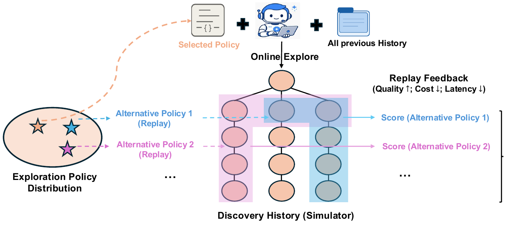
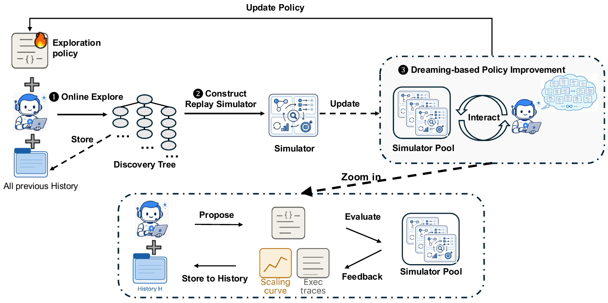

# Dream-RSI: Recursive Self-Improvement through Evolving Worlds

## 来源信息

| 项 | 内容 |
| --- | --- |
| 标题 | Dream-RSI: Recursive Self-Improvement through Evolving Worlds |
| 作者 | Tong Zheng¹², Xidong Wu¹, Zheng Zhang¹, Zhankui He³, Chaoyi Zhang¹, Benjamin Coleman³, Ruoqiao Wei¹, Di Bai³, Haolin Liu⁴, Rui Liu², Xue Wang¹, Yue Zhuan¹, Wang-Cheng Kang³, Renkai Xiang¹, Heng Huang², Xinwu Cheng¹, Yunsong Guo¹（¹ Google；² University of Maryland, College Park；³ Google DeepMind；⁴ University of Virginia） |
| 机构 | Google（第一机构） |
| 来源 | 项目页 <https://dream-rsi.com/>；原文 PDF <https://www.dream-rsi.com/assets/dream-rsi.pdf>（本笔记基准版） |
| 其他版本 | [arXiv:2609.14858](https://arxiv.org/abs/2609.14858) v2（43 页，2026-10-06）；本笔记未覆盖的新增内容见 `audit.md` |
| 阅读日期 | 2026-10-08 |

---

## 核心结论

一句话：**Dream-RSI 把「搜索历史」从上下文升级成可回放的世界模型——一次真实发现留下的树记录了每个决策点的真实结果，于是大量候选探索策略可以在冻结的历史上离线比一遍，再把赢家部署回线上。**

- **解决什么问题**：自动发现系统里的探索策略（开几个分支、何时精修、何时停）通常由人写死；想在线学习它，又因为「评价一个策略要跑完整条 rollout」而代价过高。
- **核心想法**：不学动力学模型，直接把**已经真实发生过的发现树**当作模拟器。回放一个候选策略时只「揭示」记录中已有的子节点，不调用 agent、不调评估器。
- **怎么做到**：把探索策略写成可执行代码；在线跑一轮 → 把树并入历史 → 让 LLM 改策略代码，在全部历史上回放打分 → 选回放分最高的策略进入下一轮。
- **关键结果**：Lasso 任务上，相对同系统固定策略，平均运行时间 3587.1→2931.0 ms、agent 调用 550→317（Gemini-3.1-Pro）；数学优化 3 个任务中 2 个达到或超过基线；4 个 GPU kernel 都有改善。
- **一句话定位**：它改进的是「怎么分配搜索算力」，不是模型能力本身；收益是质量–算力权衡，且强依赖任务结构。

---

## 问题

自动发现系统（AlphaEvolve、SimpleTES、PACEvolve 一类）通常由两层组成：底层 coding agent 负责「在某个 workspace 上生成并评测一个新候选」，外层探索策略负责「这一轮从哪些候选继续、并行开几条线、什么时候停」。这篇论文动的是外层。

**固定探索策略的瓶颈**。现有系统大多把外层写死：分支宽度、并行度、停止条件都由人设定，发现过程中不随经验改变。任务变难、搜索空间膨胀时，算力会继续投向已经无效的方向。

**在线学习探索策略的难点**。评价一个候选解只需要一次评估；评价一个探索策略却要观察它如何塑造后续几十上百轮「提案–评估」的走向，必须跑完整条 rollout 才知道好坏。同时候选策略空间很大，新策略可能很差，每个都要付一次长程线上代价，闭环转不起来。

**已有「历史复用」的三种方式都不够**：

| 历史怎么用 | 影响什么 | 能否评价策略 |
| --- | --- | --- |
| 静态文本上下文 / 记忆 | 下一次怎么想 | 否 |
| 微调数据 | 权重 | 信号稀疏，且要更新权重 |
| **可回放的世界**（本文） | 策略选择 | 是，但只在已实现的空间上 |

**本文的设定**：一次 rollout 被组织成一棵**发现树**，每个节点记录 workspace 快照、生成产物、评测诊断和分数。探索策略只决定「这一轮从哪些节点继续」，不碰底层 agent、评测器和执行接口。

---

## 核心想法

### 一句话

历史不是「参考材料」，而是「已经付过费的模拟器」。

### 直觉

一次在线 rollout 里，每个候选解都是真跑出来的：恢复某个 workspace、生成新候选、评测、得到分数。于是这棵树里的每个节点都带一个**真实发生过的**（动作，结果）对。候选策略想比较「先精修 A 还是先开 B」时，只要这两种走法经过的节点都已在树里，就可以直接读出结果，不必重跑。

这与「让 LLM 读历史、总结几条经验」有本质区别：后者产出的是文本，只能影响下一次提案；前者产出的是**可打分的轨迹**，可以直接用来比较两个策略谁更好。

### 为什么这能成立

- **回放不是预测，是重放**：分数 $s_v$ 是真实执行结果，不是模型猜的，所以没有动力学模型的误差。
- **动作被限制在已记录的格子上**：策略只能从根或已揭示的叶子继续；回放时只揭示 `Child(v; T)`，没有记录的孩子就当作不存在。
- **转移是确定的**：同一个策略在同一棵树上回放两次，走出的轨迹相同；成本是读记录，不是执行。
- **可以反复比较**：一棵树可以被任意多个候选策略、任意多次回放，边际成本远低于再跑一次线上探索。

### 与 model-based RL 的区别

Dreamer 一类方法学一个紧凑的动力学模型，在模型里想象轨迹来改策略；Dream-RSI 不学模型，直接用被记录的真实结果当模型。好处是没有模型误差；代价是只能评估**已经走过的格子**，不能回答「如果当时开了一个全新分支会怎样」。

### 与「历史当上下文 / 当微调数据」的区别

| 用法 | 影响什么 | 能否评价策略 | 主要代价 |
| --- | --- | --- | --- |
| 上下文 / 记忆 | 下一次提案 | 否 | 只影响提示 |
| 微调数据 | 权重 | 信号稀疏 | 要更新权重 |
| 可回放世界（本文） | 策略选择 | 是，但只在已实现空间 | 只能奖励已记录的走法 |

### 一个走通的例子（本笔记构造，不是原文实验）

假设第一轮策略在根 $r$ 上并行开 3 个分支，得到 A（0.4）、B（0.8）、C（失败）。固定策略看到 B 最好，之后只精修 B；它不会再去碰 C 的子树。

现在有两个候选策略：

- $\pi_1$：继续精修 B；
- $\pi_2$：先回到 C，在 C 的失败点上换一个修复方向，再回头精修 A。

在线上比较 $\pi_1$ 和 $\pi_2$ 要各跑一条完整 rollout；在回放里，C 的子节点、A 的子节点都已经记录，$\pi_2$ 只是按不同顺序「揭示」这些记录，立刻得到两条轨迹的回放分。于是「要不要在失败分支上再试一次」这种元层决策，第一次可以用接近零的成本比较。

但如果 $\pi_2$ 想开一个**从未跑过**的新根 D，回放里没有 D 的任何记录，就无法给 $\pi_2$ 打分——这是这套方法最本质的边界。

### 设计上的三个关键选择

1. **策略是代码，不是向量**：LLM 可以直接改控制流（开几个分支、何时停、如何组合探索/利用/修复），比调几个连续超参表达力强得多。
2. **动作是批**：每轮选一个集合 $C$（$|C| \le W$）并行执行 `CONTINUE`，并行度天然成为策略的一部分。
3. **历史冻结**：回放期间不改历史、不重跑 agent，保证所有候选策略在同一组世界上比较。

### 代价

- **结构性偏置**：回放只能奖励「已记录」的走法，系统会偏向深化已有方向，而不是开新方向。
- **代理目标**：回放分高不等于线上发现好；论文只保证「回放分不劣于当前策略」。
- **成本转移**：离线回放、策略提案的 LLM 调用、节点快照存储都没有计入论文的成本口径。

---

## 方法

### 符号表

| 符号 | 含义 | 取值 / 维度 |
| --- | --- | --- |
| $r$ | 任务根节点 | 初始 workspace 状态 |
| $\mathcal{T}$ | 发现树 | 节点集合 |
| $v$ | 树中节点 | 一次「生成–评测」尝试 |
| $s_v$ | 节点 $v$ 的任务分数 | 越大越好，任务内协议固定 |
| $A(\mathcal{T})$ | 当前可继续节点 | 根 + 所有叶子 |
| $W$ | 并行 worker 数 | $\ge 1$；每个 worker 一次跑一个请求 |
| $C$ | 一轮选择的批 | $C \subseteq A(\mathcal{T})$，$\lvert C\rvert \le W$ |
| $K_1$ | 在线 rollout 最多决策轮数 | 原文未给数值 |
| $K_2$ | 单次回放最多决策轮数 | 原文未给数值 |
| $H_t$ | 前 $t$ 轮在线历史 | $\{T_1,\dots,T_t\}$ |
| $\pi$ | 探索策略 | 可执行 Python 代码 |
| $M$ | 每轮策略修订次数 | 原文未给数值 |
| $\beta_1,\beta_2$ | 成本惩罚 / 并行奖励系数 | $\ge 0$，原文未给数值 |
| $N_i^m$ | 第 $m$ 版策略在第 $i$ 棵树上揭示的非根节点数 | 代表这条轨迹「所代表的」生成–评测请求数 |
| $V_i^m$ | 单棵树回放分 | 式 (1) |
| $V^m$ | 在 $t$ 棵树上的平均回放分 | 策略版本的评测分 |

### 3.1 发现树与唯一原子动作

一个 rollout 增量地构建一棵以任务根 $r$ 为根的发现树。每个非根节点 $v$ 有唯一 primary parent；parent 标明了产生 $v$ 的那次尝试**从哪里开始**——agent 恢复 parent 保存的 workspace，用那里累积的观测当上下文生成新候选，再评测。节点 $v$ 记录从 $r$ 到 $v$ 的演化历史，以及这一次尝试的结果：文件系统快照、生成的产物、评测诊断和分数 $s_v$。

唯一的原子操作是 $\operatorname{CONTINUE}(v)$：恢复 $v$ 的 workspace，生成并评测**一个新子节点**。从根继续 = 开一个新分支；从非根叶子继续 = 精修 / 修复该分支末端。

设并行 worker 数为 $W$。对当前树 $\mathcal{T}$，可继续节点集合与可行批为：

```math
A(\mathcal{T}) = \{r\} \cup \{v \in \mathcal{T} : v \text{ 是叶子}\}, \qquad
A(\mathcal{T}; W) = \{C \subseteq A(\mathcal{T}) : |C| \le W\}
```

逐项读法：$A(\mathcal{T})$ 把「根」和「所有叶子」放在一起，因为这两类节点都可以继续——根可以开新分支，叶子可以精修；$A(\mathcal{T}; W)$ 是所有大小不超过 $W$ 的子集，表示一轮最多并行发出 $W$ 个 `CONTINUE`。

策略每轮从当前树里选一个批 $C \in A(\mathcal{T}; W)$，并行执行批内所有 `CONTINUE`，观察这一批全部完成后的结果，再进入下一轮。**选空批 = 终止 rollout**。根在开出分支后仍然可选，所以「探索新方向」和「精修已有分支」在形式上没有区别，只是同一个批里选了不同的节点。

### 3.2 在线 rollout

策略 $\pi_t$ 在已完成历史 $H_{t-1}$ 的辅助下跑一次 rollout，最多 $K_1$ 个决策轮。第 $k$ 轮：

1. 选批 $C_{t,k} \in A(T_{t,k}; W)$；
2. 对批内每个 $v$ 执行 `CONTINUE(v)` 并评测；
3. 把新子节点挂到各自 parent 上，得到 $T_{t,k+1}$。

**转移是随机的**：同一个 workspace 下，agent 可能给出不同候选，评测也可能有波动。rollout 在选空批或用完 $K_1$ 轮时结束，得到 $T_t$，并把它并入历史：

```math
H_t = H_{t-1} \cup \{T_t\}
```

逐项读法：历史是**单调增长**的树集合；第 $t$ 轮之后，模拟器池里有 $t$ 棵树，后面的回放可以在全部 $t$ 棵树上进行。

### 3.3 离线回放

历史 $H_t$ **冻结**。策略经历 $M$ 次代码修订：

```math
\pi_t^0 = \pi_t,\ \pi_t^1,\ \dots,\ \pi_t^{M-1}
```

逐项读法：$\pi_t^m$ 是第 $t$ 轮的第 $m$ 版策略；$m=0$ 就是当前正在线上使用的策略，$m=M-1$ 是本轮最后一次修订。

每个版本都要在**每一棵**已记录树 $T_i$（$i=1,\dots,t$）上回放一遍。回放从根开始，只揭示已记录的子节点：

```math
T_i^{m,k+1} = T_i^{m,k} \cup \{\operatorname{Child}(v; T_i) : v \in C_i^{m,k}\}
```

逐项读法：$T_i^{m,k}$ 是第 $m$ 版策略在第 $i$ 棵树上、第 $k$ 轮结束时已经揭示的子树；$C_i^{m,k}$ 是这一轮选的批；$\operatorname{Child}(v; T_i)$ 是节点 $v$ 在原始记录树 $T_i$ 中的孩子。**转移是确定的**——直接给到记录的那个孩子，孩子可能不存在。

策略**只能看到已揭示的子树与合法动作信息**，看不到未揭示节点的结果。每个回放最多 $K_2$ 轮，终止条件为：选空批 / 无记录可继续 / 用完 $K_2$ 轮。每个「策略–树」对都**从根重新回放**，新版本不继承之前版本揭示过的子树，保证比较公平。



*图 2（原文 Figure 2，p.4）：历史作为回放模拟器。上：选定策略 + 全部历史 → 在线探索产出一棵含执行轨迹的发现树。下：不同候选策略在同一棵已记录的树里走出不同轨迹（虚线箭头 = 揭示已存结果），各自得到一个回放分数。因为节点结果都已预存，一次昂贵的在线运行可以支撑大量快速、零执行成本的 off-policy 评估。裁剪自原文 PDF（© 2026 Google. All rights reserved）。*

### 3.4 回放目标：式 (1)

记 $N_i^m = |T_i^{m,k_i^{m,\star}}| - 1$ 为回放中揭示的非根节点数——回放本身不执行任何新尝试，但 $N_i^m$ 计的就是这条轨迹**所代表的**生成–评测请求数。对固定系数 $\beta_1,\beta_2 \ge 0$：

```math
V_i^m \;=\; \underbrace{\max_{v \in \mathcal{T}_i^{m,k_i^{m,\star}}} s_v}_{\text{discovery quality}}
\;-\; \underbrace{\beta_1 N_i^m}_{\text{execution cost}}
\;+\; \underbrace{\beta_2 \cdot \frac{N_i^m}{\max\{1,\, k_i^{m,\star}\}}}_{\text{parallelism bonus}}
\tag{1}
```

逐项读法：

- **第一项** $\max_v s_v$：回放期间达到的最好解质量。这一项只取已揭示节点的最高分，不要求走到叶子。
- **第二项** $-\beta_1 N_i^m$：惩罚尝试过的生成次数，即总工作量。$N_i^m$ 越大，扣得越多。
- **第三项** $+\beta_2 \cdot N_i^m / \max\{1,k_i^{m,\star}\}$：奖励「每个决策轮平均执行了多少次尝试」。分母 $k_i^{m,\star}$ 是这次回放完成的轮数，所以把有用的继续**成批**发出、而不是串行一个个跑，会得到更高分。
- $\beta_1/\beta_2$ 实际上在编码「宽而浅」还是「窄而深」的偏好：加大并行度能提高第三项，但如果没有更好的解，第一项不变而第二项变大。

策略版本 $\pi_t^m$ 的评测分是在固定历史上的平均回放分：

```math
V^m = \frac{1}{t}\sum_{i=1}^{t} V_i^m
```

逐项读法：每个版本在 $t$ 棵树上各得到一个 $V_i^m$，取算术平均作为这个版本的总分；$t$ 越大，评分越稳定，但离线回放的工作量也随 $t$ 线性增长。

离线阶段先评测当前策略 $\pi_t^0 = \pi_t$，再由 policy-development agent 阅读回放轨迹与分数（以及更早修订的反馈），识别成功决策与反复出现的失败，改出 $\pi_t^{m+1}$，并在同样的 $t$ 个回放世界上评测。$M$ 次修订后选：

```math
\pi_{t+1} = \pi_t^{m^\star}, \qquad
m^\star \in \arg\max_{m \in \{0,\ldots,M-1\}} V^m
```

逐项读法：$m^\star$ 是在固定历史 $H_t$ 上回放分最高的版本；下一轮线上策略 $\pi_{t+1}$ 直接取这个版本，而不是把所有版本做平均。

这是全文唯一的「保证」：因为候选集包含当前策略本身，所以 $V^{m^\star} \ge V^0$——下一轮策略在固定历史 $H_t$ 上的平均回放分不劣于当前策略。注意这是对**回放分数**的保证，不是对在线发现结果的保证。

### 3.5 一轮完整的 RSI 循环

```text
输入：初始策略 π_1，历史 H_0 = ∅
for t = 1, 2, ...:
    1. 在线：用 π_t 在真实环境跑 rollout，最多 K_1 轮，得到 T_t
    2. 并入历史：H_t = H_{t-1} ∪ {T_t}
    3. 离线：π_t^0 = π_t
       for m = 0 .. M-1:
           在 H_t 的每一棵树上回放 π_t^m，算 V^m
           若 m < M-1：LLM 根据回放轨迹与分数改出 π_t^{m+1}
    4. 选择：π_{t+1} = argmax_m V^m
```

关键点：**在线只跑当前策略一次，离线可以比较 $M$ 个版本、每个版本在 $t$ 棵树上回放**。随 $t$ 增大，模拟器池变大，同一个策略版本能拿到更稳定的评分；代价是离线工作量随 $t$ 增长。



*图 1（原文 Figure 1，p.2）：三阶段 RSI 循环——❶ 在线探索展开发现树并记录轨迹；❷ 把发现树转成可复用的回放模拟器池；❸ 基于 dreaming 的策略改进（Propose → Evaluate on Simulator → Feedback），更新后的策略重新部署到下一轮。裁剪自原文 PDF（© 2026 Google. All rights reserved）。*

### 3.6 与已有方法的结构差异

| 做法 | 改什么 | 反馈来源 | 主要代价 |
| --- | --- | --- | --- |
| 固定探索策略 | 人手写死 | 无 | 不能适应任务 |
| 在线元学习 | 策略参数 / 代码 | 完整在线 rollout | 长程、昂贵 |
| 历史当上下文 | 提示 | 文本 | 不能评价策略 |
| **Dream-RSI** | 策略代码 | 冻结历史回放 | 只覆盖已实现空间 |

---

## 主要结果

**设置**（§4）：8 个任务 / 3 个领域。对照是 **Recursive Fixed Exploration**：与 Dream-RSI 共用同一个 discovery agent、评估器、初始化、资源约束，并且从同一份手工设计的探索策略出发；两者第 1 轮行为完全相同，之后固定策略保持不变、Dream-RSI 每轮用回放改进后重新部署。成本口径 = 累计 discovery-agent 调用次数。模型为 Gemini-3.1-Pro 与 Gemini-3.7-Flash。

| 领域 | 任务 | 对照 | 关键数字 | 说明 |
| --- | --- | --- | --- | --- |
| 算法工程 | Lasso 正则化路径 | 同系统固定策略 | 3587.1→2931.0 ms；550→317 calls（Pro） | 平均改善集中在 RCV1，其余 5 个数据集变差 |
| 数学优化 | Sum–Difference | SimpleTES / 固定策略 | 1.145427（最高） | 3 个任务中唯一明确刷新 |
| 数学优化 | Autocorrelation | SimpleTES | 1.456375 vs 1.453675 | 低于 SimpleTES，也低于自身固定基线 1.456001 |
| 数学优化 | Circle Packing | 多基线 | 2.635983 | 与多个基线并列，不是改进 |
| GPU kernel | 4 个 KernelBench 任务 | 固定策略 | 2.43× / 1.79× 更少代数；2.09× / 1.44× 更高分 | 前两个是「同等性能省代数」，后两个是「同等预算下分数更高」 |

几点必须一起读的口径：

- **Lasso 的均值由 RCV1 主导**：六个下游数据集的平均改善是 656.1 ms，但 RCV1 单个数据集的原始变化是 −4934.1 ms（折合到均值 −822.4 ms/项），其余五个数据集全部变差（Gisette +979.2、DNA +8.4、Leukemia +4.1、Colon +1.9、Duke Breast +4.1）。Flash 侧 6 个里 5 个改善，同样由 RCV1 主导。
- **数学优化是 2/3，不是全面超越**：Sum–Difference 有新最好值；Autocorrelation 落后；Circle Packing 并列。
- **kernel 的两类数字不能混用**：VGG16 / LayerNorm 是「达到相当性能所需代数」之比（Dream-RSI 在 423 / 568 代就结束，固定策略跑到约 998 代）；ConvDiv / ConvMax 是「同等代数下」的性能之比。若把 ConvDiv 改成终点对终点，比值只有约 1.48，因为固定策略在 Dream-RSI 停手后还在涨。
- **相对 SimpleTES 的「162×」是调用数之比**（51200/317），但模型不同（Gemini-3.1-Pro vs gpt-oss-120b），「generation」与「discovery-agent call」是否同一单位，论文没有界定。

**两条进一步分析**（§5）：

- **历史当「提示」不如当「模拟器」**：把历史抽象成高层洞见写进提示词，分别加到固定策略与 Dream-RSI 上。ConvDiv 终值：Dream-RSI 1.90 vs 加指导 1.44；固定策略 1.28 vs 加指导 0.63。两个范式里加指导都更差，作者归因于强语义先验过度约束搜索空间、损害探索多样性。
- **探索行为会随轮次变化，但增益递减**：ConvDiv 的 9 个递归轮次里，轮内最好性能 0.427→0.625→0.855→1.403→1.488→1.499→1.770→1.880→1.898；评测尝试数 110→110→87→80→50→92→80→91→86。作者读作「性能上升时先收缩算力，停滞时再加大探索」，但逐轮数据只是大致吻合，后期增益明显递减。

---

## 边界与局限

- **只能评估已实现的搜索空间**：回放只在已记录的节点上给分，「本来应该开一个全新根」的策略拿不到任何奖励。改进循环因此天然偏向深化已有方向，这可能是后期增益递减、以及 Lasso 改善集中在 RCV1 的成因。论文没有做这一项的对照实验。
- **保证只对代理目标成立**：$V^{m^\star} \ge V^0$ 是关于固定历史回放分的单调性；回放分与在线发现质量之间没有理论刻画。Lasso 第 4 轮 Dream-RSI 反而比固定策略差约 990 ms，说明二者会脱钩。
- **成本核算不完整**：只统计 discovery-agent 调用；policy-development agent 的 LLM 调用、离线回放总工作量（随轮数 $t$ × 版本数 × β 栅格增长）、每节点快照存储都没有计量。
- **关键超参全无默认值**：$K_1$、$K_2$、$M$、$\beta_1$、$\beta_2$、β 栅格、候选策略数量，正文与附录都没有给出；代码截至 2026-10-08 未发布，目前无法复现。
- **证据强度有限**：Lasso 改善由单一数据集驱动；Autocorrelation 落后；ConvMax 的 1.44× 来自最后一个数据点的孤立尖峰；没有多种子 / 重复实验的方差报告；外层轮数只有 5（Lasso）/ 10（数学）。
- **标题里的「Recursive Self-Improvement」不等于能力自举**：本文改进的是探索策略代码，论文自己也把它定位在「meta-exploration layer」。

---

## 与其他工作的关系

- **vs RRSI（本仓库 00212）**：同属「不改权重、只改 harness」的路线。RRSI 正则化的是**筛选准则**，Dream-RSI 改造的是**探索控制器的获取方式**。
- **vs AlphaEvolve / SimpleTES / PACEvolve**：这些系统的探索策略由人固定；Dream-RSI 把「怎么搜」本身变成可学习的对象。
- **vs Dreamer / model-based RL**：Dreamer 学动力学模型再在模型里想象；Dream-RSI 不学模型，直接把真实记录当模型，因此没有模型误差，但也没有反事实外推能力。

<!-- 复核档案见同目录 audit.md（不随站点发布） -->
